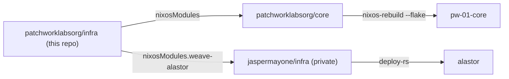

# infra

Declarative infrastructure for Patchwork Labs: the NixOS modules for Patchwork services, and their secrets.

## Layout

| Path | Contents |
|---|---|
| `flake.nix` | Flake outputs. |
| `modules/weave/` | The Weave service module. Exported as `nixosModules.weave`. |
| `hosts/alastor/weave.nix` | Weave as it runs on alastor. Exported as `nixosModules.weave-alastor`. |
| `modules/krater/` | The Krater service module (portal, worker, Postgres, screenshot storage). Exported as `nixosModules.krater`. |
| `hosts/alastor/krater.nix` | Krater as it would run on alastor. Exported as `nixosModules.krater-alastor`; not imported by alastor yet. |
| `secrets/` | agenix secrets. `secrets.nix` lists the recipients of each file. |

## How the repos connect

This repo is public. Nothing here depends on `jaspermayone/infra`, which is private, so every org admin can build this repo.



| Repo | Owns |
|---|---|
| `patchworklabsorg/infra` | Patchwork services, wherever they run, and their secrets. |
| `patchworklabsorg/core` | The Core VM (`pw-01-core`) only. |
| `patchworklabsorg/dns` | Patchwork DNS. |
| `jaspermayone/infra` | Jasper's hosts (alastor and others) and the lab's physical layer. It imports Patchwork services from this repo as the flake input `patchwork-infra`. |

## Weave on alastor

alastor is Jasper's VPS. `jaspermayone/infra` owns the host. This repo owns everything about Weave on it: the module, the instance settings, the CI deploy key, the Traefik routes and the secrets.

To change Weave on alastor:

1. Merge the change here.
2. In `jaspermayone/infra`, run `nix flake update patchwork-infra`.
3. Deploy alastor from `jaspermayone/infra` (`deploy .#alastor`).

alastor also rebuilds itself at 04:00 from `jaspermayone/infra` `main`. It uses the revision in that repo's `flake.lock`, so a merge here does nothing on alastor until step 2.

## Krater on alastor

Krater has no registry image. `krater-build` fetches one commit of `patchworklabsorg/krater` and builds it on the host with the repo's own Dockerfile. A deploy writes the commit to `/var/lib/krater/source-rev`, then runs `systemctl start krater-build` (the running site keeps serving) and `systemctl restart krater-web`. So Krater releases don't need a change here; only the module and its settings do.

Before alastor imports `nixosModules.krater-alastor`: DNS for its three hostnames, the Weave client ids in `hosts/alastor/krater.nix`, and the secrets `krater-env.age` and `krater-vast-key.age`. Krater's `docs/dev/production.md` has the full checklist.

## Commands

```bash
nix flake check
nix fmt
cd secrets && agenix -e <name>.age   # create or edit a secret
cd secrets && agenix -r              # re-key after changing recipients
```
