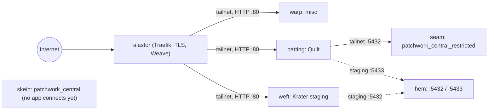
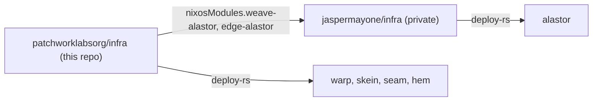
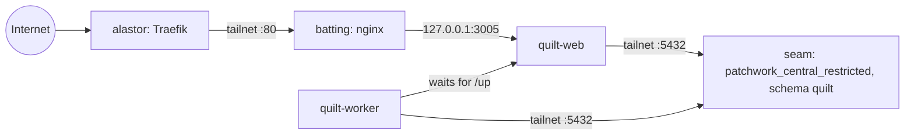
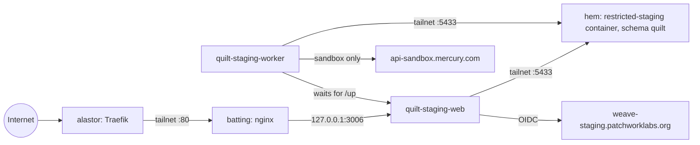

# infra

Declarative infrastructure for Patchwork Labs: every Patchwork host, the NixOS modules for Patchwork services, the Ansible for the Windows hosts and AD, and their secrets.

## Layout

| Path | Contents |
|---|---|
| `flake.nix` | Hosts, exported modules, deploy-rs nodes, checks. |
| `hosts/<name>/` | One directory per lab host. |
| `hosts/proxmox-vm.nix` | Hardware and disk layout shared by every VM. |
| `hosts/installer.nix` | The installer ISO: NixOS minimal with the admin SSH keys on root. |
| `bin/install-host` | Plans and applies the VM, reads its address, runs nixos-anywhere. |
| `bin/new-quilt-staging-secrets` | Writes the two Quilt staging secrets with a new random password and `SECRET_KEY_BASE`. Prints no value. |
| `bin/new-krater-secrets` | Writes the two secrets of Krater staging or production with a new random database password and keys. Prints no value. |
| `hosts/central-db-schema.nix` | Apps and shared schemas of the central databases. |
| `hosts/alastor/` | Modules that `jaspermayone/infra` imports for alastor. |
| `modules/common/` | Accounts, SSH, sudo, Tailscale, Nix. Every host imports it. `keys.nix` holds the SSH keys. |
| `modules/ad-join/` | Joins the host to `patchwork.internal` with sssd. `modules/common` imports it. |
| `modules/central-db/` | One central PostgreSQL cluster and its access model. |
| `modules/weave/` | The Weave service module. |
| `modules/quilt/` | The Quilt service module. |
| `modules/krater/` | The Krater service module (portal, worker, screenshot storage; Krater Compute off by default). Exported as `nixosModules.krater`. |
| `hosts/weft/krater.nix` | Krater staging and production on weft: instance settings and secrets. Production is off until `hosts/weft/krater-production.nix` turns it on. |
| `tests/` | NixOS VM tests. |
| `secrets/` | agenix secrets. `secrets.nix` lists the recipients of each file. |
| `ansible/` | Ansible for the Windows hosts and AD: `windows.yml`, `ad.yml`. See `ansible/README.md`. |
| `terraform/workspace/` | Terraform for Google Workspace: org units, groups, group settings. See `terraform/workspace/README.md`. |
| `ansible/vault/` | Git submodule `patchworklabsorg/infra-vault` (private): the Ansible vault. |
| `ad/` | The AD structure: `org.json` and `converge.ps1`. See `ad/README.md`. |
| `terraform/` | Terraform roots for resources that an API manages. See `terraform/README.md`. |
| `workspace/` | GAM script that sets up Google Workspace. |
| `terraform/github/` | Terraform for the `patchworklabsorg` GitHub org: repos, teams, members, rulesets. See `terraform/github/README.md`. |
| `terraform/proxmox/` | Terraform root for the Patchwork NixOS VMs on pve01. See `terraform/proxmox/README.md`. |

## Hosts

The lab hosts below are NixOS VMs on pve01, VLAN 90 (`patchwork.internal`). alastor is the only public edge. It terminates TLS and proxies to the lab hosts over the tailnet.

| Host | VMID | Address | Memory | Runs |
|---|---|---|---|---|
| `warp` | 356 | 10.100.90.56 | 6 GB | Misc: redirects and other low-risk shared things. No Docker. nginx on `tailscale0:80` for alastor. |
| `skein` | 355 | 10.100.90.55 | 4 GB | `patchwork_central`, prod. Tailnet only. |
| `seam` | 357 | 10.100.90.57 | 2 GB | `patchwork_central_restricted`, prod. Tailnet only. |
| `hem` | 358 | 10.100.90.58 | 2 GB | Both staging clusters: central on 5432, restricted on 5433. Quilt staging uses the restricted one. |
| `batting` | 360 | 10.100.90.60 | 4 GB | Quilt prod + staging. nginx on `tailscale0:80` for alastor. |
| `weft` | 361 | 10.100.90.61 | 4 GB | Krater staging, and Krater production (off until its switch). nginx on `tailscale0:80` for alastor. |

The Windows hosts are managed by Ansible (`ansible/`):

| Host | VMID | Address | Runs |
|---|---|---|---|
| `loom` | 310 | 10.100.90.10 | DC, PDC emulator, DNS, DHCP |
| `spindle` | 311 | 10.100.90.11 | DC, DNS |
| `bobbin` | 312 | 10.100.90.12 | Issuing CA |
| `shuttle` | 314 | 10.100.90.14 | NPS / RADIUS |

hem, batting and weft are built (2026-10-21 and 2026-10-22). weft has 4 GB and a 40 GB disk, because Krater builds its image on the host and runs SeaweedFS.



## Login

Every host joins the `patchwork.internal` AD forest (`modules/ad-join`), with the same rules as `roles/linux_ad_join` in the `jaspermayone/infra` Ansible:

- Members of `lnx-<host>-users` log in with an SSH key from their `altSecurityIdentities` (`SSHKey:<key>`). Passwords do not work over SSH.
- Members of `lnx-<host>-admins` get sudo with their AD password.
- The local accounts in `modules/common` are the break-glass way in.

Staff reach the lab over the thimble VPN or over Tailscale. thimble has WireGuard (one key per device) and, after the rollout in `ansible/README.md` ("VPN"), IKEv2 with AD login: NPS on shuttle checks the password and the `vpn-users` group. Use the daily account. Admin accounts in Protected Users cannot log in to the VPN.

Before a host is installed:

1. Add the host to `hosts` in `flake.nix`. Then create `lnx-<host>-users` and `lnx-<host>-admins` in AD: `cd ansible && ansible-playbook ad.yml -t host-groups`. The play reads the host names from the flake. If a group does not resolve, every AD login fails.
2. The same run adds the host's A record in AD DNS, from `patchwork.lanAddress` in its config (`ad.yml -t host-dns` runs only that part). sssd does not update DNS.
3. After the install, add the host key to `secrets/ad-join.age` and run `agenix -r`. `ad-join.service` then joins on the next boot or deploy.

loom and spindle must run. They are the DNS servers, the KDCs and the time source of every host.

## Login banners

The lab hosts show a sewing-theme banner, in the style of thimble's. One banner shows before the SSH login. One shows after it. `modules/banner` makes both.

The banner is on by default. `flake.nix` adds the module to every host in `hosts`, so a new host gets it with no change. alastor does not get it, because `modules/banner` is not in `nixosModules`.

Give a new host its role in `hosts/<host>/configuration.nix`. Without a role, the banners show only the host name.

```nix
patchwork.banner.role = "app host"; # short, lower case
```

To turn the banner off for a host, set `patchwork.banner.enable = false;`.

The host name comes from `networking.hostName`. The option `patchwork.banner.art` replaces the art after login. Check the result with `nix eval --raw .#nixosConfigurations.<host>.config.users.motd`. The check `banner` tests the seam banner and the default.

## Install a host

The installer ISO has the admin SSH keys on root. Nobody types in the Proxmox console. The keys come from `modules/common/keys.nix`, the same file the host accounts use.

1. Build the ISO: `nix build .#installer-iso -o result-installer`. The build needs an x86_64-linux builder. On macOS, use a Linux builder in `/etc/nix/machines`, or pass `--builders 'ssh-ng://<user>@<linux-host> x86_64-linux'`. You can also run the command on a Linux host.
2. Create or update the VM: `cd terraform/proxmox && tofu apply`. Terraform uploads the ISO and boots the VM from it. The guest agent reports the DHCP address.
3. Read the address: `tofu output ipv4_addresses`. If the list is empty, wait one minute, run `tofu refresh`, and read again.
4. Install: `nixos-anywhere --flake .#<host> --build-on remote --target-host root@<ip>`.
5. Add the host key to `secrets/ad-join.age`. See "Login".

`bin/install-host <host>` runs steps 2 to 4. It stops if the plan deletes a resource.

## Central databases

See the header of `modules/central-db/default.nix` for the full model. In short:

- Each app gets a login role and a schema with the same name. The app owns the schema and runs its own migrations there.
- A shared schema (for example `people`) has one owner app. Other apps get `<schema>_read` or `<schema>_write` through `hosts/central-db-schema.nix`.
- Nobody can create objects in `public`. Nobody can connect to a database without a grant.
- The restricted database is a separate cluster on a separate VM.

To add an app, edit `hosts/central-db-schema.nix`, add its password secrets, and deploy the DB hosts.

## How the repos connect

This repo is public. Nothing here depends on `jaspermayone/infra`, which is private, so every org admin can build this repo.



| Repo | Owns |
|---|---|
| `patchworklabsorg/infra` | Every Patchwork host, Patchwork services and their secrets. |
| `patchworklabsorg/core` | Archived. It held the Core VM, which was never built; `warp` does that job. |
| `patchworklabsorg/dns` | Patchwork DNS. |
| `patchworklabsorg/infra-vault` | Private. The Ansible vault, as the submodule `ansible/vault`. |
| `jaspermayone/infra` | Jasper's hosts (alastor and others) and the lab's physical layer. It imports Patchwork services from this repo as the flake input `patchwork-infra`. |

## Weave on alastor

alastor is Jasper's VPS. `jaspermayone/infra` owns the host. This repo owns everything about Weave on it: the module, the instance settings, the CI deploy key, the Traefik routes and the secrets.

To change Weave on alastor:

1. Merge the change here.
2. In `jaspermayone/infra`, run `nix flake update patchwork-infra`.
3. Deploy alastor from `jaspermayone/infra` (`deploy .#alastor`).

alastor also rebuilds itself at 04:00 from `jaspermayone/infra` `main`. It uses the revision in that repo's `flake.lock`, so a merge here does nothing on alastor until step 2.

## Krater on weft

Krater staging runs on weft. Krater production is configured on weft too, and its secrets exist, but it is off until `hosts/weft/krater-production.nix` turns it on (the checklist is in `hosts/weft/krater.nix`). weft is its own VM, so the people who run Krater cannot read the other apps' secrets. alastor routes `krater-staging.patchworklabs.org` and `krater-staging-storage.patchworklabs.org` to nginx on weft over the tailnet (`nixosModules.edge-alastor`).

Krater has no registry image. `krater-build` fetches one commit of `patchworklabsorg/krater` and builds it on weft with the repo's own Dockerfile. A deploy writes the commit to `/var/lib/krater/source-rev`, then runs `systemctl start krater-build` (the running site keeps serving) and `systemctl restart krater-web`. Production is the same with `krater-prod` in place of `krater` (`/var/lib/krater-prod/source-rev`, `krater-prod-build`, `krater-prod-web`). So Krater releases do not need a change here. Only the module and its settings do.

Staging deploys itself. The `Deploy` workflow in `patchworklabsorg/krater` runs after `CI` passes on `main`. It joins the tailnet as `tag:ci-krater` (an ephemeral node, OAuth client in the krater repo secrets), then sends the commit over sshd on weft port 2222 as `krater-deploy`. The key may run only the deploy command, which does the three steps above and puts the old commit back if the build fails. The public key is in `hosts/weft/krater.nix`. `tag:ci-krater` reaches `tag:patchwork-krater:2222` and nothing else (`jaspermayone/infra` `tailscale/policy.hujson`). Production has no CI deploy yet.

`krater-web` requires `krater-build`, so a deploy that turns an instance on waits for its first build (minutes; `TimeoutStartSec` is 45 minutes). Run the build by hand first, or deploy with `--magic-rollback false` and a long `--activation-timeout`.

Krater staging's database is its schema `krater` in `patchwork_central` on hem (port 5432), like the other central apps. The module runs no Postgres of its own. weft reaches hem over the tailnet (`tag:patchwork-krater` to hem:5432). Sign-in is Weave staging.

Before Krater staging runs: `bin/new-krater-secrets staging` (writes `krater-staging-env.age` and `central-staging-krater.age`), hem deployed with Krater's role password, Krater's app in Weave staging (client id in `hosts/weft/krater.nix`, client secret and Slack values in `krater-staging-env.age`), and DNS for its two hostnames (`krater-staging`, `krater-staging-storage`, proxied to alastor). Krater's compute stays off, so no Vast key is needed. Krater's `docs/dev/production.md` has the full checklist.

## Quilt on batting

[Quilt](https://github.com/patchworklabsorg/quilt) runs on batting as two Docker containers, like Weave. `hosts/batting/quilt.nix` is the instance. `modules/quilt` is the service module. nginx on batting fronts the ports, and alastor routes `quilt.patchworklabs.org` and `quilt-staging.patchworklabs.org` to batting (`nixosModules.edge-alastor`). The contract with the app is `docs/deploy.md` in the quilt repo.

| Item | Value |
|---|---|
| URL | `https://quilt.patchworklabs.org` (Traefik router `quilt`, option `traefik.hosts`) |
| Units | `quilt-web` (`./bin/rails server` on `127.0.0.1:3005`, migrates on start) and `quilt-worker` (`bundle exec good_job start`) |
| Image | `ghcr.io/patchworklabsorg/quilt:main` (option `image`). Pin it to `:<sha>` for a known build. |
| Database | `patchwork_central_restricted` on seam, role and schema `quilt`, over the tailnet |
| Secrets | `quilt-env.age`, `quilt-ghcr-token.age` (batting), `restricted-prod-quilt.age` (seam) |



Both containers use the host network, so they reach `seam.wildebeest-stargazer.ts.net` through batting's Tailscale (`tag:patchwork-quilt`). The worker waits until `GET /up` on the web server answers. The web server answers only after the migrations ran.

`RESTRICTED_DATABASE_URL` in `quilt-env.age` holds the database password. It must be the same password as in `restricted-prod-quilt.age`, which seam sets on the role `quilt`.

To deploy a new `main` image, run `sudo systemctl restart quilt-web` on batting. That restarts the worker too. To change the module, follow the same steps as for Weave above.

## Quilt staging

Quilt staging is a second instance on batting, next to production. It uses the Mercury sandbox, Weave staging and the restricted staging cluster on hem. It can never move real money: with `RAILS_ENV=staging`, Quilt refuses to boot unless `MERCURY_API_BASE` is the sandbox URL (patchworklabsorg/quilt#35). The option is `staging` in `modules/quilt`. `hosts/batting/quilt.nix` turns it on.

| Item | Production | Staging |
|---|---|---|
| URL | `https://quilt.patchworklabs.org` | `https://quilt-staging.patchworklabs.org` (router `quilt-staging`) |
| Units | `quilt-web`, `quilt-worker` | `quilt-staging-web`, `quilt-staging-worker` |
| Port | `127.0.0.1:3005` | `127.0.0.1:3006` |
| `RAILS_ENV` | `production` | `staging` |
| Image | `ghcr.io/patchworklabsorg/quilt:main` (option `image`) | `ghcr.io/patchworklabsorg/quilt:main` (option `staging.image`) |
| Mercury | `https://api.mercury.com/api/v1/`, live tokens | `https://api-sandbox.mercury.com/api/v1/` (set in Nix), sandbox tokens |
| Weave | Weave production | `https://weave-staging.patchworklabs.org` (set in Nix), a Weave staging app |
| Database | seam:5432, `patchwork_central_restricted` | hem:5433, `patchwork_central_restricted` (the restricted staging cluster) |
| Env file | `quilt-env.age` | `quilt-staging-env.age` |
| Role password | `restricted-prod-quilt.age` (seam) | `restricted-staging-quilt.age` (hem) |
| Registry token | `quilt-ghcr-token.age` | The same file |



`MERCURY_API_BASE` and `WEAVE_ISSUER` are in `staging.extraEnv`, not in the env file. `extraEnv` overrides the env file, so a value in the env file cannot point staging at the live Mercury API.

The database URL in `quilt-staging-env.age`:

```text
RESTRICTED_DATABASE_URL=postgres://quilt:<password>@hem.wildebeest-stargazer.ts.net:5433/patchwork_central_restricted?sslmode=disable
```

`<password>` must be the value in `restricted-staging-quilt.age`. hem decrypts that file to `/run/central-db-passwords/patchwork_central_restricted/quilt` and binds the directory into the `restricted-staging` container, where `central-db-setup` sets the password on the role `quilt`. `hosts/hem/configuration.nix` explains why hem does not use `/run/agenix` for this. hem has no server TLS. Tailscale encrypts the path, so the URL uses `sslmode=disable`.

To deploy a new `main` image to staging, run `sudo systemctl restart quilt-staging-web` on batting. That restarts the staging worker too.

### Go live

Do the steps in this order.

1. Merge patchworklabsorg/quilt#35. Wait until `image.yml` pushes `ghcr.io/patchworklabsorg/quilt:main`. An older image has no `staging` environment and does not boot.
2. Free 2 GiB of memory on pve01. Make sure that VMID 358 and `10.100.90.58` are free.
3. Prepare AD for hem. Run `cd ansible && ansible-playbook ad.yml -t host-groups`. Add the A record for hem in AD DNS. See "Login".
4. Create the VM: `cd terraform/proxmox && tofu apply -target='proxmox_virtual_environment_vm.nixos["hem"]'`. Read the address with `tofu output ipv4_addresses`.
5. Install hem: `nixos-anywhere --flake .#hem --build-on remote --target-host root@<ip>`.
6. Join hem to the tailnet. Make sure that the tailnet policy lets batting (`tag:patchwork-quilt`) reach `hem:5433`.
7. Get the host key: `ssh-keyscan -t ed25519 10.100.90.58`. Add it as `hem` in `secrets/secrets.nix`. Add `hem` to `restricted-staging-quilt.age` and `ad-join.age`. Remove the TODO.
8. Create the secrets: `nix develop -c bin/new-quilt-staging-secrets`. The script writes `restricted-staging-quilt.age` and `quilt-staging-env.age` with a random password and `SECRET_KEY_BASE`. It leaves the Weave client and the Mercury tokens empty.
9. In Weave staging (`https://weave-staging.patchworklabs.org`), register Quilt as a confidential app:
   - Redirect URI: `https://quilt-staging.patchworklabs.org/auth/callback`.
   - Scopes: `openid profile email roles directory introspect`. A superadmin allows `directory` and `introspect`.
   - App roles: `viewer`, `finance`, `admin`.
10. In the Mercury sandbox dashboard (Settings, API Tokens), create a read-only token. Staging refuses to boot without `MERCURY_API_TOKEN`.
11. Add the values: `cd secrets && agenix -e quilt-staging-env.age`. Set `WEAVE_CLIENT_ID`, `WEAVE_CLIENT_SECRET` and `MERCURY_API_TOKEN`. Keep `QUILT_TOPUPS=off`.
12. Re-key: `cd secrets && agenix -r`. Commit the `.age` files and merge.
13. Deploy hem: `deploy .#hem`. In the container, make sure that `central-db-setup` succeeded and does not log "no password file for quilt": `sudo nixos-container run restricted-staging -- journalctl -u central-db-setup`.
14. From batting, test the connection: `psql "<RESTRICTED_DATABASE_URL>" -c 'SHOW search_path'`. The result must be `quilt`.
15. Merge the DNS record `quilt-staging` (A `129.213.163.213`, proxied): patchworklabsorg/dns#11.
16. Deploy batting (`deploy .#batting`). alastor routes `quilt-staging` to batting (`edge-alastor`).
17. On batting, check `systemctl status quilt-staging-web quilt-staging-worker` and `curl -i http://127.0.0.1:3006/up`. Then sign in at `https://quilt-staging.patchworklabs.org`.

To test top-ups on staging, add a sandbox `MERCURY_WRITE_TOKEN` with batting's public IP on its allowlist, and set `QUILT_TOPUPS` to `approval_only`.

## Commands

```bash
nix flake check
nix fmt
nix build .#checks.x86_64-linux.central-db   # VM test; needs a Linux builder with kvm
deploy .#<host>                               # deploy-rs over the tailnet
cd secrets && agenix -e <name>.age   # create or edit a secret
cd secrets && agenix -r              # re-key after changing recipients
git submodule update --init ansible/vault    # the Ansible vault (private repo)
cd ansible && ansible-playbook windows.yml   # Windows baseline
cd ansible && ansible-playbook ad.yml -t audit   # AD report, changes nothing
```
