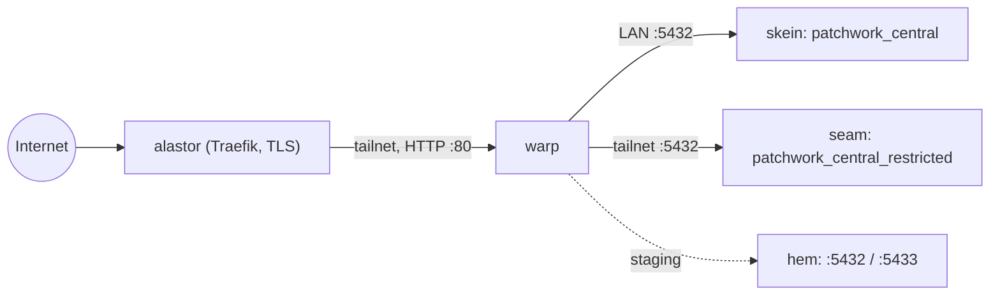
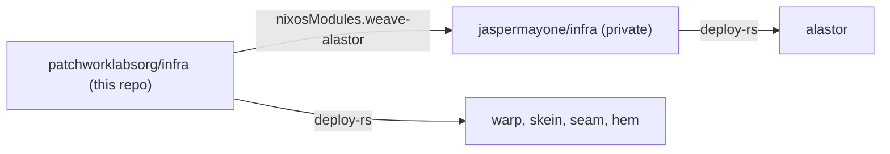

# infra

Declarative infrastructure for Patchwork Labs: every Patchwork host, the NixOS modules for Patchwork services, the Ansible for the Windows hosts and AD, and their secrets.

## Layout

| Path | Contents |
|---|---|
| `flake.nix` | Hosts, exported modules, deploy-rs nodes, checks. |
| `hosts/<name>/` | One directory per lab host. |
| `hosts/proxmox-vm.nix` | Hardware and disk layout shared by every VM. |
| `hosts/central-db-schema.nix` | Apps and shared schemas of the central databases. |
| `hosts/alastor/` | Modules that `jaspermayone/infra` imports for alastor. |
| `modules/common/` | Accounts, SSH, sudo, Tailscale, Nix. Every host imports it. |
| `modules/ad-join/` | Joins the host to `patchwork.internal` with sssd. `modules/common` imports it. |
| `modules/central-db/` | One central PostgreSQL cluster and its access model. |
| `modules/weave/` | The Weave service module. |
| `tests/` | NixOS VM tests. |
| `secrets/` | agenix secrets. `secrets.nix` lists the recipients of each file. |
| `ansible/` | Ansible for the Windows hosts and AD: `windows.yml`, `ad.yml`. See `ansible/README.md`. |
| `ansible/vault/` | Git submodule `patchworklabsorg/infra-vault` (private): the Ansible vault. |
| `terraform/` | Terraform roots for resources that an API manages. See `terraform/README.md`. |
| `workspace/` | GAM script that sets up Google Workspace. |

## Hosts

The lab hosts below are NixOS VMs on pve01, VLAN 90 (`patchwork.internal`). alastor is the only public edge. It terminates TLS and proxies to the lab hosts over the tailnet.

| Host | VMID | Address | Memory | Runs |
|---|---|---|---|---|
| `warp` | 356 | 10.100.90.56 | 6 GB | Weave prod + staging, future apps. nginx on `tailscale0:80` for alastor. |
| `skein` | 355 | 10.100.90.55 | 4 GB | `patchwork_central`, prod. LAN + tailnet. |
| `seam` | 357 | 10.100.90.57 | 2 GB | `patchwork_central_restricted`, prod. Tailnet only. |
| `hem` | 358 | 10.100.90.58 | 2 GB | Both staging clusters: central on 5432, restricted on 5433. |

The Windows hosts are managed by Ansible (`ansible/`):

| Host | VMID | Address | Runs |
|---|---|---|---|
| `loom` | 310 | 10.100.90.10 | DC, PDC emulator, DNS, DHCP |
| `spindle` | 311 | 10.100.90.11 | DC, DNS |
| `bobbin` | 312 | 10.100.90.12 | Issuing CA |
| `shuttle` | 314 | 10.100.90.14 | NPS / RADIUS |

VMIDs 356-358 and their addresses are proposed. Confirm that they are free before you create the VMs. pve01 had 121 of 125.8 GiB committed on 2026-08-25, so free about 14 GiB first.



## Login

Every host joins the `patchwork.internal` AD forest (`modules/ad-join`), with the same rules as `roles/linux_ad_join` in the `jaspermayone/infra` Ansible:

- Members of `lnx-<host>-users` log in with an SSH key from their `altSecurityIdentities` (`SSHKey:<key>`). Passwords do not work over SSH.
- Members of `lnx-<host>-admins` get sudo with their AD password.
- The local accounts in `modules/common` are the break-glass way in.

Staff reach the lab over the thimble VPN (AD login through NPS on shuttle) or over Tailscale.

Before a host is installed:

1. Add the host to `hosts` in `flake.nix`. Then create `lnx-<host>-users` and `lnx-<host>-admins` in AD: `cd ansible && ansible-playbook ad.yml -t host-groups`. The play reads the host names from the flake. If a group does not resolve, every AD login fails.
2. Add the host's A record in AD DNS. sssd does not update DNS.
3. After the install, add the host key to `secrets/ad-join.age` and run `agenix -r`. `ad-join.service` then joins on the next boot or deploy.

loom and spindle must run. They are the DNS servers, the KDCs and the time source of every host.

## Central databases

See the header of `modules/central-db/default.nix` for the full model. In short:

- Each app gets a login role and a schema with the same name. The app owns the schema and runs its own migrations there.
- A shared schema (for example `people`) has one owner app. Other apps get `<schema>_read` or `<schema>_write` through `hosts/central-db-schema.nix`.
- Nobody can create objects in `public`. Nobody can connect to a database without a grant.
- The restricted database is a separate cluster on a separate VM.

To add an app, edit `hosts/central-db-schema.nix`, add its password secrets, and deploy the DB hosts.

## How the repos connect

This repo is public. Nothing here depends on `jaspermayone/infra`, which is private, so every org admin can build this repo.



| Repo | Owns |
|---|---|
| `patchworklabsorg/infra` | Every Patchwork host, Patchwork services and their secrets. |
| `patchworklabsorg/core` | Archived. It held the Core VM, which was never built; `warp` does that job. |
| `patchworklabsorg/dns` | Patchwork DNS. |
| `patchworklabsorg/infra-vault` | Private. The Ansible vault, as the submodule `ansible/vault`. |
| `jaspermayone/infra` | Jasper's hosts (alastor and others) and the lab's physical layer. It imports Patchwork services from this repo as the flake input `patchwork-infra`. |

## Weave on alastor

alastor is Jasper's VPS. `jaspermayone/infra` owns the host. This repo owns everything about Weave on it: the module, the instance settings, the CI deploy key, the Traefik routes and the secrets.

To change Weave on alastor:

1. Merge the change here.
2. In `jaspermayone/infra`, run `nix flake update patchwork-infra`.
3. Deploy alastor from `jaspermayone/infra` (`deploy .#alastor`).

alastor also rebuilds itself at 04:00 from `jaspermayone/infra` `main`. It uses the revision in that repo's `flake.lock`, so a merge here does nothing on alastor until step 2.

## Commands

```bash
nix flake check
nix fmt
nix build .#checks.x86_64-linux.central-db   # VM test; needs a Linux builder with kvm
deploy .#<host>                               # deploy-rs over the tailnet
cd secrets && agenix -e <name>.age   # create or edit a secret
cd secrets && agenix -r              # re-key after changing recipients
git submodule update --init ansible/vault    # the Ansible vault (private repo)
cd ansible && ansible-playbook windows.yml   # Windows baseline
cd ansible && ansible-playbook ad.yml -t audit   # AD report, changes nothing
```
