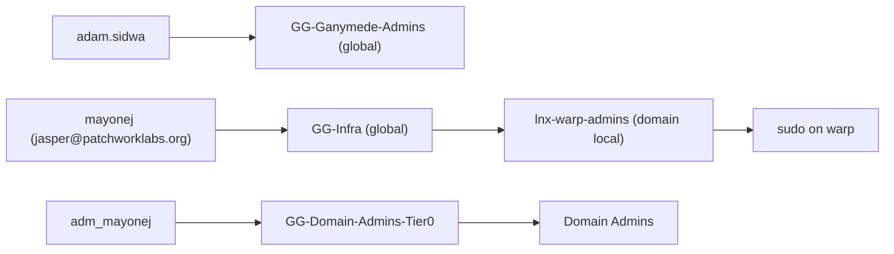
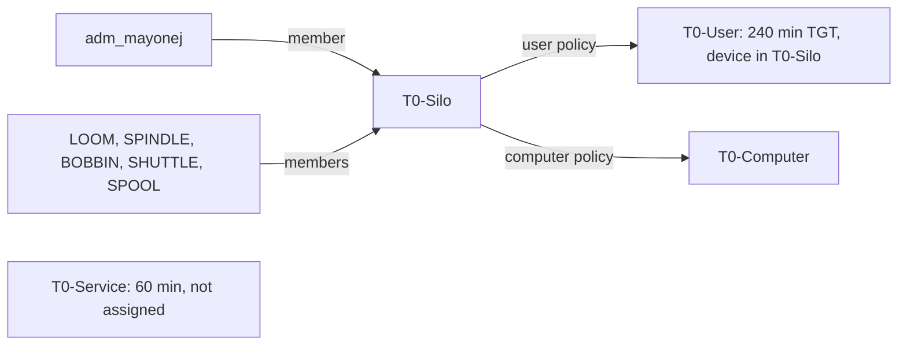

# ad

The `patchwork.internal` directory, built around the Patchwork business units. The names here match Google Workspace, Google Cloud and Mercury, so a person or a dollar is in the same business unit in each system.

| File | Contents |
|---|---|
| `org.json` | The source of truth: OUs, people, their org attributes, role groups, resource groups. |
| `converge.ps1` | Makes AD match `org.json`. Idempotent, supports `-WhatIf`, logs every change. |
| `TIERING.md` | Proposal: the tier model, the Tier 0 authentication policy silo, just-in-time Domain Admin, break-glass and LAPS. |
| `../tests/ad/` | A test that runs `converge.ps1` against an in-memory directory. `nix flake check` runs it. |

## Model

- **Attributes carry the org chart.** `company` = `Patchwork Labs inc.`, `division` = business unit, `department` = sub-department, plus `title` and `manager`. Board members and officers have no manager.
- **OUs are for policy and delegation only.** They match the Workspace OUs.
- **AGDLP.** People go in global role groups (`GG-*`, `Groups/Roles`). Role groups go in domain local resource groups (`Groups/Resources`). Only resource groups get permissions. The board and the officers are groups, never OUs.
- **Tier 0.** `adm_mayonej` (in `Admin-Accounts`) is the only person with Domain Admins, through `GG-Domain-Admins-Tier0`. Daily accounts get no admin rights. `svc-ansible` stays in Domain Admins, because Ansible manages the DCs.
- **Break-glass.** The built-in `Administrator` (RID 500) is disabled, because `builtinAdministrator.enabled` is `false`. The script finds it by SID, so a rename does not hide it. It disables the account only while an admin account in `org.json` is enabled and is in Domain Admins (direct or nested). Otherwise it reports this and keeps the account enabled. It removes the account from the groups in `builtinAdministrator.removeFrom` (Enterprise Admins, Schema Admins). Nobody knows its password: `ansible-playbook ad.yml -t administrator-random` sets a discarded random one. Any Domain Admin path can reset it and enable the account. DSRM on each DC (LAPS-DSRM) is the last resort. See [`TIERING.md`](TIERING.md) section 4.
- **Login names.** `sam` is the sAMAccountName, the internal username. It does not change. People log in with their UPN, `<upn>@patchworklabs.org`. `upn` is the part before the @. If you leave it out, it is the same as `sam`. The script adds the UPN suffix to the forest. Admin accounts keep `<sam>@patchwork.internal`.
- **Match on both.** The script finds each user by `sam` first, then by UPN. If the two find different accounts, it reports this and changes nothing for that user. It never makes a second account for a person who already has one.
- **Community members belong to Weave.** Weave creates them in `Users/Members`. `converge.ps1` never changes anything in that OU, or the members of `GG-Ganymede-Users`.



These accounts existed before `org.json`. They keep their sAMAccountNames:

| `sam` | UPN | Kind |
|---|---|---|
| `mayonej` | `jasper@patchworklabs.org` | Daily account of Jasper Mayone |
| `adm_mayonej` | `adm_mayonej@patchwork.internal` | Tier 0 account of Jasper Mayone |
| `klukask` | `kieran@patchworklabs.org` | Kieran Klukas |
| `petrarcad` | `dominic@patchworklabs.org` | Dominic Petrarca |
| `svc-ansible`, `svc-lnx-join`, `svc-dhcp-dns`, `svc-pve-ldap` | not managed | Service accounts. The script does not create them. |

| OU | Holds |
|---|---|
| `Users/Staff`, `Users/Board-Only` | Staff, and directors with no operational role |
| `Users/Sponsored-Projects/<project>` | Organizers of a fiscally sponsored project |
| `Users/Members` | Community members (Weave) |
| `Service-Accounts`, `Admin-Accounts`, `Disabled` | Non-human accounts, tier 0 accounts, suspended accounts |
| `Groups/Roles`, `Groups/Resources` | Global role groups, domain local resource groups |
| `Computers`, `Servers` | Workstations; member servers and lab hosts |

## Run it

Run on a DC, or on a host with RSAT, as `adm_mayonej`. The GPO step needs the GroupPolicy module (GPMC).

```powershell
.\converge.ps1 -WhatIf            # read the WOULD lines
.\converge.ps1                    # Build
```

Logs go to `C:\ProgramData\Patchwork\ad-converge\`. Each run ends with a count of changes, reports and errors. A REPORT line needs a person to look at it. The script changes nothing for it.

New accounts are disabled and must change the password at the next logon. The script never sets, reads or logs a password. To start an account, set a first password (or let Weave set it), then enable the account.

## Move from the old tree

The old tree is `OU=Patchwork-Objects`. Do these steps in order, with `-WhatIf` first each time.

1. `.\converge.ps1` (Build). This makes the new tree. It moves nothing.
2. Run Build again. It removes the daily accounts from the admin groups only when each admin account is enabled and had a Domain Admins path before the run started. The run that adds the `GG-Domain-Admins-Tier0` path never removes the old path. Direct memberships of admin accounts (for example `adm_mayonej` in Domain Admins) are only reported. They stay until JIT works and `tiering.jit.removeStanding` is `true` (see "Tier 0").
3. Point the join rights at the new computer OUs. In `ansible/inventory/group_vars/patchwork.yml`, set `ad_computer_ou_server` to `OU=Servers,OU=Patchwork,DC=patchwork,DC=internal` and `ad_computer_ou_client` to `OU=Computers,OU=Patchwork,DC=patchwork,DC=internal`. Run `ansible-playbook ad.yml -t join-delegation`.
4. Set `patchwork.ad.computerOU` in `modules/ad-join` to the new `Servers` OU.
5. `.\converge.ps1 -Phase Migrate`. It copies the GPO links to the new OUs, moves every object, and changes the `lnx-*` and app groups to domain local. It reports each object that it cannot place. Add each one to `org.json` and run Migrate again.
6. Check: SSH to a lab host as an AD user, sudo, VPN login through shuttle, GPOs on bobbin and shuttle (`gpresult /r`).
7. `.\converge.ps1 -Phase Prune`. It deletes the old OUs. It refuses while any object is still in them.

## Add a person

Add an entry to `users` in `org.json`, and add the person to their role groups:

```json
{ "sam": "examples", "upn": "sam", "kind": "person", "ou": "Users/Staff",
  "givenName": "Sam", "surname": "Example",
  "division": "Programs", "department": "Project Ganymede",
  "title": "Volunteer", "manager": "adam.sidwa" }
```

This person logs in as `sam@patchworklabs.org`. Leave out `upn` when it is the same as `sam`. Before you add a person, look for an account that they already have. If one exists, use its sAMAccountName as `sam`.

Add the person to `GG-All-Staff`, so `PSO-Staff` applies. `nix flake check` fails for an account that no PSO applies to. `division` and `department` must be a pair from `divisions`. `manager` is a `sam`, or `null` for no manager. Group members are `sam` values. A key you leave out is not managed. A key set to `null` clears the attribute. To suspend a person, set `"kind": "disabled"` and `"ou": "Disabled"`, and take them out of every group.

## Password policy

`passwordPolicy` in `org.json` sets the password and lockout rules. Build makes AD match it. Times are in days or minutes. A time of `0` means never.

| Policy | Applies to | Min length | Expires | History | Lockout |
|---|---|---|---|---|---|
| Default domain policy | Everyone else, for example Weave members | 12 | never | 24 | 10 tries, 15 min |
| `PSO-Tier0` (precedence 10) | `GG-Domain-Admins-Tier0` | 20 | never | 24 | 5 tries, 30 min |
| `PSO-Service` (precedence 20) | `GG-Service-Accounts` | 32 | never | 24 | none |
| `PSO-Staff` (precedence 30) | `GG-All-Staff` | 14 | never | 24 | 10 tries, 15 min |

Complexity is on for all policies. A lower precedence wins when two PSOs apply to one account. `PSO-Service` has no lockout, because a lockout would stop the service. A new rule applies at the next password change. It does not expire a password that exists.

A PSO applies to global groups, not to OUs. Each role group in `appliesTo` must be in `roleGroups`. The script removes a PSO subject that is not in `org.json`. It reports a PSO in AD that is not in `org.json`, and does not delete it.

The `Default Domain Policy` GPO also holds the default domain settings. The DC applies the GPO again, and the GPO values replace the values that the script sets. Set the same values in the GPO (Computer Configuration, Policies, Windows Settings, Security Settings, Account Policies). If the GPO and `org.json` are different, each Build shows a change for the default domain policy.

## Tier 0: silo and just-in-time admin

The `tiering` block in `org.json` holds the Tier 0 authentication policy silo and the switches for just-in-time (JIT) admin. The design and the decisions are in [`TIERING.md`](TIERING.md) (PR #18). Build makes AD match the block.

| Key | Value | Effect |
|---|---|---|
| `silo` | `T0-Silo` | The authentication policy silo. |
| `enforce` | `false` | Audit mode. The DCs log what they would refuse (events 305, 306) and refuse nothing. `true` enforces the silo, `T0-User` and `T0-Computer`. |
| `userPolicy` | `T0-User` | 240-minute TGT, and a TGT only from a device in `T0-Silo`. AD makes the TGT non-renewable. |
| `computerPolicy` | `T0-Computer` | No TGT lifetime and no condition. Microsoft says not to set a TGT lifetime for computers. |
| `servicePolicy` | `T0-Service` | 60-minute TGT, no device condition, always in audit mode. Not in the silo and not assigned. It is for `svc-ansible` in TIERING.md step 5b. |
| `users` | `adm_mayonej` | Silo members. Only admin accounts. |
| `computers` | `LOOM`, `SPINDLE`, `BOBBIN`, `SHUTTLE`, `SPOOL` | Silo members, without the `$`. A computer that does not exist yet (`SPOOL`) is reported and skipped. |
| `jit` | see below | Just-in-time admin. |

Each account gets two things: access to the silo (`Grant-ADAuthenticationPolicySiloAccess`) and the silo assigned to it (`Set-ADAccountAuthenticationPolicySilo`). Build never takes an account out of the silo. It reports an account that has access but is not in `org.json`. The built-in Administrator is never added: the KDC exempts it from every authentication policy.



### JIT switches

| Key | Value now | Effect |
|---|---|---|
| `jit.enabled` | `false` | While `false`, Build manages the members of `GG-Domain-Admins-Tier0` like every other group. When `true` and the AD Privileged Access Management feature is on, Build stops managing that group's members. A member with a time to live is a grant, and Build logs it as INFO. Build reports every standing member. When the feature is off, Build reports this and acts as if `enabled` were `false`. |
| `jit.removeStanding` | `false` | When `true` (and JIT is active), Build removes the standing admin memberships of admin accounts: the standing members of `GG-Domain-Admins-Tier0`, direct members of Domain Admins and Enterprise Admins that `privileged.allowedDirectMembers` does not allow, and admin accounts in `jit.standingGroups` (`DnsAdmins`, `DHCP Administrators`). It refuses when no allowed admin account (`svc-ansible`) is an enabled direct member of Domain Admins, so a fallback path stays. Until then, each of these memberships is a REPORT line. |
| `jit.eligible` | `GG-T0-Eligible` | Who can ask for a grant. The `PatchworkT0` endpoint allows only this group. `PSO-Tier0` applies to it too, so `adm_mayonej` keeps its password policy without standing admin. |
| `jit.defaultHours`, `jit.maxHours` | 1, 4 | The grant length. `ad.yml -t jit-endpoint` copies these to the DCs. `nix flake check` refuses a maximum over 4 hours. |

The order is in `../ansible/README.md`, "Tier 0 run order". Test a grant before you set `removeStanding`. `nix flake check` refuses `removeStanding` without `enabled`.

## Add a sponsored project

1. Add the project to `divisions."Sponsored Projects"`.
2. Add the OU `Users/Sponsored-Projects/<project>` to `ous`.
3. Add a role group `GG-<Project>-Organizers` with its organizers.
4. Use the same project name as in Workspace and Mercury.

## Add a program

1. Add the program to `divisions.Programs`.
2. Add `GG-<Program>-Admins` and, if needed, `GG-<Program>-Users`. Set `"manageMembers": false` on a group that another system fills.
3. Program staff stay in `Users/Staff`. Their `department` is the program.

## Add a lab host

Add the host to `flake.nix`, and add its name to `linuxHosts`. `nix flake check` fails until both lists match. Build then makes `lnx-<host>-users` and `lnx-<host>-admins`, with `GG-Infra` in both.

## Retire a lab host

Move its name from `linuxHosts` to `retiredHosts`, and remove it from `flake.nix`. Build deletes its `lnx-<host>-users` and `lnx-<host>-admins` groups. Delete its computer object in AD by hand.

## Later

- Weave provisioning: a service account with rights on `Users/Members` only, so Weave can create members and set the passwords people choose there.
- Directory sync to Google (GCDS) is possible, because the names match. It is not set up. Weave is the planned source for Workspace.
