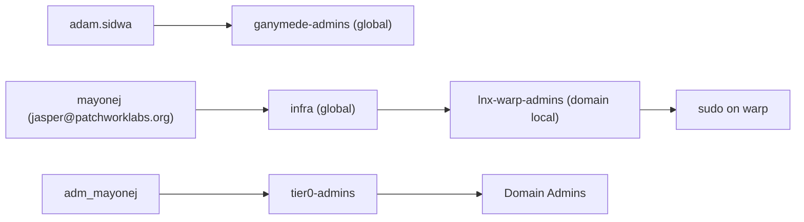
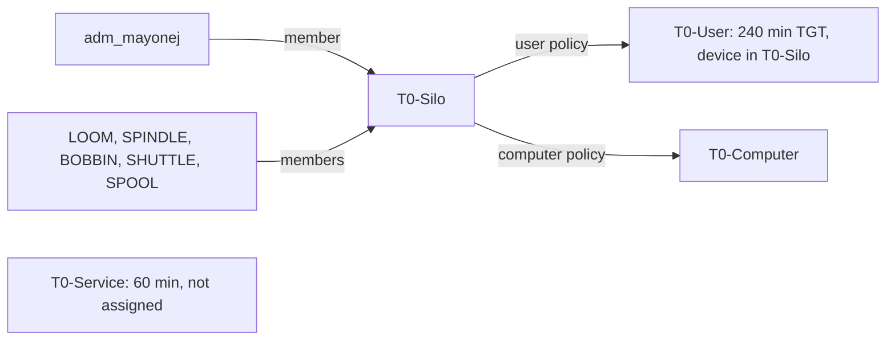
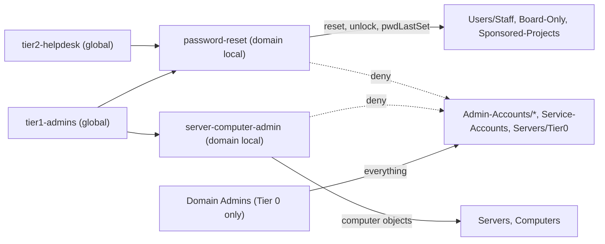
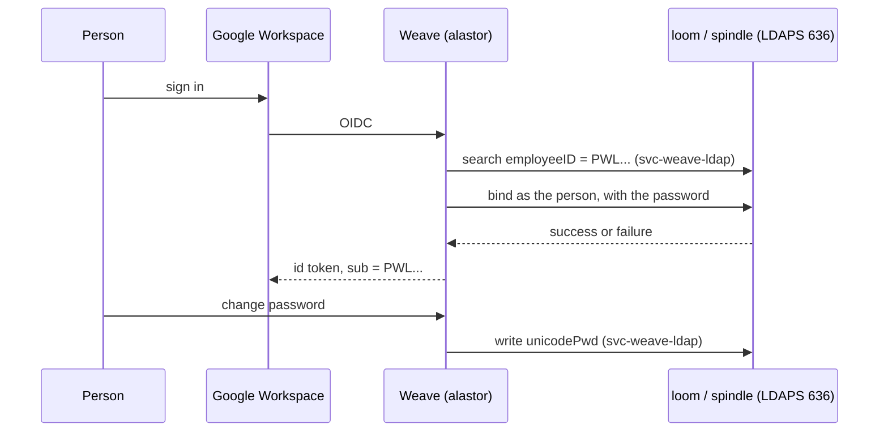

# ad

The `patchwork.internal` directory, built around the Patchwork business units. The names here match Google Workspace, Google Cloud and Mercury, so a person or a dollar is in the same business unit in each system.

| File | Contents |
|---|---|
| `org.json` | The source of truth: OUs, people, their org attributes, role groups, resource groups. |
| `converge.ps1` | Makes AD match `org.json`. Idempotent, supports `-WhatIf`, logs every change. |
| `TIERING.md` | Proposal: the tier model, the Tier 0 authentication policy silo, just-in-time Domain Admin, break-glass and LAPS. |
| `../tests/ad/` | A test that runs `converge.ps1` against an in-memory directory. `nix flake check` runs it. |

## Model

- **Attributes carry the org chart.** `company` = `Patchwork Labs inc.`, `division` = business unit, `department` = sub-department, plus `title` and `manager`. Board members and officers have no manager.
- **OUs are for policy and delegation only.** They match the Workspace OUs.
- **AGDLP.** People go in global role groups (`roleGroups`, `Groups/Roles`, for example `board`, `infra`). Role groups go in domain local access groups (`resourceGroups` and `hostGroups`, `Groups/Resources`, for example `password-reset`, `lnx-warp-admins`). Only access groups get permissions. The board and the officers are groups, never OUs.
- **Group names.** A managed group has a plain name: lower case words joined by hyphens, with no `GG-` or `DL-` prefix. The scope (global or domain local) shows the kind, not the name. The `lnx-<host>-users` and `lnx-<host>-admins` host groups keep their names. See "Group names" below.
- **Tier 0.** `adm_mayonej` (in `Admin-Accounts`) is the only person with Domain Admins, through `tier0-admins`. Daily accounts get no admin rights. `svc-ansible` stays in Domain Admins, because Ansible manages the DCs.
- **Break-glass.** The built-in `Administrator` (RID 500) is disabled, because `builtinAdministrator.enabled` is `false`. The script finds it by SID, so a rename does not hide it. It disables the account only while an admin account in `org.json` is enabled and is in Domain Admins (direct or nested). Otherwise it reports this and keeps the account enabled. It removes the account from the groups in `builtinAdministrator.removeFrom` (Enterprise Admins, Schema Admins). Nobody knows its password: `ansible-playbook ad.yml -t administrator-random` sets a discarded random one. Any Domain Admin path can reset it and enable the account. DSRM on each DC (LAPS-DSRM) is the last resort. `ansible-playbook ad.yml -t breakglass-alert` writes an event (source `Patchwork-Alert`) to the Application log of each DC when the account is used. Mail is off by default. To read the events, see "Alerts" in [`../ansible/README.md`](../ansible/README.md). See [`TIERING.md`](TIERING.md) section 4.
- **Login names.** `sam` is the sAMAccountName, the internal username. It does not change. People log in with their UPN, `<upn>@patchworklabs.org`. `upn` is the part before the @. If you leave it out, it is the same as `sam`. The script adds the UPN suffix to the forest. Admin accounts keep `<sam>@patchwork.internal`.
- **Match on both.** The script finds each user by `sam` first, then by UPN. If the two find different accounts, it reports this and changes nothing for that user. It never makes a second account for a person who already has one.
- **Community members belong to Weave.** Weave creates them in `Users/Members` with `svc-weave-ldap`. `converge.ps1` never changes anything in that OU, or the members of `ganymede-users`.
- **AD holds the only password.** Weave checks a password with an LDAPS bind as the person, and writes a new password to AD with `svc-weave-ldap`. See "Weave" below.
- **The Weave link is `employeeID`.** It holds the Weave public id (`PWL...`, the OIDC `sub`). `weaveId` in `org.json` sets it for staff. Weave sets it for the members that it creates.



These accounts existed before `org.json`. They keep their sAMAccountNames:

| `sam` | UPN | Kind |
|---|---|---|
| `mayonej` | `jasper@patchworklabs.org` | Daily account of Jasper Mayone |
| `adm_mayonej` | `adm_mayonej@patchwork.internal` | Tier 0 account of Jasper Mayone |
| `klukask` | `kieran@patchworklabs.org` | Kieran Klukas |
| `petrarcad` | `dominic@patchworklabs.org` | Dominic Petrarca |
| `svc-ansible`, `svc-lnx-join`, `svc-dhcp-dns`, `svc-pve-ldap` | not managed | Service accounts. The script does not create them. |
| `svc-weave-ldap` | none | Weave service account. The script creates it disabled. See "Weave". |

| OU | Holds |
|---|---|
| `Users/Staff`, `Users/Board-Only` | Staff, and directors with no operational role |
| `Users/Sponsored-Projects/<project>` | Organizers of a fiscally sponsored project |
| `Users/Members` | Community members (Weave) |
| `Service-Accounts`, `Disabled` | Non-human accounts, suspended accounts |
| `Admin-Accounts/Tier0`, `Tier1`, `Tier2` | Admin accounts by tier. `adm_mayonej` and `svc-ansible` are in `Tier0`. `Tier1` and `Tier2` are empty. |
| `Groups/Roles`, `Groups/Resources` | Global role groups, domain local resource groups |
| `Computers`, `Servers` | Workstations; member servers and lab hosts |
| `Servers/Tier0` | Tier 0 member servers: bobbin, shuttle and spool. No Tier 1 rights. |

## Run it

Run on a DC, or on a host with RSAT, as `adm_mayonej`. The GPO step needs the GroupPolicy module (GPMC).

```powershell
.\converge.ps1 -WhatIf            # read the WOULD lines
.\converge.ps1                    # Build
```

Logs go to `C:\ProgramData\Patchwork\ad-converge\`. Each run ends with a count of changes, reports and errors. A REPORT line needs a person to look at it. The script changes nothing for it.

New accounts are disabled and must change the password at the next logon. The script never sets, reads or logs a password. To start an account, set a first password (or let Weave set it), then enable the account.

## Move from the old tree

The old tree is `OU=Patchwork-Objects`. Do these steps in order, with `-WhatIf` first each time.

1. `.\converge.ps1` (Build). This makes the new tree. It moves nothing.
2. Run Build again. It removes the daily accounts from the admin groups only when each admin account is enabled and had a Domain Admins path before the run started. The run that adds the `tier0-admins` path never removes the old path. Direct memberships of admin accounts (for example `adm_mayonej` in Domain Admins) are only reported. They stay until JIT works and `tiering.jit.removeStanding` is `true` (see "Tier 0").
3. Point the join rights at the new computer OUs. In `ansible/inventory/group_vars/patchwork.yml`, set `ad_computer_ou_server` to `OU=Servers,OU=Patchwork,DC=patchwork,DC=internal` and `ad_computer_ou_client` to `OU=Computers,OU=Patchwork,DC=patchwork,DC=internal`. Run `ansible-playbook ad.yml -t join-delegation`.
4. Set `patchwork.ad.computerOU` in `modules/ad-join` to the new `Servers` OU.
5. `.\converge.ps1 -Phase Migrate`. It copies the GPO links to the new OUs, moves every object, and changes the `lnx-*` and app groups to domain local. It reports each object that it cannot place. Add each one to `org.json` and run Migrate again.
6. Check: SSH to a lab host as an AD user, sudo, VPN login through shuttle, GPOs on bobbin and shuttle (`gpresult /r`).
7. `.\converge.ps1 -Phase Prune`. It deletes the old OUs. It refuses while any object is still in them.

## Add a person

Add an entry to `users` in `org.json`, and add the person to their role groups:

```json
{ "sam": "examples", "upn": "sam", "kind": "person", "ou": "Users/Staff",
  "givenName": "Sam", "surname": "Example",
  "division": "Programs", "department": "Project Ganymede",
  "title": "Volunteer", "manager": "adam.sidwa", "weaveId": "PWL5A1B2C3D4" }
```

This person logs in as `sam@patchworklabs.org`. Leave out `upn` when it is the same as `sam`. Before you add a person, look for an account that they already have. If one exists, use its sAMAccountName as `sam`.

`weaveId` is the public id of the person in Weave (the `PWL...` id on the Weave admin page). It is the OIDC `sub`. Build writes it to `employeeID`. Copy the id from Weave. Do not make one up. If the person has no Weave account yet, leave out `weaveId`. Build then reports `<sam> has no weaveId` on each run. `nix flake check` refuses an id that is not `PWL`, one digit and nine upper-case hex digits, and the same id on two people.

Add the person to `all-staff`, so `PSO-Staff` applies. `nix flake check` fails for an account that no PSO applies to. `division` and `department` must be a pair from `divisions`. `manager` is a `sam`, or `null` for no manager. Group members are `sam` values. A key you leave out is not managed. A key set to `null` clears the attribute. To suspend a person, set `"kind": "disabled"` and `"ou": "Disabled"`, and take them out of every group.

## Password policy

`passwordPolicy` in `org.json` sets the password and lockout rules. Build makes AD match it. Times are in days or minutes. A time of `0` means never.

| Policy | Applies to | Min length | Expires | History | Lockout |
|---|---|---|---|---|---|
| Default domain policy | Everyone else, for example Weave members | 12 | never | 24 | 10 tries, 15 min |
| `PSO-Tier0` (precedence 10) | `tier0-admins` | 20 | never | 24 | 5 tries, 30 min |
| `PSO-Service` (precedence 20) | `service-accounts` | 32 | never | 24 | none |
| `PSO-Staff` (precedence 30) | `all-staff` | 14 | never | 24 | 10 tries, 15 min |

Complexity is on for all policies. A lower precedence wins when two PSOs apply to one account. `PSO-Service` has no lockout, because a lockout would stop the service. A new rule applies at the next password change. It does not expire a password that exists.

A PSO applies to global groups, not to OUs. Each role group in `appliesTo` must be in `roleGroups`. The script removes a PSO subject that is not in `org.json`. It reports a PSO in AD that is not in `org.json`, and does not delete it.

The `Default Domain Policy` GPO also holds the default domain settings. The DC applies the GPO again, and the GPO values replace the values that the script sets. Set the same values in the GPO (Computer Configuration, Policies, Windows Settings, Security Settings, Account Policies). If the GPO and `org.json` are different, each Build shows a change for the default domain policy.

## Tier 0: silo and just-in-time admin

The `tiering` block in `org.json` holds the Tier 0 authentication policy silo and the switches for just-in-time (JIT) admin. The design and the decisions are in [`TIERING.md`](TIERING.md) (PR #18). Build makes AD match the block.

| Key | Value | Effect |
|---|---|---|
| `silo` | `T0-Silo` | The authentication policy silo. |
| `enforce` | `false` | Audit mode. The DCs log what they would refuse (events 305, 306) and refuse nothing. `true` enforces the silo, `T0-User` and `T0-Computer`. |
| `userPolicy` | `T0-User` | 240-minute TGT, and a TGT only from a device in `T0-Silo`. AD makes the TGT non-renewable. |
| `computerPolicy` | `T0-Computer` | No TGT lifetime and no condition. Microsoft says not to set a TGT lifetime for computers. |
| `servicePolicy` | `T0-Service` | 60-minute TGT, no device condition, always in audit mode. Not in the silo and not assigned. It is for `svc-ansible` in TIERING.md step 5b. |
| `users` | `adm_mayonej` | Silo members. Only admin accounts. |
| `computers` | `LOOM`, `SPINDLE`, `BOBBIN`, `SHUTTLE`, `SPOOL` | Silo members, without the `$`. A computer that does not exist yet (`SPOOL`) is reported and skipped. |
| `jit` | see below | Just-in-time admin. |

Each account gets two things: access to the silo (`Grant-ADAuthenticationPolicySiloAccess`) and the silo assigned to it (`Set-ADAccountAuthenticationPolicySilo`). Build never takes an account out of the silo. It reports an account that has access but is not in `org.json`. The built-in Administrator is never added: the KDC exempts it from every authentication policy.



### JIT switches

| Key | Value now | Effect |
|---|---|---|
| `jit.enabled` | `false` | While `false`, Build manages the members of `tier0-admins` like every other group. When `true` and the AD Privileged Access Management feature is on, Build stops managing that group's members. A member with a time to live is a grant, and Build logs it as INFO. Build reports every standing member. When the feature is off, Build reports this and acts as if `enabled` were `false`. |
| `jit.removeStanding` | `false` | When `true` (and JIT is active), Build removes the standing admin memberships of admin accounts: the standing members of `tier0-admins`, direct members of Domain Admins and Enterprise Admins that `privileged.allowedDirectMembers` does not allow, and admin accounts in `jit.standingGroups` (`DnsAdmins`, `DHCP Administrators`). It refuses when no allowed admin account (`svc-ansible`) is an enabled direct member of Domain Admins, so a fallback path stays. Until then, each of these memberships is a REPORT line. |
| `jit.eligible` | `tier0-eligible` | Who can ask for a grant. The `PatchworkT0` endpoint allows only this group. `PSO-Tier0` applies to it too, so `adm_mayonej` keeps its password policy without standing admin. |
| `jit.defaultHours`, `jit.maxHours` | 1, 4 | The grant length. `ad.yml -t jit-endpoint` copies these to the DCs. `nix flake check` refuses a maximum over 4 hours. |

The order is in `../ansible/README.md`, "Tier 0 run order". Test a grant before you set `removeStanding`. `nix flake check` refuses `removeStanding` without `enabled`.

## Delegation

The goal: an admin cannot reset another admin. Only Domain Admins can. Domain Admins is Tier 0 only (`adm_mayonej` through `tier0-admins`, and `svc-ansible`). No ACL can stop a Domain Admin. So the protection is to keep Domain Admins small, and to give the lower tiers rights that never reach an admin or a service account.

The exception that the request named: `adm_mayonej` can reset the built-in `Administrator`. It is a Domain Admin, so it can already do that. Nothing extra is set for it. But the GPO `T0-Builtin-Administrator-Disabled` (`ansible/ad.yml -t admin-disabled-gpo`) keeps the account disabled on the DCs. To enable it for break-glass, a Domain Admin must first disable the GPO link on the domain root. Otherwise the DCs disable the account again at the next security policy refresh. See [`TIERING.md`](TIERING.md) section 4 for the steps.

The `delegation` block in `org.json` holds the rights. Build makes AD match it.

| Role group (global) | Resource group (domain local, holds the ACEs) | OU | Rights | Deny |
|---|---|---|---|---|
| `tier2-helpdesk` | `password-reset` | `Users/Staff`, `Users/Board-Only`, `Users/Sponsored-Projects` and their child OUs | On user objects: reset password, write `lockoutTime` (unlock), write `pwdLastSet` (change at next logon), read all | `Admin-Accounts` (all tiers), `Service-Accounts`, `Servers/Tier0` |
| `tier1-admins` | `password-reset` | same as above | same as above | same as above |
| `tier1-admins` | `server-computer-admin` | `Servers`, `Computers` and their child OUs | Create and delete computer objects. Full control of computer objects (reset password, DNS host name, SPN and the rest) | `Admin-Accounts` (all tiers), `Service-Accounts`, `Servers/Tier0` |
| `svc-lnx-join` (not a group) | none (`ansible/ad.yml -t join-delegation` sets its rights) | `Servers`, `Computers` | Join computers | `Servers/Tier0` |
| `svc-weave-ldap` (not a group) | none (`"principal"` in `delegation.grants`) | `Users/Staff`, `Users/Board-Only`, `Users/Sponsored-Projects` and their child OUs | On user objects: reset password, change password, write `lockoutTime` (unlock, because a reset does not unlock), read all. No other attribute writes. | `Admin-Accounts` (all tiers), `Service-Accounts`, `Servers/Tier0`, `Disabled` |
| `svc-weave-ldap` (not a group) | none | `Users/Members` | Create user objects. On user objects: reset password, change password, write `pwdLastSet`, `lockoutTime`, `userAccountControl`, `employeeID`, `givenName`, `sn`, `displayName`, `mail`, `userPrincipalName`, read all. No delete. | same as above |



Rules:

- **On `Users/Members`, only Weave.** Weave owns it. An OU with `"managed": false` names its `"owner"` (`svc-weave-ldap`). `nix flake check` refuses a grant to a group on that OU or on an OU above it, and a `"principal"` grant there to anybody but the owner. Nothing on `Disabled`, and nothing on the Domain Controllers OU.
- **A grant to a service account is the exception to AGDLP.** Use it only for the account of one integration, like `svc-lnx-join`. A group would let a person get the same rights by a group change. `nix flake check` refuses a `"principal"` that is not a service account in `org.json`, and refuses any grantee that has no deny on `Admin-Accounts`, `Service-Accounts` and `Servers/Tier0`.
- **No group except Domain Admins has rights on `Admin-Accounts`.** A Tier 1 admin account (in `Admin-Accounts/Tier1`) cannot reset another Tier 1 account or a Tier 0 account. `password-reset` and `server-computer-admin` also get an explicit deny there, in case somebody grants them a right on a parent OU later. The deny covers write, create, delete, permissions, owner and every extended right (reset password too). Read stays allowed.
- **Tier 0 servers are in `Servers/Tier0`.** A Tier 1 admin with full control of the bobbin computer object could take over the CA (for example with resource-based constrained delegation), and with it the forest. So the deny on `Servers/Tier0` beats the right that `Servers` gives. The same deny covers `svc-lnx-join`, whose join rights on `Servers` reached bobbin and shuttle before this change. `tiering.serverOU` names the OU. Build moves each computer in `tiering.computers` that is not a DC into it.
- **Both role groups are empty.** Add a member only after you make a Tier 1 or Tier 2 admin account in `Admin-Accounts/Tier1` or `Tier2`. Do not add a daily account.
- **Helpdesk can reset each person in the three people OUs.** That includes `mayonej`, whose `infra` membership gives sudo on the lab hosts. Keep this in mind before you add a member to `tier2-helpdesk`. An account with `adminCount=1` (it was in a protected group once) has inheritance off. No delegated right reaches it until a Domain Admin clears `adminCount` and turns inheritance on again. Build reports each such account.
- **Extra ACEs.** Build adds a missing ACE, and never removes one. It reports each explicit allow ACE that gives more than read on an OU in the block (and on the Domain Controllers OU), unless it is a default ACE (SYSTEM, Domain Admins, Enterprise Admins, Administrators, Account Operators, Print Operators) or `delegation.knownAces` lists it. `Account Operators` can create and delete accounts in every OU by default. Keep it empty. Build reports its members.
- **AdminSDHolder.** SDProp copies the ACL of `CN=AdminSDHolder` to each protected account every 60 minutes. Build only reports: an account in `delegation.expectAdminCount` without `adminCount=1`, an account with `adminCount=1` that is not in that list, and an ACE on AdminSDHolder from a principal that is not there by default.

### How Build moves the admin accounts and the Tier 0 servers

`adm_mayonej` and `svc-ansible` are in `Admin-Accounts`, and bobbin and shuttle are in `Servers`. Build moves an object only **down**, into a child OU of the OU that it is in now, inside `OU=Patchwork`. The GPOs of the old OU still apply in the child OU, and group memberships, the silo membership and `manager` follow the move. So the first Build after this change moves:

- `adm_mayonej`, `svc-ansible`: `Admin-Accounts` to `Admin-Accounts/Tier0`.
- `BOBBIN`, `SHUTTLE`: `Servers` to `Servers/Tier0`.

Each move is one `Move to ... (a child OU of its OU)` line. Any other difference (up, or to another branch) stays a REPORT for Migrate.

## Add a sponsored project

1. Add the project to `divisions."Sponsored Projects"`.
2. Add the OU `Users/Sponsored-Projects/<project>` to `ous`.
3. Add a role group `<project>-organizers` (for example `hackboston-organizers`) with its organizers.
4. Use the same project name as in Workspace and Mercury.

## Add a program

1. Add the program to `divisions.Programs`.
2. Add `<program>-admins` and, if needed, `<program>-users` (for example `ganymede-admins`, `ganymede-users`). Set `"manageMembers": false` on a group that another system fills.
3. Program staff stay in `Users/Staff`. Their `department` is the program.

## Group names

`nix flake check` (`tests/ad-org.nix`) enforces these rules for `roleGroups` and `resourceGroups`:

- The name is lower case letters and digits, in words joined by hyphens, 64 characters or fewer. `board`, `tier0-admins` and `vpn-users` pass. `GG-Board` and `Domain-Users` fail.
- The name does not start with `lnx-`. That prefix is for the `hostGroups` templates.
- sAMAccountName is one namespace for users, groups and computers, and AD compares it without case. So a group name must not be a `sam` in `users`, a host in `linuxHosts`, `retiredHosts` or `tiering.computers`, a built-in group (`Administrators`, `Users`, `Domain Users` and the others), a reserved name, or the name of another group.
- A group name must not be the local part of a Workspace group address on another domain (`organizers@hackboston.dev`). A UPN must not be a Workspace group address. The check reads the addresses from `../terraform/workspace/main.tf`.
- `formerNames` must not hold a current group name or a `sam`, and one former name belongs to one group only.

The role groups that have a Workspace group have the same name as its address: `board` is `board@patchworklabs.org`, `infra` is `infra@patchworklabs.org`. See `../terraform/workspace/README.md`.

## Rename a group

A rename must keep the group object. The SID stays, so the members, the nesting, the ACEs, the PSO links and the silo and JIT references stay. Do not delete a group and make a new one.

1. In `org.json`, change `name`, and add the old name to `formerNames`: `{ "name": "infra", "formerNames": ["GG-Infra"], ... }`. Change every reference in the repo (members, `appliesTo`, `privileged`, `tiering.jit`, `delegation`).
2. Run `.\converge.ps1 -WhatIf`. Each rename shows as `WOULD Rename group <old> to <new> (sAMAccountName)` and `WOULD Rename group CN <old> to <new>`. A `displayName` that holds the old name shows as `WOULD Set displayName`. There must be no `Create ... group` line, no member change and no `Allow for` or `Deny for` ACE line for the renamed groups. Look for `REPORT Group <name>` lines: a conflict blocks the rename.
3. Run `.\converge.ps1`. Each line is a `CHANGE`. A second run has zero changes.
4. Refresh the systems that keep a group name (see below).
5. Keep `formerNames` until every system uses the new names. Remove it in a later change.

Build finds a group by its name, then by a former name. If it finds the group under its name AND under a former name, it cannot know which object is right. It writes `REPORT Group <name> exists more than once` and does not touch that group, its members, or any group, PSO or ACE that names it. Delete or rename the wrong object by hand, then run Build again.

### Refresh after a rename

| System | What keeps the name | What to do |
|---|---|---|
| JIT endpoint on loom and spindle | `jit.json` and the `RoleDefinitions` of `PatchworkT0.pssc` name `tiering.jit.group` and `tiering.jit.eligible` | `ansible-playbook ad.yml -t jit-endpoint`. It writes the new names and registers the endpoint again. Until then, `Request-T0Admin` looks for the old group names and fails. |
| Break-glass alert task | The event filter holds the SID of `privileged.tier0Group` | Nothing is required: the SID does not change. Run `ansible-playbook ad.yml -t breakglass-alert` only after Build. Before the rename it stops, because `privileged.tier0Group` does not exist yet. After Build a rerun changes nothing. |
| NixOS hosts (sssd) | The cache holds the nested group names (`infra` in `lnx-<host>-*`) | On each host: `sudo sss_cache -E`, or wait for the cache to expire. Login and sudo use the `lnx-` groups, which keep their names. |
| Proxmox (`pve01`) | An AD or LDAP realm with a group filter or synced groups, if one is set up by hand | Change a filter that names a `GG-` group. Then run `pveum realm sync <realm>`. This repo has no realm config. |
| NPS on shuttle | A Windows Groups condition in a network policy | NPS keeps the SID. Open `nps.msc` and check that each condition shows the new name. |
| GPO security filtering | The GPO ACL | A GPO ACL holds SIDs, so the filter stays. Check with `Get-GPPermission -All`. |
| Workspace and GCP | Group addresses | No change. The addresses already have the plain names. |

## Add a lab host

Add the host to `flake.nix`, and add its name to `linuxHosts`. `nix flake check` fails until both lists match. Build then makes `lnx-<host>-users` and `lnx-<host>-admins`, with `infra` in both.

## Retire a lab host

Move its name from `linuxHosts` to `retiredHosts`, and remove it from `flake.nix`. Build deletes its `lnx-<host>-users` and `lnx-<host>-admins` groups. Delete its computer object in AD by hand.

## Weave

Google Workspace uses Weave (`weave.patchworklabs.org`) as its OIDC sign-in. AD (`patchwork.internal`) holds the only copy of the password of each person who has an AD account. A person without an AD account keeps a Weave password.



### svc-weave-ldap

| Item | Value |
|---|---|
| Account | `svc-weave-ldap` in `Service-Accounts`. Build creates it disabled, with "change password at next logon". |
| Password policy | `PSO-Service` through `service-accounts`: 32 characters, no lockout. |
| Rights | The two `svc-weave-ldap` rows in the delegation table above. |
| Denied | `Admin-Accounts` (all tiers), `Service-Accounts`, `Servers/Tier0`, `Disabled`. A deny covers write, create, delete, permissions, owner and every extended right. |
| Not delegatable | `ansible/ad.yml -t svc-posture` sets AES only and "not delegatable". `-t audit` checks it. |
| Password store | `secrets/weave-ldap.age` (agenix), password only. Recipients: `jsp` and the host that runs Weave (`alastor` today, `warp` after the move). |

The deny on `Service-Accounts` covers `svc-weave-ldap` itself, but it is an inherited deny. The default ACL of a user object gives Everyone and SELF an explicit "change password" right, and an explicit allow wins over an inherited deny. So Weave can change its own password when it knows the old one. A compromised Weave can rotate the password, and then the copy in `weave-ldap.age` is stale. Watch for event 4723 on `svc-weave-ldap`.

### What Weave cannot reach

- **Admin accounts, service accounts, Tier 0 servers, disabled accounts.** No grant reaches these OUs, and an explicit deny stops a grant on a parent OU later.
- **Members of protected groups.** SDProp sets `adminCount=1` on each member of a protected group (Domain Admins and the others), turns ACL inheritance off on the account, and copies the ACL of `CN=AdminSDHolder`. The Weave ACEs on the people OUs are inherited ACEs, so they never reach such an account. That includes a daily account that was a Domain Admin once (`mayonej` today) until a Domain Admin clears `adminCount` and turns inheritance on again. Build reports each such account (see "AdminSDHolder" above). Do not add `svc-weave-ldap` to AdminSDHolder.
- **The Domain Controllers OU.** It is not in `org.json`, so no grant can name it. Build reports any extra ACE there.

Weave owns each member object that it creates. An owner can change the ACL of its object. This is limited to objects in `Users/Members`, with two guards in Build:

- **No takeover by name.** Weave picks the sAMAccountName of a member. Build never manages an account that is in `Users/Members` (or in the old `Members` OU), even when its name is a `sam` in `org.json`. It reports the account and does not add it to a group. Without this, a member named like a new admin entry would get the groups of that entry, up to Domain Admins.
- **Owner report.** Build reports each managed account whose owner is `svc-weave-ldap`.

To make a member into staff: move the account out of `Users/Members` by hand, set its owner to Domain Admins (`dsacls "<dn>" /takeownership`, as a Domain Admin), add it to `org.json` with its sAMAccountName as `sam`, then run Build.

### The link: employeeID

| Account | Who sets `employeeID` |
|---|---|
| Staff, board, organizers (`kind: person`) | Build, from `weaveId` in `org.json`. Weave has no write right on it there. |
| Members in `Users/Members` | Weave, when it creates the member. |
| Admin and service accounts | Nobody. `nix flake check` refuses `weaveId` on them. Weave must never link one. |

A key that is absent is not managed: Build does not clear an `employeeID` that is there. `"weaveId": null` clears it. If the id is the `employeeID` of another account, Build reports this and does not set it. Weave can give a user a new public id (`regenerate_p_id`). Then the link breaks. Change `weaveId` in `org.json` at the same time.

### What Weave must do

- Find the account by `employeeID`. Accept a bind only for an account in `Users/Staff`, `Users/Board-Only`, `Users/Sponsored-Projects` or `Users/Members`.
- Limit wrong passwords per account below the AD lockout (`PSO-Staff`: 10 in 15 minutes; default policy: 10 in 15 minutes). Read `badPwdCount` before the bind and stop near the limit. Otherwise anybody on the internet can lock a person out of AD (VPN, sudo, every AD sign-in) through the Weave login page.
- Give each member a sAMAccountName with a prefix that `org.json` never uses, for example `m-`. Build refuses a takeover by name anyway, but a prefix stops the clash before it starts.
- Disable a member. Do not delete one: `svc-weave-ldap` has no delete right.
- `ganymede-users` has `"manageMembers": false`, but `svc-weave-ldap` has no right on it. An admin manages its members by hand until a later change gives Weave that right.

### LDAPS

Both DCs serve LDAPS on TCP 636. Read on 2026-10-20 with `openssl s_client`:

| DC | Certificate | Valid until |
|---|---|---|
| `loom.patchwork.internal` (10.100.90.10) | SAN `DNS:loom.patchwork.internal`. EKU server auth, client auth, smart card logon. Empty subject. | 2027-08-01 |
| `spindle.patchwork.internal` (10.100.90.11) | SAN `DNS:spindle.patchwork.internal`. Same EKU. | 2027-08-01 |

The issuer is `CN=Patchwork-Issuing-CA` (bobbin, valid until 2031-08-01). Its issuer is `CN=Patchwork-Root-CA` (pattern, offline). AD CS renews the DC certificates by autoenrollment. Weave must trust the issuing CA and the root CA, and must verify the host name:

1. Run `ansible-playbook ad.yml -t ca-check`, then `ansible-playbook ad.yml -t ca-chain`. This writes `ansible/files/pki/patchwork.internal-ca-chain.pem`. The chain is public. Commit it.
2. Give Weave that file as its LDAPS trust list, with host name checks on.
3. Connect to `loom.patchwork.internal` and `spindle.patchwork.internal` by name, not by IP address, and not by `patchwork.internal`. The certificates have no other name. Weave runs in Docker containers on alastor, and a container does not read `/etc/hosts` of the host. So map the two names to the tailnet addresses of the DCs in the Weave module (`--add-host` on the web and worker containers), not with `networking.hosts`.

### Network

alastor reaches the DCs over the tailnet on TCP 636 only. The grant is in `jaspermayone/infra`, `tailscale/policy.hujson` (`tag:ingress` to `tag:patchwork-dc`, `tcp:636`). The DCs join the tailnet through `ansible/windows.yml` with that tag. Both are separate PRs. Merge the policy PR first, then the `windows.yml` PR, then run `windows.yml`. Until then, Weave cannot reach LDAPS from alastor. When Weave runs on warp, it is on VLAN 90 with the DCs, and it does not need the tailnet path.

### Start Weave on AD: steps for an admin

Do these by hand, in order. Use `-WhatIf` first each time.

1. `.\converge.ps1 -WhatIf`, then `.\converge.ps1` on loom as `adm_mayonej`. It creates `svc-weave-ldap` (disabled), adds it to `service-accounts`, and sets the Weave ACEs and denies.
2. Make a random password of 32 characters or more. Do not write it in a file in a repo. Do not paste it in a chat.
3. On loom, as `adm_mayonej`:

   ```powershell
   Set-ADAccountPassword -Identity svc-weave-ldap -Reset -NewPassword (Read-Host -AsSecureString 'svc-weave-ldap password')
   Set-ADUser -Identity svc-weave-ldap -ChangePasswordAtLogon $false
   Enable-ADAccount -Identity svc-weave-ldap
   ```

4. Store the password with agenix: `cd secrets && agenix -e weave-ldap.age`. Add the entry to `secrets/secrets.nix` first, with the recipients `jsp` and `alastor`. Then give it to Weave in `hosts/alastor/weave.nix`.
5. `ansible-playbook ad.yml -t svc-posture`, then `ansible-playbook ad.yml -t audit`.
6. Add the `weaveId` of each staff person to `org.json`, and run Build again.

## Later

- Directory sync to Google (GCDS) is possible, because the names match. It is not set up. Weave is the planned source for Workspace.
