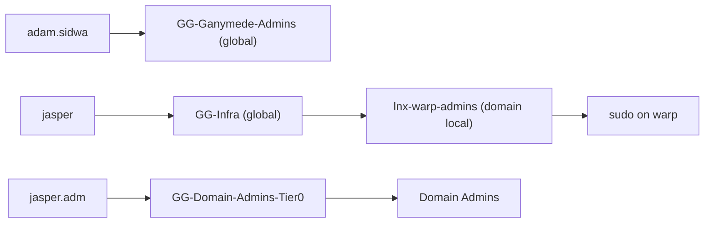

# ad

The `patchwork.internal` directory, built around the Patchwork business units. The names here match Google Workspace, Google Cloud and Mercury, so a person or a dollar is in the same business unit in each system.

| File | Contents |
|---|---|
| `org.json` | The source of truth: OUs, people, their org attributes, role groups, resource groups. |
| `converge.ps1` | Makes AD match `org.json`. Idempotent, supports `-WhatIf`, logs every change. |
| `TIERING.md` | Proposal: the tier model, the Tier 0 authentication policy silo, just-in-time Domain Admin, break-glass and LAPS. |
| `../tests/ad/` | A test that runs `converge.ps1` against an in-memory directory. `nix flake check` runs it. |

## Model

- **Attributes carry the org chart.** `company` = `Patchwork Labs inc.`, `division` = business unit, `department` = sub-department, plus `title` and `manager`. Board members and officers have no manager.
- **OUs are for policy and delegation only.** They match the Workspace OUs.
- **AGDLP.** People go in global role groups (`GG-*`, `Groups/Roles`). Role groups go in domain local resource groups (`Groups/Resources`). Only resource groups get permissions. The board and the officers are groups, never OUs.
- **Tier 0.** `jasper.adm` (in `Admin-Accounts`) is the only person with Domain Admins, through `GG-Domain-Admins-Tier0`. Daily accounts get no admin rights. `svc-ansible` stays in Domain Admins, because Ansible manages the DCs. The built-in `Administrator` is the break-glass account.
- **Login names.** People log in as `<name>@patchworklabs.org`. The script adds that UPN suffix to the forest. Admin accounts keep `@patchwork.internal`.
- **Community members belong to Weave.** Weave creates them in `Users/Members`. `converge.ps1` never changes anything in that OU, or the members of `GG-Ganymede-Users`.



| OU | Holds |
|---|---|
| `Users/Staff`, `Users/Board-Only` | Staff, and directors with no operational role |
| `Users/Sponsored-Projects/<project>` | Organizers of a fiscally sponsored project |
| `Users/Members` | Community members (Weave) |
| `Service-Accounts`, `Admin-Accounts`, `Disabled` | Non-human accounts, tier 0 accounts, suspended accounts |
| `Groups/Roles`, `Groups/Resources` | Global role groups, domain local resource groups |
| `Computers`, `Servers` | Workstations; member servers and lab hosts |

## Run it

Run on a DC, or on a host with RSAT, as `jasper.adm` (or the built-in `Administrator` the first time). The GPO step needs the GroupPolicy module (GPMC).

```powershell
.\converge.ps1 -WhatIf            # read the WOULD lines
.\converge.ps1                    # Build
```

Logs go to `C:\ProgramData\Patchwork\ad-converge\`. Each run ends with a count of changes, reports and errors. A REPORT line needs a person to look at it. The script changes nothing for it.

New accounts are disabled and must change the password at the next logon. The script never sets, reads or logs a password. To start an account, set a first password (or let Weave set it), then enable the account.

## Move from the old tree

The old tree is `OU=Patchwork-Objects`. Do these steps in order, with `-WhatIf` first each time.

1. `.\converge.ps1` (Build). This makes the new tree. It moves nothing.
2. Enable `jasper.adm` and set its password. Run Build again. It then removes the daily accounts from the admin groups.
3. Point the join rights at the new computer OUs. In `ansible/inventory/group_vars/patchwork.yml`, set `ad_computer_ou_server` to `OU=Servers,OU=Patchwork,DC=patchwork,DC=internal` and `ad_computer_ou_client` to `OU=Computers,OU=Patchwork,DC=patchwork,DC=internal`. Run `ansible-playbook ad.yml -t join-delegation`.
4. Set `patchwork.ad.computerOU` in `modules/ad-join` to the new `Servers` OU.
5. `.\converge.ps1 -Phase Migrate`. It copies the GPO links to the new OUs, moves every object, and changes the `lnx-*` and app groups to domain local. It reports each object that it cannot place. Add each one to `org.json` and run Migrate again.
6. Check: SSH to a lab host as an AD user, sudo, VPN login through shuttle, GPOs on bobbin and shuttle (`gpresult /r`).
7. `.\converge.ps1 -Phase Prune`. It deletes the old OUs. It refuses while any object is still in them.

## Add a person

Add an entry to `users` in `org.json`, and add the person to their role groups:

```json
{ "sam": "sam.example", "kind": "person", "ou": "Users/Staff",
  "givenName": "Sam", "surname": "Example",
  "division": "Programs", "department": "Project Ganymede",
  "title": "Volunteer", "manager": "adam.sidwa" }
```

`division` and `department` must be a pair from `divisions`. `manager` is a `sam`, or `null` for no manager. A key you leave out is not managed. A key set to `null` clears the attribute. To suspend a person, set `"kind": "disabled"` and `"ou": "Disabled"`, and take them out of every group.

## Add a sponsored project

1. Add the project to `divisions."Sponsored Projects"`.
2. Add the OU `Users/Sponsored-Projects/<project>` to `ous`.
3. Add a role group `GG-<Project>-Organizers` with its organizers.
4. Use the same project name as in Workspace and Mercury.

## Add a program

1. Add the program to `divisions.Programs`.
2. Add `GG-<Program>-Admins` and, if needed, `GG-<Program>-Users`. Set `"manageMembers": false` on a group that another system fills.
3. Program staff stay in `Users/Staff`. Their `department` is the program.

## Add a lab host

Add the host to `flake.nix`, and add its name to `linuxHosts`. `nix flake check` fails until both lists match. Build then makes `lnx-<host>-users` and `lnx-<host>-admins`, with `GG-Infra` in both.

## Retire a lab host

Move its name from `linuxHosts` to `retiredHosts`, and remove it from `flake.nix`. Build deletes its `lnx-<host>-users` and `lnx-<host>-admins` groups. Delete its computer object in AD by hand.

## Later

- Weave provisioning: a service account with rights on `Users/Members` only, so Weave can create members and set the passwords people choose there.
- Directory sync to Google (GCDS) is possible, because the names match. It is not set up. Weave is the planned source for Workspace.
