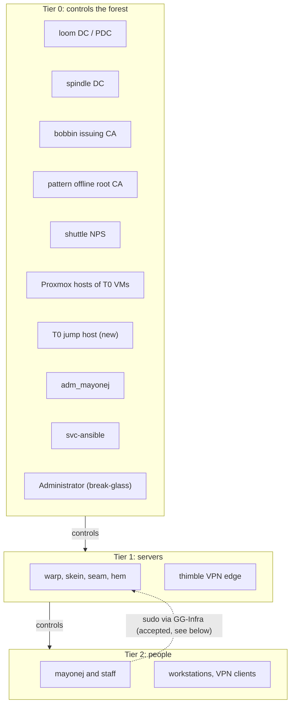
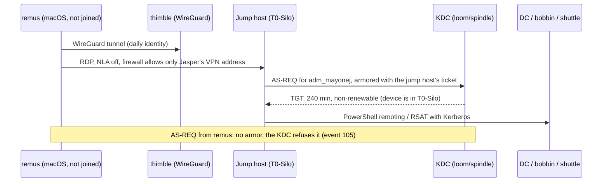
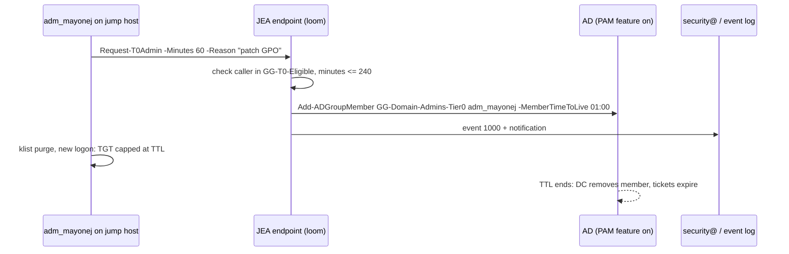
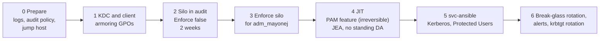

# AD tiering, silos and just-in-time admin

Status: **proposal**. This document changes nothing. Each live step in the rollout needs approval first. The steps that you cannot undo are in **bold**.

This design covers the `patchwork.internal` forest:

1. The tier model.
2. An authentication policy silo for Tier 0.
3. Just-in-time (JIT) Domain Admin.
4. The break-glass account.
5. LAPS.
6. A phased rollout, audit mode first, and which tool owns each piece after the rollout.

## Facts read from the live forest

These facts come from read-only `Get-*` queries against loom on 2026-10-14. No change was made.

| Item | Live value |
|---|---|
| Forest functional level | `Windows2025Forest` |
| Domain functional level | `Windows2025Domain` |
| DCs | loom and spindle, both Windows Server 2025 Datacenter (10.0.26100), both GC. loom holds all five FSMO roles. |
| Optional features | Privileged Access Management: **not enabled**. Recycle Bin: **not enabled**. Database 32k Pages: not enabled. |
| Authentication policies and silos | None |
| KDC "claims, compound authentication and Kerberos armoring" | Not configured on loom (no policy value) |
| Kerberos client armoring policy | Not configured on loom |
| NTLM restriction or NTLM audit policy | Not configured (`RestrictNTLMInDomain`, `AuditNTLMInDomain`, `LmCompatibilityLevel` have no value) |
| `Microsoft-Windows-Authentication/*` logs | All four exist and are **disabled**, `AuthenticationPolicyFailures-DomainController` too |
| Audit policy (loom) | Logon: success and failure. Credential Validation, Kerberos Authentication Service, Security Group Management: success only |
| Fine-grained password policies | None (another change adds them) |
| Windows LAPS | Schema has the `msLAPS-*` attributes. `Get-LapsADPassword` exists. loom, spindle, bobbin and shuttle all have a LAPS password, expiry 2026-11-11. skein has none (Linux). |
| GPOs | `Default Domain Policy`, `Default Domain Controllers Policy`, `Cert-AutoEnroll` (domain), `LAPS-DSRM` (Domain Controllers), `LAPS-Local-Admin` (Member-Servers), `Client-Baseline` (Staff-Production), `Tier0-Admin-Protection` (Staff-Computers) |
| `Tier0-Admin-Protection` | Denies local logon and RDP logon to `Domain Admins` on Staff-Computers |
| Computer objects | LOOM, SPINDLE (Domain Controllers), BOBBIN, SHUTTLE, SKEIN (Member-Servers). No object for pattern. |

### Privileged groups

| Group | Members |
|---|---|
| Domain Admins | `Administrator`, `adm_mayonej`, `svc-ansible` |
| Enterprise Admins | `Administrator`, `adm_mayonej` |
| Schema Admins | `Administrator` |
| Administrators | `Administrator`, `Domain Admins`, `Enterprise Admins` |
| Protected Users | `adm_mayonej` |
| DnsAdmins | `adm_mayonej` |
| Group Policy Creator Owners | `Administrator` |
| Cert Publishers | `BOBBIN$` |
| Account, Backup, Server, Print Operators | empty |
| `GG-Domain-Admins-Tier0` | does not exist yet |

### Privileged accounts

| Account | Facts |
|---|---|
| `Administrator` | Enabled. Password set 2026-08-09, never expires. **Last logon 2026-10-12.** Not "sensitive and cannot be delegated". |
| `adm_mayonej` | Enabled. In `OU=Admin-Accounts,OU=Administrative,OU=Patchwork-Objects`. Password set 2026-10-14. Also in `pve-operators`, `DHCP Administrators`, `DnsAdmins`. Not "sensitive and cannot be delegated". `msDS-SupportedEncryptionTypes` = 0. |
| `svc-ansible` | Domain Admins. AES only (24), not delegatable, password never expires. Last logon 2026-10-14. Ansible logs in with NTLM over WinRM HTTP 5985 (`group_vars/windows.yml`). |
| `krbtgt` | Password set 2026-08-09 (forest creation). Never rotated. |
| `mayonej` | Jasper's daily account. In `G_Board` only. |

### Name drift

The repo and the forest use different names today. This document uses the **live** names.

| Live | `ad/org.json` and `ad/README.md` |
|---|---|
| `adm_mayonej` | `jasper.adm` |
| `mayonej` | `jasper` |
| `OU=Patchwork-Objects` tree | `OU=Patchwork` tree (after Migrate) |

Another change moves `adm_mayonej` into `GG-Domain-Admins-Tier0` and adds fine-grained password policies. This PR does not touch `org.json` or `converge.ps1`. The sections below say what those files must change later.

## 1. Tier model

The rule: an account of tier N logs on only to assets of tier N. A higher tier can control a lower tier. A lower tier must never hold credentials or sessions of a higher tier.

| Tier | Assets | Accounts |
|---|---|---|
| **0** | loom, spindle (DCs). bobbin (issuing CA). pattern (offline root CA). shuttle (NPS). The Proxmox hosts that run these VMs. The proposed Tier 0 jump host. remus, as long as it holds the `svc-ansible` password. | `adm_mayonej`, `svc-ansible`, `Administrator`, DSRM (LAPS-DSRM) |
| **1** | warp, skein, seam, hem (NixOS). thimble (VyOS edge). App servers. | `lnx-<host>-admins` members. `svc-lnx-join`, `svc-pve-ldap`, `svc-dhcp-dns`. No dedicated Tier 1 person account yet. |
| **2** | Staff workstations (`Computers` OU). VPN sessions. | Daily accounts: `mayonej`, staff, members |



### bobbin: Tier 0

bobbin is an enterprise CA. A CA that the forest trusts for smart card logon can issue a certificate for any account, `Administrator` too. A person who controls bobbin controls the forest. `BOBBIN$` is in `Cert Publishers`. bobbin is Tier 0 with no exceptions. pattern, the offline root CA, is Tier 0 for the same reason. It is off and has no computer object, so it is outside the silo. Confirm that pattern is the offline root CA (the Ansible inventory says so).

### shuttle: Tier 0

Recommendation: put shuttle in Tier 0.

- `svc-ansible`, a Domain Admin, logs on to shuttle over WinRM. Any host where a Tier 0 credential logs on is a Tier 0 host.
- shuttle checks every staff VPN login. An attacker on shuttle can let any device into the lab network and can collect MS-CHAPv2 responses of every VPN user.
- A separate Tier 1 management identity for one server costs more than this org can maintain.

The other choice is Tier 1 with a separate Tier 1 Ansible account. That removes Domain Admin logons from shuttle. It is a good change if more Windows member servers come later.

### Proxmox: Tier 0

A Proxmox administrator can read the disk of a DC VM and take `ntds.dit`. The Proxmox hosts that run loom, spindle, bobbin and shuttle are Tier 0. `adm_mayonej` is in `pve-operators`. That is correct for a Tier 0 account. A daily account must never be in it. Keep `root@pam` on each Proxmox host as the hypervisor break-glass, because an AD login to Proxmox can break during the silo rollout (see risks).

### Tier 1 and Tier 2 today

- `GG-Infra` gives the daily account sudo on the NixOS hosts. That is a Tier 2 account that administers Tier 1. Accept it for now. The NixOS hosts hold no Tier 0 credentials, and no Tier 0 account is in `GG-Infra`. Later, add a Tier 1 account (`mayonej.t1`) if more people get sudo.
- `Tier0-Admin-Protection` denies Domain Admins local and RDP logon on Staff-Computers. Keep it. Link it to the new `Computers` OU at Migrate (Migrate copies links). Add a second GPO for member servers that are Tier 1, when such Windows servers exist.

## 2. Authentication policy silo for Tier 0

### What a silo does

An authentication policy controls the Kerberos TGT of an account. It sets a short, non-renewable TGT lifetime. It can also set "allowed to authenticate from": the KDC gives a TGT only when the request comes from an allowed device. The device must armor the request (Kerberos FAST) with its own computer ticket. A silo groups users and computers so that one condition ("the device is in the silo") covers them all.

Important limits:

- **NTLM fails** for an account whose policy has access control conditions. The DC logs event 101.
- The built-in `Administrator` (RID 500) is **always exempt** from authentication policies, also when it is in a silo. That makes it a working break-glass, and it means the silo does not protect it.
- A device that is not domain joined has no computer ticket. It cannot armor a request. remus (macOS, not joined) can never satisfy "allowed to authenticate from".

### Proposed objects

| Object | Value |
|---|---|
| Silo | `T0-Silo` |
| User policy | `T0-User`: `UserTGTLifetimeMins 240`, `UserAllowedToAuthenticateFrom` = device in `T0-Silo` |
| Computer policy | `T0-Computer`: no TGT lifetime (Microsoft says not to set one for computers), no conditions at first |
| Service policy | `T0-Service`: for `svc-ansible`, see below |
| Silo members, computers | `LOOM$`, `SPINDLE$`, `BOBBIN$`, `SHUTTLE$`, the jump host |
| Silo members, users | `adm_mayonej` |
| Not in the silo | `Administrator` (exempt anyway), `svc-ansible` (phase 5), all daily and Tier 1 accounts |

The SDDL for `UserAllowedToAuthenticateFrom`. In this attribute `@USER` means the device account:

```text
O:SYG:SYD:(XA;OICI;CR;;;WD;(@USER.ad://ext/AuthenticationSilo == "T0-Silo"))
```

Sketch, for review only. Do not run it before the approval in phase 2:

```powershell
New-ADAuthenticationPolicy -Name T0-User -UserTGTLifetimeMins 240 `
  -UserAllowedToAuthenticateFrom 'O:SYG:SYD:(XA;OICI;CR;;;WD;(@USER.ad://ext/AuthenticationSilo == "T0-Silo"))' `
  -Enforce:$false -ProtectedFromAccidentalDeletion $true
New-ADAuthenticationPolicy -Name T0-Computer -Enforce:$false -ProtectedFromAccidentalDeletion $true
New-ADAuthenticationPolicySilo -Name T0-Silo -UserAuthenticationPolicy T0-User `
  -ComputerAuthenticationPolicy T0-Computer -ServiceAuthenticationPolicy T0-Service `
  -Enforce:$false -ProtectedFromAccidentalDeletion $true
foreach ($a in 'LOOM$','SPINDLE$','BOBBIN$','SHUTTLE$','<JUMP>$','adm_mayonej') {
  Grant-ADAuthenticationPolicySiloAccess -Identity T0-Silo -Account $a
  Set-ADAccountAuthenticationPolicySilo -Identity $a -AuthenticationPolicySilo T0-Silo
}
```

Prerequisites:

1. A GPO on the Domain Controllers OU: "KDC support for claims, compound authentication and Kerberos armoring" = **Supported**. "Supported" does not require armoring from other clients, so it breaks nothing.
2. A GPO on the Tier 0 member servers and the jump host: "Kerberos client support for claims, compound authentication and Kerberos armoring" = **Enabled**.
3. The `AuthenticationPolicyFailures-DomainController` log enabled on both DCs.

### How the admin logs in without a domain-joined PAW

remus cannot armor. So `adm_mayonej` must never type its password into remus for a Kerberos logon. The proposal: one Tier 0 jump host.

- A Windows Server 2025 VM on the Tier 0 Proxmox host, joined, in `T0-Silo`. It holds RSAT, GPMC, the AD module and the JIT client.
- It is on the server VLAN. Its firewall and thimble allow RDP to it only from Jasper's VPN address.
- Proposed name: `heddle`. The name is your choice.

The difficulty is RDP from macOS. With Network Level Authentication (NLA), the Mac client authenticates first with CredSSP. CredSSP uses NTLM or Kerberos from the Mac. NTLM fails (Protected Users and the silo). Kerberos from the Mac is not armored, so the KDC refuses the TGT. Two working paths:

| Path | How | Risk |
|---|---|---|
| A. NLA off on the jump host only | The Mac opens the RDP session without pre-authentication. The logon happens on the jump host's own logon screen. The jump host armors the request. | The logon screen is open to anyone who reaches TCP 3389. The firewall limits that to Jasper's VPN address. Patch the jump host first. |
| B. Proxmox console | Open the jump host console in the Proxmox web UI (noVNC or SPICE) and log on there. | Depends on the Proxmox login. Slower to use. Good as a fallback. |

Recommendation: path A as the daily path, path B as the fallback. From the jump host, manage the DCs, bobbin and shuttle with PowerShell remoting or RSAT (Kerberos network logon, no TGT request on the target). For RDP to a Tier 0 server, use `mstsc /remoteGuard`. Protected Users blocks the credential delegation that plain CredSSP needs.



The other choice is a domain-joined Windows VM on remus as a PAW. The host (remus) is not trusted, so that VM is weaker than a jump host on Tier 0 hardware. It is not recommended.

### svc-ansible under a silo

Today Ansible runs on remus, logs in as `PATCHWORK\svc-ansible` with NTLM over WinRM HTTP, and needs the password from the vault. remus is not joined. So:

- In `T0-Silo` with the `T0-User` condition: NTLM fails (event 101). Kerberos from remus has no armor and fails (event 105). **Ansible stops.**
- In Protected Users: NTLM fails. **Ansible stops.** `ad.yml -t audit` already flags this.

Recommendation, in three steps:

| Step | Change | Result |
|---|---|---|
| 5a. Now | Keep `svc-ansible` out of the silo and out of Protected Users. Add compensating controls (list below). | Ansible works as today. |
| 5b. Kerberos | Switch WinRM to Kerberos: `ansible_winrm_transport: kerberos`, `pywinrm[kerberos]` on the control node, `kinit` from the vault password. Kerberos needs names, not IPs: set `ansible_winrm_kerberos_hostname_override` or use FQDNs. Then put `svc-ansible` in Protected Users, and give it `T0-Service` with `UserTGTLifetimeMins 60` and **no** device condition. | No NTLM for the most powerful service account. Short TGT. Works from remus because there is no device condition. |
| 5c. Tier 0 control node | Move the Ansible control node off remus to a joined Tier 0 host (for example, the jump host with WSL, or a small NixOS Tier 0 VM joined with sssd). Add the device condition to `T0-Service`. | remus no longer holds a Domain Admin password and stops being a Tier 0 asset. |

A Linux control node can armor with its machine keytab (MIT `kinit -T`). Test in audit mode (event 305) before you enforce, because AD device claims from an MIT client are not tested in this forest.

Compensating controls for step 5a:

- The WinRM firewall rule allows only Jasper's VPN address (`Enable-AnsibleWinRM.ps1 -RemoteAddress`). Today the scope is the control node subnet. Make it one address.
- A GPO denies `svc-ansible` local logon, RDP logon, batch and service logon on every host.
- Keep AES only and "not delegatable" (`-t svc-posture`, already live).
- Alert on any logon of `svc-ansible` (4624, 4776) from an address other than the VPN address. Alert on any group change that it makes outside an Ansible run.
- Rotate the password on a schedule and after any remus incident.

## 3. PAM and just-in-time admin

### The options

| Option | What it is | For | Against |
|---|---|---|---|
| a. AD PAM optional feature | `Enable-ADOptionalFeature 'Privileged Access Management Feature'`. Then `Add-ADGroupMember -MemberTimeToLive`. The DC removes the member when the TTL ends. The KDC caps every Kerberos ticket at the remaining TTL. | Expiry is done by the DC, not by a script. Tickets die with the membership. The forest is already at 2025 level. | **Irreversible.** It needs forest level 2016 or later (met). |
| b. Scripted JIT without the feature | A script adds the member and a scheduled task removes it later. | Reversible. | If the task fails, the membership stays: standing admin. Tickets live up to 10 hours after removal. |
| c. No standing DA except break-glass | Use `Administrator` for every admin task. | Simple. | Exempt from silos, shared, no name in the logs. It makes the break-glass a daily account, which is the problem today. |

### Recommendation: a + a JEA request endpoint

Use the AD PAM feature (a) and put a small request flow on top of it, modeled on `terraform/gcp-org/pam.tf` and the `tf` wrapper.

| GCP PAM (`pam.tf`, `tf`) | AD JIT (proposed) |
|---|---|
| Entitlement `org-admin`, max 1 h | Entitlement `t0-da`: membership of `GG-Domain-Admins-Tier0`, default 1 h, max 4 h |
| Entitlement `infra-admin`, max 4 h | Entitlement `t0-ea`: membership of `Enterprise Admins`, max 1 h, rarely used |
| Eligible principals: the admins group | Eligible: a new group `GG-T0-Eligible` with `adm_mayonej` |
| Justification required, no approval | Justification required, no approval. One admin cannot approve their own request. |
| Email to `security@`, audit sink | A Windows event on the DC, and a message to `security@` (target to decide) |
| `tf apply` asks for a grant, reuses an open grant | `Request-T0Admin` asks for a grant, reuses an open TTL membership |

Why a JEA endpoint: `GG-Domain-Admins-Tier0` is nested in Domain Admins. AdminSDHolder (SDProp) resets the ACL of protected groups every 60 minutes. A delegated "write members" right on the group disappears. So the request must run as a principal that already has the right. A Just Enough Administration (JEA) endpoint on loom and spindle does that:

- It runs as a virtual account on the DC.
- Only `GG-T0-Eligible` can connect, and only with Kerberos from the jump host (the silo).
- It exposes one function: `Request-T0Admin -Entitlement t0-da -Minutes 60 -Reason "..."`. The function checks the limits, calls `Add-ADGroupMember -MemberTimeToLive`, writes an event to a custom `Patchwork-JIT` log, and sends the notification.



What this protects: `adm_mayonej` has no standing Domain Admin. A stolen `adm_mayonej` session outside a grant can do nothing at Tier 0 except request a grant, and each request is logged and sent out. What this does not protect: an attacker with `adm_mayonej` on the jump host can request a grant. With one admin, there is no second person to approve. That is the same as the GCP setup today.

### Changes to org.json and converge.ps1 (later PR)

`Sync-Members` makes the group members match `org.json`. It would remove JIT members, or add `adm_mayonej` back as standing. Before JIT goes live:

- `GG-Domain-Admins-Tier0`: set `"members": []` and `"manageMembers": false`, or add a new flag that tells `Sync-Members` to leave TTL members alone.
- Add `GG-T0-Eligible` with `adm_mayonej`.
- `privileged.allowedDirectMembers`: remove `adm_mayonej` from Enterprise Admins. Report TTL members as "JIT", not as a finding.
- Remove standing `DnsAdmins` and `DHCP Administrators` from `adm_mayonej`. `DnsAdmins` is a known path to Domain Admin, so it belongs inside the grant.

### What you must approve

1. **Enable the Privileged Access Management optional feature in the forest. You cannot disable it after this.** Command: `Enable-ADOptionalFeature 'Privileged Access Management Feature' -Scope ForestOrConfigurationSet -Target patchwork.internal`.
2. Remove `adm_mayonej` from standing Domain Admins (through `GG-Domain-Admins-Tier0`), Enterprise Admins, DnsAdmins and DHCP Administrators.
3. The maximum grant length (proposed: 1 h default, 4 h max for `t0-da`, 1 h for `t0-ea`).
4. The notification target for grants and break-glass use.

## 4. Break-glass

The built-in `Administrator` is the break-glass account. Live state: it logged on 2026-10-12, so it is in use as a working account. It is in Enterprise Admins, Schema Admins and Group Policy Creator Owners.

Recommendations:

- Stop all routine use. After the Tier 0 account and the jump host work, use `Administrator` only when `adm_mayonej`, the silo or the KDC is broken.
- **Rotate the password** after routine use stops. Use a long random password (at least 30 characters). Store it in two places: the password manager vault for infra break-glass, and a sealed paper copy in a physical safe. Do not put it in the Ansible vault or in agenix. After each use, rotate it again.
- Keep it out of Protected Users and out of the silo. It must work when Kerberos is broken, and the silo exempts it anyway.
- Set "Account is sensitive and cannot be delegated".
- Remove it from Schema Admins and Enterprise Admins. As a Domain Admin in the forest root it can add itself back when needed. Leave Schema Admins empty. This needs a change to `allowedDirectMembers` in `org.json`.
- DSRM passwords are already managed by `LAPS-DSRM`. They are the second break-glass, for a DC that does not boot into AD.
- `root@pam` on each Proxmox host is the hypervisor break-glass.

Alerting on use:

- On both DCs, an event-triggered scheduled task for 4768 (TGT), 4776 (NTLM validation) and 4624 where the account SID ends in `-500`. The task sends a message to the notification target.
- Nothing ships DC logs off the DCs yet. The task is the smallest working alert. Event forwarding to a central log can replace it later.
- Test the alert every quarter with a planned break-glass logon, then rotate the password.

## 5. LAPS

Windows LAPS is already deployed. All four Windows hosts have a managed password that expires on 2026-11-11 (30-day cycle). `LAPS-DSRM` covers the DC DSRM accounts. `LAPS-Local-Admin` covers Member-Servers.

The GPO values were not readable with `Get-GPRegistryValue` in this check. Check these settings by hand and record them here:

| Setting | Recommended value |
|---|---|
| Backup directory | Active Directory |
| Password encryption | Enabled |
| Authorized decryptor | `GG-Domain-Admins-Tier0` for Tier 0 hosts. A Tier 1 group for Tier 1 Windows hosts, when they exist. |
| Password age | 30 days (live) |
| Complexity and length | Large letters, small letters, numbers, specials. 20 characters or more. |
| Post-authentication action | Reset the password and log off, 8 h grace |

Other recommendations:

- Read rights: run `Find-LapsADExtendedRights` on each computer OU. Only the Tier 0 group may read Tier 0 passwords. Remove any other reader.
- Migrate: the `LAPS-Local-Admin` link moves to the new `Servers` OU when `converge.ps1 -Phase Migrate` copies the links. Check `Get-LapsADPassword -Identity bobbin` metadata (not the value) after the move.
- Workstations: add a LAPS GPO on the `Computers` OU with a Tier 2 reader group when the first Windows workstation joins.
- NixOS hosts do not use LAPS. Their local accounts come from `modules/common`.

## 6. Phased rollout

Each phase starts only after you approve it. Each phase has a check and a rollback. Run it on loom (the PDC emulator).



### Phase 0: prepare

- Enable `Microsoft-Windows-Authentication/AuthenticationPolicyFailures-DomainController` and `ProtectedUserFailures-DomainController` on both DCs.
- Audit policy on the DCs: Kerberos Authentication Service and Kerberos Service Ticket Operations, success and failure. Credential Validation, success and failure. Today failures are not logged.
- Build the jump host. Join it. Do not add it to the silo yet.
- Check that `adm_mayonej` can log on to the jump host and run RSAT with Kerberos.
- Rollback: disable the logs. No risk.

### Phase 1: armoring GPOs

- Domain Controllers OU: "KDC support for claims, compound authentication and Kerberos armoring" = Supported.
- Tier 0 members and the jump host: "Kerberos client support for claims, compound authentication and Kerberos armoring" = Enabled.
- Check: `klist` on the jump host shows armored tickets after a new logon. No new failures in the System log.
- Rollback: unlink the GPOs.

### Phase 2: silo in audit mode

- Create `T0-User`, `T0-Computer` and `T0-Silo` with `-Enforce:$false`. Add the members.
- Use every admin path for two weeks: jump host, PowerShell remoting, RDP with Remote Credential Guard to bobbin and shuttle, Proxmox login with AD, GPMC, AD CS console.
- Check every day:

  ```powershell
  Get-WinEvent -LogName 'Microsoft-Windows-Authentication/AuthenticationPolicyFailures-DomainController' -ErrorAction SilentlyContinue |
    Where-Object Id -in 101,105,106,305,306 |
    Select-Object TimeCreated, Id, Message
  ```

  Event 305 means "would refuse a TGT". Event 306 means "would refuse a service ticket". Run the query on both DCs.
- Exit rule: no 305 or 306 events for paths that must keep working. Any remaining event matches a path that you accept to lose (for example, a logon from remus).
- Rollback: `Remove-ADAuthenticationPolicySilo`. It is audit mode, so nothing breaks.

### Phase 3: enforce

- `Set-ADAuthenticationPolicy T0-User -Enforce $true` and `Set-ADAuthenticationPolicySilo T0-Silo -Enforce $true`.
- Change the `adm_mayonej` password after you enforce, so that no old cached credential works (Microsoft guidance).
- Check: a logon attempt with `adm_mayonej` from a non-silo host fails with event 105.
- Rollback: as `Administrator` (exempt), set `-Enforce $false` on both objects.

### Phase 4: JIT

- **Enable the PAM optional feature. This cannot be undone.**
- Deploy the JEA endpoint on loom and spindle. Create `GG-T0-Eligible`.
- Merge the `org.json` and `converge.ps1` changes from section 3 first, so a converge run does not undo JIT.
- Request one grant. Check that the membership has a TTL: `Get-ADGroup GG-Domain-Admins-Tier0 -Properties member -ShowMemberTimeToLive`.
- Then remove the standing memberships of `adm_mayonej`.
- Rollback: add `adm_mayonej` back to `GG-Domain-Admins-Tier0` without a TTL. The feature stays on, which is harmless.

### Phase 5: svc-ansible

- 5a compensating controls first. Then 5b (Kerberos transport, Protected Users, `T0-Service`) in audit mode, then enforced. Then 5c when a Tier 0 control node exists.
- Check: `ansible windows -m ansible.windows.win_ping` and `ansible-playbook ad.yml -t audit` after each step. Update the "Connection" section of `ansible/README.md` and `ad_audit_service_accounts` in `ad.yml`, which today requires `svc-ansible` to stay out of Protected Users.
- Rollback: remove `svc-ansible` from Protected Users and return to NTLM.

### Phase 6: break-glass and krbtgt

- Rotate the `Administrator` password. Store it as section 4 says. Install and test the alert task.
- Rotate the `krbtgt` password two times, with at least 10 hours (the maximum TGT lifetime) between the two resets. It has not changed since the forest was built, and `Administrator` was in daily use.

### Who owns each piece after the rollout

| Piece | Owner | Why |
|---|---|---|
| `T0-Silo`, `T0-User`, `T0-Computer`, `T0-Service`, silo members | `converge.ps1`, from a new `tiering` block in `org.json` | It already owns the privileged groups and reports on them. Directory objects belong there. |
| `GG-T0-Eligible`, TTL-aware `GG-Domain-Admins-Tier0` | `converge.ps1` | Same as above. It must report TTL members as JIT, not remove them. |
| PAM optional feature | By hand, once | One irreversible command. Do not put it in a script that runs again. |
| JEA endpoint and `Request-T0Admin` | Ansible, new tag `ad.yml -t jit-endpoint` | It installs files and a session configuration on each DC. |
| Authentication logs on the DCs | Ansible, new tag `ad.yml -t authn-log` | The same pattern as `-t dns-log`. |
| Silo and JIT report | Ansible, new tag `ad.yml -t tiering-audit`, report only | Lists silo state, 101/105/305/306 counts, standing privileged members, open TTL grants. Fails with `-e ad_audit_strict=true`. |
| Break-glass alert task | Ansible, new tag `ad.yml -t breakglass-alert` | Same on both DCs. |
| Armoring GPOs, deny-logon GPOs | By hand today, documented in this file | GPOs are by hand in this repo. Move them to code when GPO management moves to code. |
| `svc-ansible` posture | Ansible `-t svc-posture` and `-t audit` (extend for Protected Users after 5b) | They already own it. |

A sketch of the `org.json` block for the later PR:

```json
"tiering": {
  "silo": "T0-Silo",
  "enforce": false,
  "userPolicy": { "name": "T0-User", "tgtMinutes": 240, "deviceInSilo": true },
  "computerPolicy": { "name": "T0-Computer" },
  "servicePolicy": { "name": "T0-Service", "tgtMinutes": 60, "deviceInSilo": false },
  "users": ["adm_mayonej"],
  "computers": ["LOOM", "SPINDLE", "BOBBIN", "SHUTTLE", "<jump host>"],
  "jit": { "group": "GG-Domain-Admins-Tier0", "eligible": "GG-T0-Eligible", "maxMinutes": 240 }
}
```

## Risks

| Risk | Effect | Mitigation |
|---|---|---|
| Lockout of `adm_mayonej` after enforce | No named admin access | `Administrator` is exempt from silos. Rollback is `-Enforce $false`. Test in audit mode first. |
| NLA off on the jump host | Pre-authentication logon screen reachable | Firewall limits 3389 to Jasper's VPN address. Patch first. Proxmox console as fallback. |
| Proxmox AD login (`svc-pve-ldap`, LDAP bind) for `adm_mayonej` | Can fail under Protected Users or the silo | Watch events 101 and 305 in phase 2. Keep `root@pam`. |
| PAM feature is irreversible | Cannot go back to a forest without it | It changes nothing until a TTL membership exists. The forest is single-domain and already at 2025 level. |
| `converge.ps1` undoes JIT | Standing DA comes back, or a grant disappears early | Merge the `org.json` and `converge.ps1` change before phase 4. |
| `svc-ansible` stays a NTLM Domain Admin until phase 5 | NTLM relay or password theft from remus gives Domain Admin | Compensating controls in 5a. Move to Kerberos, then to a Tier 0 control node. |
| One admin approves their own JIT requests | No two-person control | Same as GCP PAM. Every grant is logged and sent to `security@`. |
| Recycle Bin is not enabled | An accidental delete of a Tier 0 object needs an authoritative restore | Optional: **enable the Recycle Bin feature. This also cannot be undone.** It is outside this design but helps recovery. |

## Decisions for you

1. Approve the tier placement: bobbin, shuttle and the Proxmox hosts in Tier 0.
2. Confirm that pattern is the offline root CA.
3. Approve a new Tier 0 jump host (name, Windows Server 2025, on Tier 0 Proxmox).
4. Choose the jump host logon path: NLA off with a firewall limit (recommended), or the Proxmox console only.
5. Approve the `T0-User` TGT lifetime (240 minutes) and the silo members.
6. **Approve enabling the Privileged Access Management optional feature. It is irreversible.**
7. Approve the JIT limits (1 h default, 4 h max for Domain Admins, 1 h for Enterprise Admins) and the removal of standing Domain Admins, Enterprise Admins, DnsAdmins and DHCP Administrators from `adm_mayonej`.
8. Choose the notification target for JIT grants and break-glass use (email to `security@`, a webhook, or both).
9. Approve the `svc-ansible` path: compensating controls now, Kerberos with Protected Users next, a Tier 0 control node later.
10. Approve the break-glass changes: stop routine use of `Administrator`, rotate its password, store it in the password manager and on paper, remove it from Schema Admins and Enterprise Admins.
11. Approve two `krbtgt` resets.
12. Optional: **approve enabling the AD Recycle Bin. It is irreversible.**
