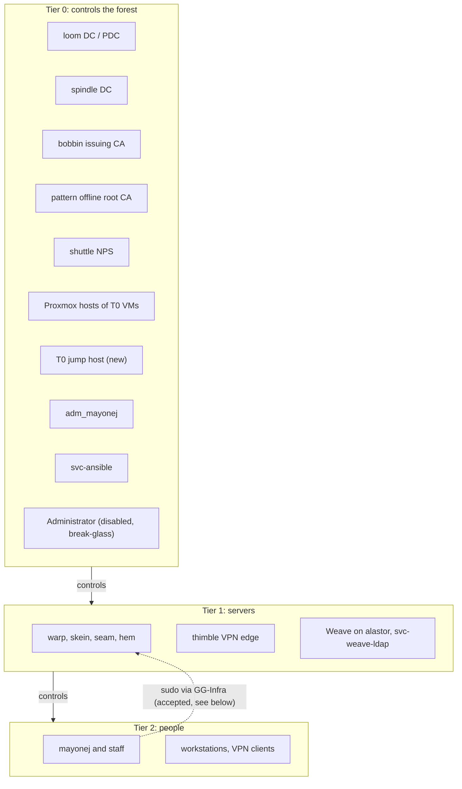
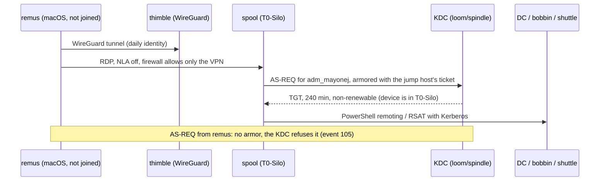
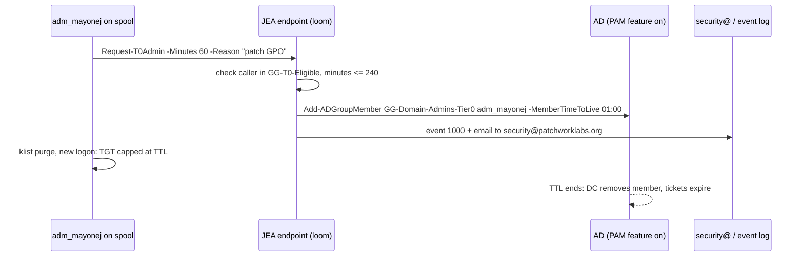
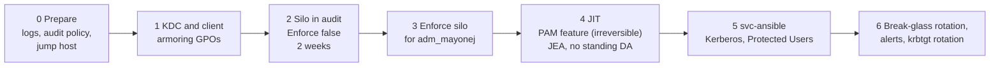

# AD tiering, silos and just-in-time admin

Status: **approved in part**. See [Decisions (2026-10-14)](#decisions-2026-10-14). This document changes nothing by itself. Each live step in the rollout starts only after its approval. The steps that you cannot undo are in **bold**.

This design covers the `patchwork.internal` forest:

1. The tier model.
2. An authentication policy silo for Tier 0.
3. Just-in-time (JIT) Domain Admin.
4. The break-glass account.
5. LAPS.
6. A phased rollout, audit mode first, and which tool owns each piece after the rollout.

## Decisions (2026-10-14)

| # | Topic | Decision |
|---|---|---|
| 1 | Tier placement | Approved. bobbin, shuttle and the Proxmox hosts of the Tier 0 VMs are Tier 0. |
| 2 | pattern | pattern is the offline root CA. Keep it off and out of the domain. |
| 3 | Jump host | Approved. NLA off, firewall limited to Jasper's VPN address, Proxmox console as the fallback. Name: `spool` (computer object `SPOOL`). |
| 4 | `T0-Silo` | Approved. 240-minute non-renewable TGT. Audit mode first. |
| 5 | PAM optional feature | **Not approved yet.** Read [What JIT looks like in practice](#what-jit-looks-like-in-practice) for the lockout analysis. |
| 6 | JIT limits | Approved: 1 h default and 4 h max for Domain Admins, 1 h for Enterprise Admins, justification required. `adm_mayonej` loses standing Domain Admins, Enterprise Admins, DnsAdmins and DHCP Administrators only after JIT works and is tested. |
| 7 | Alerts | Email to `security@patchworklabs.org` only. No webhook. |
| 8 | `svc-ansible` | Approved: compensating controls now, then Kerberos with Protected Users, then a Tier 0 control node. |
| 9 | Break-glass | Approved with a change: nobody stores or remembers the `Administrator` password. The account stays disabled. See [section 4](#4-break-glass). Remove it from Enterprise Admins and Schema Admins. |
| 10 | `krbtgt` | Approved: two resets, 10 hours or more apart. |
| 11 | AD Recycle Bin | Approved and **done** on 2026-10-14. `EnabledScopes` = `CN=Partitions,CN=Configuration,DC=patchwork,DC=internal`. |

Also done on 2026-10-14: the real `converge.ps1` Build ran. It made the `OU=Patchwork` tree, the `GG-*` groups and the fine-grained password policies (PSOs), and it disabled the built-in `Administrator`. Some live facts below are from before that run. The notes in the tables say which.

## Facts read from the live forest

These facts come from read-only `Get-*` queries against loom on 2026-10-14, before the converge Build and the Recycle Bin change of the same night. No change was made by these queries.

| Item | Live value |
|---|---|
| Forest functional level | `Windows2025Forest` |
| Domain functional level | `Windows2025Domain` |
| DCs | loom and spindle, both Windows Server 2025 Datacenter (10.0.26100), both GC. loom holds all five FSMO roles. |
| Optional features | Privileged Access Management: **not enabled**. Recycle Bin: not enabled at query time, **enabled later on 2026-10-14**. Database 32k Pages: not enabled. |
| Authentication policies and silos | None |
| KDC "claims, compound authentication and Kerberos armoring" | Not configured on loom (no policy value) |
| Kerberos client armoring policy | Not configured on loom |
| NTLM restriction or NTLM audit policy | Not configured (`RestrictNTLMInDomain`, `AuditNTLMInDomain`, `LmCompatibilityLevel` have no value) |
| `Microsoft-Windows-Authentication/*` logs | All four exist and are **disabled**, `AuthenticationPolicyFailures-DomainController` too |
| Audit policy (loom) | Logon: success and failure. Credential Validation, Kerberos Authentication Service, Security Group Management: success only |
| Fine-grained password policies | None at query time. The converge Build added them later the same night. |
| Windows LAPS | Schema has the `msLAPS-*` attributes. `Get-LapsADPassword` exists. loom, spindle, bobbin and shuttle all have a LAPS password, expiry 2026-11-11. skein has none (Linux). |
| GPOs | `Default Domain Policy`, `Default Domain Controllers Policy`, `Cert-AutoEnroll` (domain), `LAPS-DSRM` (Domain Controllers), `LAPS-Local-Admin` (Member-Servers), `Client-Baseline` (Staff-Production), `Tier0-Admin-Protection` (Staff-Computers) |
| `Tier0-Admin-Protection` | Denies local logon and RDP logon to `Domain Admins` on Staff-Computers |
| Computer objects | LOOM, SPINDLE (Domain Controllers), BOBBIN, SHUTTLE, SKEIN (Member-Servers). No object for pattern. |

### Privileged groups

| Group | Members |
|---|---|
| Domain Admins | `Administrator`, `adm_mayonej`, `svc-ansible` |
| Enterprise Admins | `Administrator`, `adm_mayonej` |
| Schema Admins | `Administrator` |
| Administrators | `Administrator`, `Domain Admins`, `Enterprise Admins` |
| Protected Users | `adm_mayonej` |
| DnsAdmins | `adm_mayonej` |
| Group Policy Creator Owners | `Administrator` |
| Cert Publishers | `BOBBIN$` |
| Account, Backup, Server, Print Operators | empty |
| `GG-Domain-Admins-Tier0` | did not exist at query time. The converge Build made it later the same night. |

### Privileged accounts

| Account | Facts |
|---|---|
| `Administrator` | Enabled at query time. **Last logon 2026-10-12.** Password set 2026-08-09, never expires. Not "sensitive and cannot be delegated". **The converge Build disabled it later on 2026-10-14.** |
| `adm_mayonej` | Enabled. In `OU=Admin-Accounts,OU=Administrative,OU=Patchwork-Objects`. Password set 2026-10-14. Also in `pve-operators`, `DHCP Administrators`, `DnsAdmins`. Not "sensitive and cannot be delegated". `msDS-SupportedEncryptionTypes` = 0. |
| `svc-ansible` | Domain Admins. AES only (24), not delegatable, password never expires. Last logon 2026-10-14. Ansible logs in with NTLM over WinRM HTTP 5985 (`group_vars/windows.yml`). |
| `krbtgt` | Password set 2026-08-09 (forest creation). Never rotated. |
| `mayonej` | Jasper's daily account. In `G_Board` only. |

### Name drift

The repo and the forest use different names today. This document uses the **live** names.

| Live | `ad/org.json` and `ad/README.md` |
|---|---|
| `adm_mayonej` | `jasper.adm` |
| `mayonej` | `jasper` |
| `OU=Patchwork-Objects` tree (objects not yet moved) | `OU=Patchwork` tree (built 2026-10-14, objects move at Migrate) |

Another change moves `adm_mayonej` into `GG-Domain-Admins-Tier0` and adds fine-grained password policies. This document does not touch `org.json` or `converge.ps1`. The sections below say what those files must change later.

## 1. Tier model

The rule: an account of tier N logs on only to assets of tier N. A higher tier can control a lower tier. A lower tier must never hold credentials or sessions of a higher tier.

| Tier | Assets | Accounts |
|---|---|---|
| **0** | loom, spindle (DCs). bobbin (issuing CA). pattern (offline root CA). shuttle (NPS). The Proxmox hosts that run these VMs. The proposed Tier 0 jump host. remus, as long as it holds the `svc-ansible` password. | `adm_mayonej`, `svc-ansible`, `Administrator` (disabled), DSRM (LAPS-DSRM) |
| **1** | warp, skein, seam, hem (NixOS). thimble (VyOS edge). App servers. Weave and the host that runs it (alastor today, warp later). | `lnx-<host>-admins` members. `svc-lnx-join`, `svc-pve-ldap`, `svc-dhcp-dns`, `svc-weave-ldap`. No dedicated Tier 1 person account yet. |
| **2** | Staff workstations (`Computers` OU). VPN sessions. | Daily accounts: `mayonej`, staff, members |



### bobbin: Tier 0 (approved)

bobbin is an enterprise CA. A CA that the forest trusts for smart card logon can issue a certificate for any account, `Administrator` too. A person who controls bobbin controls the forest. `BOBBIN$` is in `Cert Publishers`. bobbin is Tier 0 with no exceptions. pattern, the offline root CA, is Tier 0 for the same reason. It stays off and out of the domain. It has no computer object, so it is outside the silo.

### shuttle: Tier 0 (approved)

shuttle is in Tier 0.

- `svc-ansible`, a Domain Admin, logs on to shuttle over WinRM. Any host where a Tier 0 credential logs on is a Tier 0 host.
- shuttle will check every staff VPN login when the planned IKEv2 VPN goes live. Then an attacker on shuttle can let any device into the lab network and can collect MS-CHAPv2 responses of every VPN user. Today thimble uses WireGuard keys only and does not ask shuttle (`ansible/README.md`, "thimble").
- A separate Tier 1 management identity for one server costs more than this org can maintain.

The other choice is Tier 1 with a separate Tier 1 Ansible account. That removes Domain Admin logons from shuttle. It is a good change if more Windows member servers come later.

### Proxmox: Tier 0 (approved)

A Proxmox administrator can read the disk of a DC VM and take `ntds.dit`. The Proxmox hosts that run loom, spindle, bobbin and shuttle are Tier 0. `adm_mayonej` is in `pve-operators`. That is correct for a Tier 0 account. A daily account must never be in it. Keep `root@pam` on each Proxmox host as the hypervisor break-glass, because an AD login to Proxmox can break during the silo rollout (see risks).

### Tier 1 and Tier 2 today

- Delegated rights below Domain Admins: `GG-T1-Admins` (computer objects in `Servers` and `Computers`, and the helpdesk rights) and `GG-T2-Helpdesk` (reset, unlock, change at next logon in the people OUs). Both are empty. No group except Domain Admins has rights on `Admin-Accounts` or `Servers/Tier0`. See "Delegation" in `README.md`.
- `GG-Infra` gives the daily account sudo on the NixOS hosts. That is a Tier 2 account that administers Tier 1. Accept it for now. The NixOS hosts hold no Tier 0 credentials, and no Tier 0 account is in `GG-Infra`. Later, add a Tier 1 account (`mayonej.t1`) if more people get sudo.
- `Tier0-Admin-Protection` denies Domain Admins local and RDP logon on Staff-Computers. Keep it. Link it to the new `Computers` OU at Migrate (Migrate copies links). Add a second GPO for member servers that are Tier 1, when such Windows servers exist.

### Weave and alastor: Tier 1 (sensitive)

`svc-weave-ldap` can reset the password of, and unlock, each person in `Users/Staff`, `Users/Board-Only`, `Users/Sponsored-Projects` and `Users/Members` (see "Weave" in `README.md`). It controls Tier 2. So by the rule above, Weave is Tier 1, and so is everything that controls Weave:

- alastor, the host that runs Weave today. Root on alastor can read `weave-ldap.age` after agenix decrypts it. alastor also terminates public traffic for many other services. A break-in through any of them is a break-in into Weave.
- The Weave code and its deploy path: write access to `patchworklabsorg/weave`, its CI, and the `weave-deploy` SSH key.
- The admins of Weave, and the recipients of `weave-ldap.age` (`jsp`, `alastor`).
- Weave is also the sign-in for Google Workspace, so Weave already controls the Google identity of each person.

Weave can reach Tier 1 through one path: a reset of `mayonej`, whose `GG-Infra` membership gives sudo on the NixOS hosts. The same path exists for helpdesk (see "Tier 1 and Tier 2 today"). Today `mayonej` has `adminCount=1`, so no inherited right reaches it, Weave included. After a Domain Admin clears `adminCount`, Weave can reset it.

Weave has no path to Tier 0. The denies on `Admin-Accounts`, `Service-Accounts` and `Servers/Tier0`, and AdminSDHolder on protected accounts, keep it out. A Tier 0 account must never get a `weaveId`, and must never sign in through Weave.

Rules:

- Treat alastor as sensitive. Keep the agenix recipients of `weave-ldap.age` to `jsp` and the Weave host.
- Move Weave to warp when the move is ready. warp runs only Patchwork apps.
- Rotate the `svc-weave-ldap` password when somebody leaves the Weave admins or the recipient list.
- Watch the DC security log for password resets (event 4724) by `svc-weave-ldap` on accounts outside the people OUs. There must be none.

## 2. Authentication policy silo for Tier 0

### What a silo does

An authentication policy controls the Kerberos TGT of an account. It sets a short, non-renewable TGT lifetime. It can also set "allowed to authenticate from": the KDC gives a TGT only when the request comes from an allowed device. The device must armor the request (Kerberos FAST) with its own computer ticket. A silo groups users and computers so that one condition ("the device is in the silo") covers them all.

Important limits:

- **NTLM fails** for an account whose policy has access control conditions. The DC logs event 101.
- The built-in `Administrator` (RID 500) is **always exempt** from authentication policies, also when it is in a silo. The silo does not protect it. It stays disabled (section 4), and any Domain Admin can enable it for recovery.
- A device that is not domain joined has no computer ticket. It cannot armor a request. remus (macOS, not joined) can never satisfy "allowed to authenticate from".

### Proposed objects

| Object | Value |
|---|---|
| Silo | `T0-Silo` |
| User policy | `T0-User`: `UserTGTLifetimeMins 240`, `UserAllowedToAuthenticateFrom` = device in `T0-Silo` |
| Computer policy | `T0-Computer`: no TGT lifetime (Microsoft says not to set one for computers), no conditions at first |
| Service policy | `T0-Service`: for `svc-ansible`, see below |
| Silo members, computers | `LOOM$`, `SPINDLE$`, `BOBBIN$`, `SHUTTLE$`, `SPOOL$` |
| Silo members, users | `adm_mayonej` |
| Not in the silo | `Administrator` (exempt anyway), `svc-ansible` (phase 5), all daily and Tier 1 accounts |

The SDDL for `UserAllowedToAuthenticateFrom`. In this attribute `@USER` means the device account:

```text
O:SYG:SYD:(XA;OICI;CR;;;WD;(@USER.ad://ext/AuthenticationSilo == "T0-Silo"))
```

Sketch, for review only. Do not run it before the approval in phase 2:

```powershell
New-ADAuthenticationPolicy -Name T0-User -UserTGTLifetimeMins 240 `
  -UserAllowedToAuthenticateFrom 'O:SYG:SYD:(XA;OICI;CR;;;WD;(@USER.ad://ext/AuthenticationSilo == "T0-Silo"))' `
  -Enforce:$false -ProtectedFromAccidentalDeletion $true
New-ADAuthenticationPolicy -Name T0-Computer -Enforce:$false -ProtectedFromAccidentalDeletion $true
New-ADAuthenticationPolicySilo -Name T0-Silo -UserAuthenticationPolicy T0-User `
  -ComputerAuthenticationPolicy T0-Computer -ServiceAuthenticationPolicy T0-Service `
  -Enforce:$false -ProtectedFromAccidentalDeletion $true
foreach ($a in 'LOOM$','SPINDLE$','BOBBIN$','SHUTTLE$','SPOOL$','adm_mayonej') {
  Grant-ADAuthenticationPolicySiloAccess -Identity T0-Silo -Account $a
  Set-ADAccountAuthenticationPolicySilo -Identity $a -AuthenticationPolicySilo T0-Silo
}
```

Prerequisites:

1. A GPO on the Domain Controllers OU: "KDC support for claims, compound authentication and Kerberos armoring" = **Supported**. "Supported" does not require armoring from other clients, so it breaks nothing.
2. A GPO on the Tier 0 member servers and the jump host: "Kerberos client support for claims, compound authentication and Kerberos armoring" = **Enabled**.
3. The `AuthenticationPolicyFailures-DomainController` log enabled on both DCs.

### How the admin logs in without a domain-joined PAW

remus cannot armor. So `adm_mayonej` must never type its password into remus for a Kerberos logon. The proposal: one Tier 0 jump host.

- A Windows Server 2025 VM on the Tier 0 Proxmox host, joined, in `T0-Silo`. It holds RSAT, GPMC, the AD module and the JIT client.
- It is on the server VLAN. Its firewall and thimble allow RDP to it only from Jasper's VPN address.
- Name: `spool`. Built 2026-10-20: `terraform/proxmox/windows.tf`, offline domain join into `Servers/Tier0`, `ansible/jump-host.yml` for the consoles and the RDP shortcuts.

#### What NLA is

Network Level Authentication (NLA) is an RDP setting. With NLA on, Windows checks the login before it opens the RDP session. The client must prove the password first, with Kerberos or NTLM. Without NLA, Windows opens the session and shows its own logon screen. Then you type the password on the server.

#### Why the Mac fails with NLA on

The difficulty is RDP from macOS. With NLA on, the Mac client authenticates first with CredSSP. CredSSP uses NTLM or Kerberos from the Mac. NTLM fails (Protected Users and the silo). Kerberos from the Mac is not armored, so the KDC refuses the TGT. Two working paths:

| Path | How | Risk |
|---|---|---|
| A. NLA off on the jump host only | The Mac opens the RDP session without pre-authentication. The logon happens on the jump host's own logon screen. The jump host armors the request. | The logon screen is open to anyone who reaches TCP 3389. The firewall limits that to Jasper's VPN address. Patch the jump host first. |
| B. Proxmox console | Open the `spool` console in the Proxmox web UI (noVNC or SPICE) and log on there. | Depends on the Proxmox login. Slower to use. Good as a fallback. |

Decision: path A is the daily path, path B is the fallback. From the jump host, manage the DCs, bobbin and shuttle with PowerShell remoting or RSAT (Kerberos network logon, no TGT request on the target). For RDP to a Tier 0 server, use `mstsc /remoteGuard`. Protected Users blocks the credential delegation that plain CredSSP needs.



The other choice is a domain-joined Windows VM on remus as a PAW. The host (remus) is not trusted, so that VM is weaker than a jump host on Tier 0 hardware. It is not recommended.

### svc-ansible under a silo

Today Ansible runs on remus, logs in as `PATCHWORK\svc-ansible` with NTLM over WinRM HTTP, and needs the password from the vault. remus is not joined. So:

- In `T0-Silo` with the `T0-User` condition: NTLM fails (event 101). Kerberos from remus has no armor and fails (event 105). **Ansible stops.**
- In Protected Users: NTLM fails. **Ansible stops.** `ad.yml -t audit` already flags this.

Recommendation, in three steps:

| Step | Change | Result |
|---|---|---|
| 5a. Now | Keep `svc-ansible` out of the silo and out of Protected Users. Add compensating controls (list below). | Ansible works as today. |
| 5b. Kerberos | Switch WinRM to Kerberos: `ansible_winrm_transport: kerberos`, `pywinrm[kerberos]` on the control node, `kinit` from the vault password. Kerberos needs names, not IPs: set `ansible_winrm_kerberos_hostname_override` or use FQDNs. Then put `svc-ansible` in Protected Users, and give it `T0-Service` with `UserTGTLifetimeMins 60` and **no** device condition. | No NTLM for the most powerful service account. Short TGT. Works from remus because there is no device condition. |
| 5c. Tier 0 control node | Move the Ansible control node off remus to a joined Tier 0 host (for example, the jump host with WSL, or a small NixOS Tier 0 VM joined with sssd). Add the device condition to `T0-Service`. | remus no longer holds a Domain Admin password and stops being a Tier 0 asset. |

A Linux control node can armor with its machine keytab (MIT `kinit -T`). Test in audit mode (event 305) before you enforce, because AD device claims from an MIT client are not tested in this forest.

Compensating controls for step 5a:

- The WinRM firewall rule allows only Jasper's VPN address (`Enable-AnsibleWinRM.ps1 -RemoteAddress`). Today the scope is the control node subnet. Make it one address. This needs the thimble NAT removed first: with NAT, every VPN client arrives as 10.100.92.20.
- A GPO denies `svc-ansible` local logon, RDP logon, batch and service logon on every host.
- Keep AES only and "not delegatable" (`-t svc-posture`, already live).
- Alert on any logon of `svc-ansible` (4624, 4776) from an address other than the VPN address (one address per person only after the NAT is removed). Alert on any group change that it makes outside an Ansible run.
- Rotate the password on a schedule and after any remus incident.

## 3. PAM and just-in-time admin

### The options

| Option | What it is | For | Against |
|---|---|---|---|
| a. AD PAM optional feature | `Enable-ADOptionalFeature 'Privileged Access Management Feature'`. Then `Add-ADGroupMember -MemberTimeToLive`. The DC removes the member when the TTL ends. The KDC caps every Kerberos ticket at the remaining TTL. | Expiry is done by the DC, not by a script. Tickets die with the membership. The forest is already at 2025 level. | **Irreversible.** It needs forest level 2016 or later (met). |
| b. Scripted JIT without the feature | A script adds the member and a scheduled task removes it later. | Reversible. | If the task fails, the membership stays: standing admin. Tickets live up to 10 hours after removal. |
| c. No standing DA except break-glass | Use `Administrator` for every admin task. | Simple. | Exempt from silos, shared, no name in the logs. It makes the break-glass a daily account, which is the problem today. |

### Recommendation: a + a JEA request endpoint

Use the AD PAM feature (a) and put a small request flow on top of it, modeled on `terraform/gcp-org/pam.tf` and the `tf` wrapper.

| GCP PAM (`pam.tf`, `tf`) | AD JIT (proposed) |
|---|---|
| Entitlement `org-admin`, max 1 h | Entitlement `t0-da`: membership of `GG-Domain-Admins-Tier0`, default 1 h, max 4 h |
| Entitlement `infra-admin`, max 4 h | Entitlement `t0-ea`: membership of `Enterprise Admins`, max 1 h, rarely used |
| Eligible principals: the admins group | Eligible: a new group `GG-T0-Eligible` with `adm_mayonej` |
| Justification required, no approval | Justification required, no approval. One admin cannot approve their own request. |
| Email to `security@`, audit sink | A Windows event on the DC, and an email to `security@patchworklabs.org` |
| `tf apply` asks for a grant, reuses an open grant | `Request-T0Admin` asks for a grant, reuses an open TTL membership |

Why a JEA endpoint: `GG-Domain-Admins-Tier0` is nested in Domain Admins. AdminSDHolder (SDProp) resets the ACL of protected groups every 60 minutes. A delegated "write members" right on the group disappears. So the request must run as a principal that already has the right. A Just Enough Administration (JEA) endpoint on loom and spindle does that:

- It runs as a virtual account on the DC.
- Only `GG-T0-Eligible` can connect, and only with Kerberos from `spool` (the silo).
- It exposes one function: `Request-T0Admin -Entitlement t0-da -Minutes 60 -Reason "..."`. The function checks the limits, calls `Add-ADGroupMember -MemberTimeToLive`, writes an event to a custom `Patchwork-JIT` log, and sends the notification.



What this protects: `adm_mayonej` has no standing Domain Admin. A stolen `adm_mayonej` session outside a grant can do nothing at Tier 0 except request a grant, and each request is logged and sent out. What this does not protect: an attacker with `adm_mayonej` on the jump host can request a grant. With one admin, there is no second person to approve. That is the same as the GCP setup today.

### What JIT looks like in practice

A worked example. Jasper must change a GPO on a Tuesday evening.

1. Jasper connects to the thimble VPN from remus with the daily account.
2. Jasper opens RDP to `spool` and logs on as `adm_mayonej`. The account is in Protected Users and in `T0-Silo`, but it has no Domain Admin rights now.
3. In PowerShell on `spool`: `Request-T0Admin -Entitlement t0-da -Minutes 60 -Reason "Change Client-Baseline firewall rule"`.
4. The JEA endpoint on loom adds `adm_mayonej` to `GG-Domain-Admins-Tier0` with a TTL of 1 hour. It writes an event and sends an email to `security@patchworklabs.org`.
5. Jasper logs off and on again (or runs `klist purge`). The new TGT carries Domain Admins. The KDC caps it at the time left in the grant.
6. Jasper opens GPMC and makes the change.
7. After 1 hour the DC removes the membership. The tickets expire at the same time. Nothing must be cleaned up.

If the work takes longer, Jasper requests again, up to 4 hours for each grant.

#### Can JIT lock out the only admin?

Short answer: enabling the feature alone cannot. The risk starts only when standing Domain Admin is removed from `adm_mayonej`.

| Step | Lockout risk | Why |
|---|---|---|
| Enable the PAM optional feature | None | It adds the TTL option to group membership. It changes no existing membership, ACL or logon. No TTL membership exists until someone makes one. |
| Install the JEA endpoint | None | It adds a new way in. It removes nothing. |
| Test grants while `adm_mayonej` still has standing Domain Admin | None | The standing membership stays. A broken grant changes nothing. |
| Remove standing Domain Admin from `adm_mayonej` | Low | Only this step removes access. It happens only after JIT works and is tested (decision 6). |

The fallbacks if JIT breaks after standing Domain Admin is gone:

1. **`svc-ansible`** keeps standing Domain Admin. From remus, Ansible can add `adm_mayonej` back to `GG-Domain-Admins-Tier0` with no TTL.
2. **The built-in `Administrator`**. It is disabled, and nobody knows its password. Any Domain Admin path (a JIT grant or `svc-ansible`) can reset its password and enable it. The silo always exempts it.
3. **DSRM on each DC**. LAPS manages the DSRM password (`LAPS-DSRM`). Boot a DC into Directory Services Restore Mode from the Proxmox console and use it. This is the last resort.

A lockout needs all three to fail at the same time: the JEA endpoint, the `svc-ansible` password, and the DSRM passwords in AD. Read the DSRM passwords (`Get-LapsADPassword -Identity loom -AsPlainText` as a Domain Admin) only during an incident. Do not keep a copy.

### Changes to org.json and converge.ps1 (later PR)

`Sync-Members` makes the group members match `org.json`. It would remove JIT members, or add `adm_mayonej` back as standing. Before JIT goes live:

- `GG-Domain-Admins-Tier0`: set `"members": []` and `"manageMembers": false`, or add a new flag that tells `Sync-Members` to leave TTL members alone.
- Add `GG-T0-Eligible` with `adm_mayonej`.
- `privileged.allowedDirectMembers`: remove `adm_mayonej` from Enterprise Admins. Report TTL members as "JIT", not as a finding.
- Remove standing `DnsAdmins` and `DHCP Administrators` from `adm_mayonej`. `DnsAdmins` is a known path to Domain Admin, so it belongs inside the grant.

### What you must approve

Items 2, 3 and 4 are approved (see the decisions table). Item 1 is open.

1. **Enable the Privileged Access Management optional feature in the forest. You cannot disable it after this.** Not approved yet. Command: `Enable-ADOptionalFeature 'Privileged Access Management Feature' -Scope ForestOrConfigurationSet -Target patchwork.internal`.
2. Remove `adm_mayonej` from standing Domain Admins (through `GG-Domain-Admins-Tier0`), Enterprise Admins, DnsAdmins and DHCP Administrators.
3. The maximum grant length (proposed: 1 h default, 4 h max for `t0-da`, 1 h for `t0-ea`).
4. The notification target for grants and break-glass use. Decided: `security@patchworklabs.org`.

## 4. Break-glass

The built-in `Administrator` is the break-glass account. It logged on 2026-10-12, so it was in use as a working account. The converge Build disabled it on 2026-10-14. It is in Enterprise Admins, Schema Admins and Group Policy Creator Owners.

Decision: nobody stores or remembers the `Administrator` password.

- Set a long random password (at least 64 characters) that is generated and discarded. Nobody sees it, and nobody keeps it. No password manager, no paper copy, no Ansible vault, no agenix.
- Keep the account disabled.
- Recovery: any Domain Admin path resets the password and enables the account. The paths are `adm_mayonej` (standing today, through a JIT grant later) and `svc-ansible` (standing Domain Admin).
- Last resort: DSRM on a DC. `LAPS-DSRM` manages that password. Boot the DC into Directory Services Restore Mode from the Proxmox console.
- After each use, set a new discarded random password and disable the account again.
- Keep it out of Protected Users and out of the silo. It must work when Kerberos is broken, and the silo exempts it anyway.
- Set "Account is sensitive and cannot be delegated".
- Remove it from Schema Admins and Enterprise Admins. As a Domain Admin in the forest root it can add itself back when needed. Leave Schema Admins empty. This needs a change to `allowedDirectMembers` in `org.json`.
- DSRM passwords are already managed by `LAPS-DSRM`. They are the last break-glass, also for a DC that does not boot into AD.
- `root@pam` on each Proxmox host is the hypervisor break-glass.

### GPO: Administrator account status = Disabled

`ansible-playbook ad.yml -t admin-disabled-gpo` makes the GPO `T0-Builtin-Administrator-Disabled`. It sets Computer Configuration > Windows Settings > Security Settings > Local Policies > Security Options > "Accounts: Administrator account status" = Disabled. In `GptTmpl.inf` that is `[System Access]` `EnableAdminAccount = 0`. `converge.ps1` already disables the account (`builtinAdministrator.enabled` is `false`). The GPO is a second control: the DCs disable the account again by themselves.

Where the GPO is linked:

- A DC reads this setting **only from a GPO linked to the domain root**. A link on the Domain Controllers OU has no effect for this setting (Microsoft KB 259576, "Group Policy application rules for domain controllers"). So the GPO is linked to `DC=patchwork,DC=internal`.
- A security filter limits it to the DCs. The `Domain Controllers` group has Apply. `Authenticated Users` has Read only (MS16-072 needs Read), not Apply. So member servers and workstations do not apply it.
- It does not go to member servers or workstations. There LAPS manages the local Administrator account (`LAPS-Local-Admin`, section 5). LAPS needs that account enabled.

Break-glass with this GPO:

1. As a Domain Admin (`adm_mayonej`, a JIT grant later, or `svc-ansible`), disable the link of `T0-Builtin-Administrator-Disabled` on the domain root in GPMC. Or run `Set-GPLink -Name T0-Builtin-Administrator-Disabled -Target 'DC=patchwork,DC=internal' -LinkEnabled No`.
2. Wait for AD and SYSVOL to replicate to the DC that you will use, or run `gpupdate /target:computer /force` on it.
3. Reset the password and enable the account.
4. After the work: set a new discarded password (`-t administrator-random -e ad_admin_random_force=true`), disable the account, and enable the link again: `Set-GPLink -Name T0-Builtin-Administrator-Disabled -Target 'DC=patchwork,DC=internal' -LinkEnabled Yes`. `-t admin-disabled-gpo` warns while the link is disabled.

If you skip step 1, the DC disables the account again at a security policy refresh. DCs check for policy changes every 5 minutes. The security settings apply again when a GPO changes, and also on their own (about every 16 hours by default). Do not count on the time between them. Note also: Windows does not disable the account while it is in use on that DC.

Alerting on use:

- On both DCs, an event-triggered scheduled task for 4722 (account enabled) and 4724 (password reset) on the account whose SID ends in `-500`, and for 4768 (TGT), 4776 (NTLM validation) and 4624 by that account. The task sends an email to `security@patchworklabs.org`.
- Nothing ships DC logs off the DCs yet. The task is the smallest working alert. Event forwarding to a central log can replace it later.
- Test the alert every quarter: enable the account, log on once, then set a new discarded password and disable it.

## 5. LAPS

Windows LAPS is already deployed. All four Windows hosts have a managed password that expires on 2026-11-11 (30-day cycle). `LAPS-DSRM` covers the DC DSRM accounts. `LAPS-Local-Admin` covers Member-Servers.

The GPO values were not readable with `Get-GPRegistryValue` in this check. Check these settings by hand and record them here:

| Setting | Recommended value |
|---|---|
| Backup directory | Active Directory |
| Password encryption | Enabled |
| Authorized decryptor | `GG-Domain-Admins-Tier0` for Tier 0 hosts. A Tier 1 group for Tier 1 Windows hosts, when they exist. |
| Password age | 30 days (live) |
| Complexity and length | Large letters, small letters, numbers, specials. 20 characters or more. |
| Post-authentication action | Reset the password and log off, 8 h grace |

Other recommendations:

- Read rights: run `Find-LapsADExtendedRights` on each computer OU. Only the Tier 0 group may read Tier 0 passwords. Remove any other reader.
- Migrate: the `LAPS-Local-Admin` link moves to the new `Servers` OU when `converge.ps1 -Phase Migrate` copies the links. Check `Get-LapsADPassword -Identity bobbin` metadata (not the value) after the move.
- Workstations: add a LAPS GPO on the `Computers` OU with a Tier 2 reader group when the first Windows workstation joins.
- NixOS hosts do not use LAPS. Their local accounts come from `modules/common`.

## 6. Phased rollout

Each phase starts only after you approve it. Each phase has a check and a rollback. Run it on loom (the PDC emulator).



### Phase 0: prepare

- Enable `Microsoft-Windows-Authentication/AuthenticationPolicyFailures-DomainController` and `ProtectedUserFailures-DomainController` on both DCs.
- Audit policy on the DCs: Kerberos Authentication Service and Kerberos Service Ticket Operations, success and failure. Credential Validation, success and failure. Today failures are not logged.
- Build `spool`, the jump host. Join it. Done 2026-10-20. `converge.ps1` also put `SPOOL$` in `T0-Silo`, which is still in audit mode, so the silo blocks nothing.
- Check that `adm_mayonej` can log on to the jump host and run RSAT with Kerberos.
- Rollback: disable the logs. No risk.

### Phase 1: armoring GPOs

- Domain Controllers OU: "KDC support for claims, compound authentication and Kerberos armoring" = Supported.
- Tier 0 members and the jump host: "Kerberos client support for claims, compound authentication and Kerberos armoring" = Enabled.
- Check: `klist` on the jump host shows armored tickets after a new logon. No new failures in the System log.
- Rollback: unlink the GPOs.

### Phase 2: silo in audit mode

- Create `T0-User`, `T0-Computer` and `T0-Silo` with `-Enforce:$false`. Add the members.
- Use every admin path for two weeks: jump host, PowerShell remoting, RDP with Remote Credential Guard to bobbin and shuttle, Proxmox login with AD, GPMC, AD CS console.
- Check every day:

  ```powershell
  Get-WinEvent -LogName 'Microsoft-Windows-Authentication/AuthenticationPolicyFailures-DomainController' -ErrorAction SilentlyContinue |
    Where-Object Id -in 101,105,106,305,306 |
    Select-Object TimeCreated, Id, Message
  ```

  Event 305 means "would refuse a TGT". Event 306 means "would refuse a service ticket". Run the query on both DCs.
- Exit rule: no 305 or 306 events for paths that must keep working. Any remaining event matches a path that you accept to lose (for example, a logon from remus).
- Rollback: `Remove-ADAuthenticationPolicySilo`. It is audit mode, so nothing breaks.

### Phase 3: enforce

- `Set-ADAuthenticationPolicy T0-User -Enforce $true` and `Set-ADAuthenticationPolicySilo T0-Silo -Enforce $true`.
- Change the `adm_mayonej` password after you enforce, so that no old cached credential works (Microsoft guidance).
- Check: a logon attempt with `adm_mayonej` from a non-silo host fails with event 105.
- Rollback: as `Administrator` (exempt), set `-Enforce $false` on both objects.

### Phase 4: JIT

- **Enable the PAM optional feature. This cannot be undone.**
- Deploy the JEA endpoint on loom and spindle. Create `GG-T0-Eligible`.
- Merge the `org.json` and `converge.ps1` changes from section 3 first, so a converge run does not undo JIT.
- Request one grant. Check that the membership has a TTL: `Get-ADGroup GG-Domain-Admins-Tier0 -Properties member -ShowMemberTimeToLive`.
- Then remove the standing memberships of `adm_mayonej`.
- Rollback: add `adm_mayonej` back to `GG-Domain-Admins-Tier0` without a TTL. The feature stays on, which is harmless.

### Phase 5: svc-ansible

- 5a compensating controls first. Then 5b (Kerberos transport, Protected Users, `T0-Service`) in audit mode, then enforced. Then 5c when a Tier 0 control node exists.
- Check: `ansible windows -m ansible.windows.win_ping` and `ansible-playbook ad.yml -t audit` after each step. Update the "Connection" section of `ansible/README.md` and `ad_audit_service_accounts` in `ad.yml`, which today requires `svc-ansible` to stay out of Protected Users.
- Rollback: remove `svc-ansible` from Protected Users and return to NTLM.

### Phase 6: break-glass and krbtgt

- Set a discarded random password on `Administrator` and keep it disabled (section 4). Remove it from Enterprise Admins and Schema Admins. Install and test the alert task.
- Rotate the `krbtgt` password two times (approved), with at least 10 hours (the maximum TGT lifetime) between the two resets. It has not changed since the forest was built, and `Administrator` was in daily use.

### Who owns each piece after the rollout

| Piece | Owner | Why |
|---|---|---|
| `T0-Silo`, `T0-User`, `T0-Computer`, `T0-Service`, silo members | `converge.ps1`, from a new `tiering` block in `org.json` | It already owns the privileged groups and reports on them. Directory objects belong there. |
| `GG-T0-Eligible`, TTL-aware `GG-Domain-Admins-Tier0` | `converge.ps1` | Same as above. It must report TTL members as JIT, not remove them. |
| PAM optional feature | By hand, once | One irreversible command. Do not put it in a script that runs again. |
| JEA endpoint and `Request-T0Admin` | Ansible, new tag `ad.yml -t jit-endpoint` | It installs files and a session configuration on each DC. |
| Authentication logs on the DCs | Ansible, new tag `ad.yml -t authn-log` | The same pattern as `-t dns-log`. |
| Silo and JIT report | Ansible, new tag `ad.yml -t tiering-audit`, report only | Lists silo state, 101/105/305/306 counts, standing privileged members, open TTL grants. Fails with `-e ad_audit_strict=true`. |
| Break-glass alert task | Ansible, new tag `ad.yml -t breakglass-alert` | Same on both DCs. |
| Armoring GPOs, deny-logon GPOs | By hand today, documented in this file | GPOs are by hand in this repo. Move them to code when GPO management moves to code. |
| `T0-Builtin-Administrator-Disabled` GPO | Ansible, `ad.yml -t admin-disabled-gpo` | Same file handling as `-t default-domain-gpo`. |
| Delegation below Domain Admins, `Admin-Accounts/Tier*`, `Servers/Tier0` | `converge.ps1`, from the `delegation` block in `org.json` | See "Delegation" in `README.md`. |
| `svc-ansible` posture | Ansible `-t svc-posture` and `-t audit` (extend for Protected Users after 5b) | They already own it. |

A sketch of the `org.json` block for the later PR:

```json
"tiering": {
  "silo": "T0-Silo",
  "enforce": false,
  "userPolicy": { "name": "T0-User", "tgtMinutes": 240, "deviceInSilo": true },
  "computerPolicy": { "name": "T0-Computer" },
  "servicePolicy": { "name": "T0-Service", "tgtMinutes": 60, "deviceInSilo": false },
  "users": ["adm_mayonej"],
  "computers": ["LOOM", "SPINDLE", "BOBBIN", "SHUTTLE", "SPOOL"],
  "jit": { "group": "GG-Domain-Admins-Tier0", "eligible": "GG-T0-Eligible", "maxMinutes": 240 }
}
```

## Risks

| Risk | Effect | Mitigation |
|---|---|---|
| Lockout of `adm_mayonej` after enforce | No named admin access | `Administrator` is exempt from silos. Any Domain Admin path (`svc-ansible`) can enable it. Rollback is `-Enforce $false`. Test in audit mode first. |
| NLA off on the jump host | Pre-authentication logon screen reachable | Firewall limits 3389 to Jasper's VPN address. Patch first. Proxmox console as fallback. |
| Proxmox AD login (`svc-pve-ldap`, LDAP bind) for `adm_mayonej` | Can fail under Protected Users or the silo | Watch events 101 and 305 in phase 2. Keep `root@pam`. |
| PAM feature is irreversible | Cannot go back to a forest without it | It changes nothing until a TTL membership exists. Lockout risk comes only from removing standing Domain Admin (see [What JIT looks like in practice](#what-jit-looks-like-in-practice)). |
| `converge.ps1` undoes JIT | Standing DA comes back, or a grant disappears early | Merge the `org.json` and `converge.ps1` change before phase 4. |
| `svc-ansible` stays a NTLM Domain Admin until phase 5 | NTLM relay or password theft from remus gives Domain Admin | Compensating controls in 5a. Move to Kerberos, then to a Tier 0 control node. |
| One admin approves their own JIT requests | No two-person control | Same as GCP PAM. Every grant is logged and sent to `security@`. |
| Nobody knows the `Administrator` password | Break-glass depends on a working Domain Admin path or DSRM | Two independent Domain Admin paths (`adm_mayonej`, `svc-ansible`) plus DSRM through LAPS on each DC. Test the reset path every quarter. |

## Open decisions

1. **Approve enabling the Privileged Access Management optional feature. It is irreversible.** Read [What JIT looks like in practice](#what-jit-looks-like-in-practice) first.

All other decisions are recorded in [Decisions (2026-10-14)](#decisions-2026-10-14). The AD Recycle Bin is enabled.
