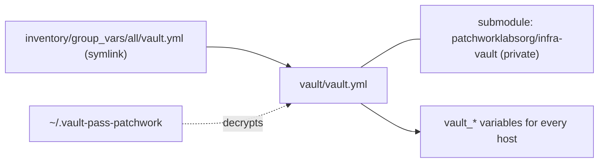
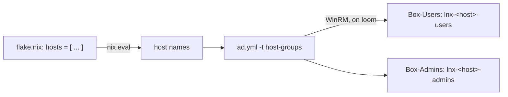
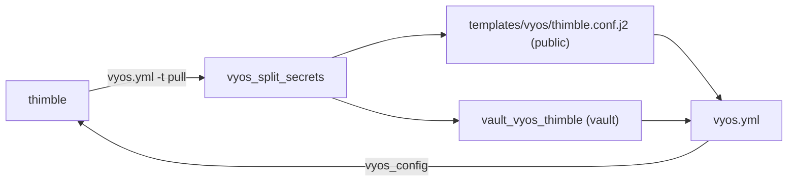

# ansible

Ansible for the Windows side of `patchwork.internal` (the domain controllers, the issuing CA and the NPS server) and for `thimble`, the VPN edge. It also keeps the directory objects that the NixOS hosts need, for example the per-host login groups.

## What this manages

| Host | Address | Group | Role in the forest |
|---|---|---|---|
| `loom` | 10.100.90.10 | `domain_controllers` | PDC emulator, DNS, DHCP |
| `spindle` | 10.100.90.11 | `domain_controllers` | Second DC, DNS |
| `bobbin` | 10.100.90.12 | `member_servers` | Issuing CA |
| `shuttle` | 10.100.90.14 | `member_servers` | NPS / RADIUS for the thimble VPN |
| `spool` | 10.100.90.59 | `jump_hosts` | Tier 0 jump host (`../ad/TIERING.md`). No Tailscale. |
| `thimble` | 10.100.92.20 (verify) | `vyos_edges` | VyOS VPN edge. Staff log in with AD through NPS. |

| Playbook | Target | What it does |
|---|---|---|
| `windows.yml` | `windows` | windows_exporter (`roles/windows_base`) and Tailscale (`roles/tailscale_windows`) |
| `ad.yml` | `domain_controllers` | Directory maintenance. Each job has its own tag. See below. |
| `sync-join-password.yml` | loom | Sets the AD password of `svc-lnx-join` to `../secrets/ad-join.age`, only if they differ. |
| `vyos.yml` | `vyos_edges` | thimble's config, from `templates/vyos/thimble.conf.j2`. |
| `jump-host.yml` | `jump_hosts`, and the DCs and member servers | The RSAT consoles and a `Tier 0` desktop folder on spool, with one RDP shortcut (`mstsc /remoteGuard`) per Tier 0 server. The servers get `DisableRestrictedAdmin = 0`, so they accept Remote Credential Guard. |

Ansible does not manage these hosts:

- `warp`, `skein`, `seam` and `hem`. They are NixOS hosts in `../flake.nix`. `modules/ad-join` joins them to AD.
- `pattern`, the offline root CA. It is stopped and is never a target.

The Proxmox layer (VM creation, templates, the network gear) is not in this repo.

These jobs are done by hand and are not in Ansible: AD CS setup and the offline root signing, NPS policies, and the GPOs other than the two armoring GPOs and the password values of the `Default Domain Policy` (see "Tier 0"). The OUs, users and groups are in `../ad/` (`converge.ps1`).

## Layout

| Path | Contents |
|---|---|
| `ansible.cfg` | Inventory path, roles path, vault password file. |
| `inventory/hosts.yml` | The Windows hosts and thimble. |
| `inventory/group_vars/patchwork.yml` | The forest: realm, DCs, OU DNs, service accounts, DHCP scopes. |
| `inventory/group_vars/windows.yml` | WinRM connection settings. |
| `inventory/group_vars/jump_hosts.yml` | spool: no Tailscale, the RDP targets, the consoles and the RSAT features. |
| `inventory/group_vars/all/main.yml` | Variables for every host. |
| `inventory/group_vars/all/vault.yml` | Symlink to `../../../vault/vault.yml`. |
| `vault/` | Git submodule: `patchworklabsorg/infra-vault` (private). Holds `vault.yml`. |
| `roles/` | `windows_base`, `tailscale_windows`. |
| `bootstrap/Enable-AnsibleWinRM.ps1` | One-time WinRM setup on a new Windows host. |
| `bin/vault-set` | Sets one key in the vault from stdin. |
| `bin/vault-import` | One-time copy of the Patchwork values from the personal vault. |
| `bin/t0-admin` | Asks the `PatchworkT0` endpoint for a just-in-time Domain Admins grant. See "Just-in-time admin". |
| `files/tiering/` | PowerShell that the Tier 0 tags install on the DCs: `PatchworkAlert` (alert events, optional mail), `PatchworkT0` (JEA module and role capability), `Invoke-BreakGlassAlert.ps1`. |
| `templates/vyos/` | VyOS configs as `set` commands, with the secrets replaced by vault references. |
| `filter_plugins/vyos_secrets.py` | Splits the secrets out of a VyOS config. Tested by `tests/`. |

## Prerequisites

1. Install the collections:

   ```sh
   ansible-galaxy collection install -r requirements.yml
   ```

2. Install `pywinrm` and `paramiko` on the control node: `pip install pywinrm paramiko`.
3. Get the vault. The submodule repo is private, so you need read access to `patchworklabsorg/infra-vault`:

   ```sh
   git submodule update --init ansible/vault
   ```

4. Put the vault password in `~/.vault-pass-patchwork`, mode `0600`. `ansible.cfg` reads it from there. It is not the same file as any other vault password on your machine.
5. Make sure that the control node can reach 10.100.90.0/24 on TCP 5985.
6. For `ad.yml -t host-groups`, install Nix with flakes.

## The vault

The secrets are in a separate private repo, `patchworklabsorg/infra-vault`. This repo is public, so the encrypted file does not go here.



- Ansible loads `inventory/group_vars/all/vault.yml` for every host. That file is a symlink into the submodule, so the vault keys are normal `group_vars/all` variables.
- If the submodule is not checked out, the symlink points at nothing and Ansible ignores it. The inventory still loads. A play that needs a secret then fails with an undefined `vault_*` variable.
- The vault repo README lists the keys.
- To set a key, pipe the value in. The script prints only the key name:

  ```sh
  pbpaste | bin/vault-set vault_ad_svc_ansible_password
  ```

  Then commit `vault.yml` in `vault/`, push it, and commit the new submodule pointer here.

- To read or edit the whole file: `ansible-vault edit vault/vault.yml`.

### Move the values from the personal vault (once)

`bin/vault-import` reads the personal `jaspermayone/infra` vault and copies the Patchwork values. It prints key names only.

```sh
bin/vault-import --dry-run   # what it would copy
bin/vault-import
```

- It creates `~/.vault-pass-patchwork` with a random password if the file does not exist. Keep a copy in your password manager.
- It copies `vault_ad_svc_ansible_password` into `vault/vault.yml`. The new names drop the `_patchwork` suffix.
- It writes the join password to `../secrets/ad-join.age` for the recipients in `secrets/secrets.nix`. It is not in the Ansible vault.
- It keeps keys and files that exist. Use `--force` to replace them.

Then commit `vault.yml` in `vault/` and `secrets/ad-join.age` here. After that, delete the `_patchwork` keys from the personal vault.

Refer to secrets by name only. Do not print them.

## Connection

Ansible connects to Windows over WinRM: NTLM over HTTP on port 5985, as `PATCHWORK\svc-ansible`. NTLM encrypts the payload, so the listener needs no certificate. Keep `svc-ansible` out of Protected Users, or NTLM stops.

Each new Windows host needs the listener and a firewall rule once. Run this on the host as an administrator. Use the subnet of your control node:

```powershell
.\bootstrap\Enable-AnsibleWinRM.ps1 -RemoteAddress <control-node-cidr>
```

Then check it from the control node:

```sh
ansible windows -m ansible.windows.win_ping -l <host>
```

## Usage

Run all commands from this directory.

```sh
ansible-playbook windows.yml                  # all Windows hosts
ansible-playbook windows.yml -l shuttle       # one host
ansible-playbook ad.yml -t audit              # report only, changes nothing
ansible-playbook ad.yml -t host-groups        # login groups for every NixOS host
ansible-playbook ad.yml -t dhcp,svc-posture
```

## ad.yml tags

Every tag is opt-in. A run without `-t` does nothing. Directory changes run once, on loom (the PDC emulator), and AD replicates them.

| Tag | What it does |
|---|---|
| `dhcp` | Adds the DHCP exclusion ranges from `dhcp_scopes`. |
| `audit` | Reports join delegation, Protected Users and service-account posture. Changes nothing. Add `-e ad_audit_strict=true` to fail on a finding. |
| `join-delegation` | Gives `svc-lnx-join` the rights to join computers in both computer OUs. |
| `host-groups` | Creates `lnx-<host>-users` and `lnx-<host>-admins` for every NixOS host in the flake. |
| `svc-posture` | Sets AES only and "not delegatable" on `svc-ansible` and `svc-lnx-join`. |
| `user-mail` | Sets the `mail` attribute from `ad_user_mail`. Does nothing while the map is empty. |
| `ldap-binds` | Creates the read-only LDAP bind accounts in `ad_ldap_bind_accounts` (`group_vars/patchwork.yml`). The list is empty until an app needs one; the comment there shows how to add one. |
| `ca-check` | Lists the enterprise CAs in AD and the CA certificates on loom, and checks that `ad_ca_subject_match` selects them. Changes nothing. Run it before `ca-chain`. |
| `ca-chain` | Exports the forest CA chain to `files/pki/patchwork.internal-ca-chain.pem`. |
| `dns-log` | Enables the DNS Analytical log on every DC. |
| `authn-log` | Enables the four `Microsoft-Windows-Authentication/*` logs on every DC. Sets the audit policy for Credential Validation, Kerberos Authentication Service, Kerberos Service Ticket Operations, User Account Management and Security Group Management to success and failure. |
| `armoring` | Makes two GPOs. `T0-Kerberos-Armoring-KDC` on the Domain Controllers OU: "KDC support for claims, compound authentication and Kerberos armoring" = Supported. `T0-Kerberos-Armoring-Client` on the domain root: "Kerberos client support for claims, compound authentication and Kerberos armoring" = Enabled. |
| `default-domain-gpo` | Makes the password and lockout values in the `Default Domain Policy` GPO match `passwordPolicy.default` in `../ad/org.json`, and raises the GPO version. On 2026-10-14 the GPO already matched, so the first run changes nothing. |
| `breakglass-alert` | Installs an event-triggered scheduled task on every DC. It writes event 1000 (source `Patchwork-Alert`) to the Application log of the DC when the built-in Administrator logs on, gets a TGT, is checked with NTLM, is enabled or has its password reset, and when a member is added to Domain Admins, `GG-Domain-Admins-Tier0`, Enterprise Admins, Schema Admins or Administrators. It sends a mail to `security@patchworklabs.org` only when `ad_alert_mail_enabled` is `true`. `-e ad_alert_test=true` writes one test event (event 1001) and mails only when mail is enabled. |
| `administrator-random` | Sets a random 96-character password on the built-in Administrator and sets "sensitive and cannot be delegated". The DC makes the password, and nobody sees it. Refuses while the account is enabled. Changes the password only when the old one is older than 24 hours, or with `-e ad_admin_random_force=true`. |
| `krbtgt-reset` | Resets the `krbtgt` password once. Refuses while the password is younger than 10 hours, or while a DC shows a replication failure. Then each DC pulls the change and the play checks that each DC has it. |
| `jit-endpoint` | Installs the `PatchworkT0` JEA endpoint on every DC. Fails while the AD Privileged Access Management feature is off. It never enables the feature. |
| `admin-disabled-gpo` | Makes the GPO `T0-Builtin-Administrator-Disabled`: "Accounts: Administrator account status" = Disabled. Links it to the domain root and applies it to the `Domain Controllers` group only. See "Built-in Administrator GPO" below. |

Every Tier 0 tag supports `--check`, except that `krbtgt-reset` still refuses in check mode when a guard fails.

## Tier 0

The design is in [`../ad/TIERING.md`](../ad/TIERING.md) (PR #18). `../ad/converge.ps1` owns the directory objects (the silo, the policies, `GG-T0-Eligible`). These tags own what is on the DCs.

### Tier 0 run order

Run each step with `--check` first. Each step starts only after the one before it works. The steps that you cannot undo are in bold.

| # | Command | Check after it |
|---|---|---|
| 1 | `ansible-playbook ad.yml -t authn-log` | `wevtutil gl Microsoft-Windows-Authentication/AuthenticationPolicyFailures-DomainController` shows `enabled: true` on both DCs. |
| 2 | `ansible-playbook ad.yml -t armoring` | In GPMC, both GPOs show the policy by name, not under "Extra Registry Settings". `gpresult /r` on loom lists both. |
| 3 | `ansible-playbook ad.yml -t default-domain-gpo` | The report shows no change, or the changes you expect. |
| 4 | `converge.ps1` Build (silo in audit mode, `tiering.enforce` is `false`) | `Get-ADAuthenticationPolicySilo T0-Silo`. Then read events 305 and 306 every day for two weeks (TIERING.md phase 2). |
| 5 | `ansible-playbook ad.yml -t breakglass-alert -e ad_alert_test=true` | On a DC, `Get-WinEvent -FilterHashtable @{LogName='Application'; ProviderName='Patchwork-Alert'}` shows event 1001. |
| 6 | `ansible-playbook ad.yml -t administrator-random` | The report says "set a new discarded random password". The account is still disabled. |
| 7 | **`ansible-playbook ad.yml -t krbtgt-reset`**, then the same command again 10 hours or more later | Each run reports one reset. The second run refuses if you start it too early. |
| 8 | **Enable the PAM optional feature by hand, once, after approval.** It cannot be undone. | `Get-ADOptionalFeature 'Privileged Access Management Feature'` shows `EnabledScopes`. |
| 9 | `ansible-playbook ad.yml -t jit-endpoint` | The report shows `PATCHWORK\GG-T0-Eligible AccessAllowed`. |
| 10 | `bin/t0-admin 1 "test the JIT endpoint"` | A grant, a `Patchwork-JIT` event on the DC, and `t0-admin status` shows the grant with the time left. |
| 11 | Set `tiering.jit.enabled` to `true` in `../ad/org.json`, run Build | Build logs the grant as INFO and reports `adm_mayonej` as a standing member. |
| 12 | Later: `tiering.jit.removeStanding` `true`, then `tiering.enforce` `true` | TIERING.md phases 3 and 4. |

Command for step 8, on loom, as `adm_mayonej`:

```powershell
Enable-ADOptionalFeature 'Privileged Access Management Feature' -Scope ForestOrConfigurationSet -Target patchwork.internal
```

### Alerts

Mail is off. The variable `ad_alert_mail_enabled` is `false` in `inventory/group_vars/patchwork.yml`. The DCs write each alert to the Application log of the DC. No Google setting is needed.

| Source | Event | Meaning |
|---|---|---|
| `Patchwork-Alert` | 1000 | The built-in Administrator was used, or a privileged group changed. The message has what, when and who. |
| `Patchwork-Alert` | 1001 | Test event from `-e ad_alert_test=true`. |
| `Patchwork-JIT` | 1000 | A JIT grant. The message has the account, the hours, the reason and the end time. |
| `Patchwork-Alert` | 1900 | A mail failed. This happens only when mail is enabled. |

To read the alerts, open Event Viewer on a DC. Go to Windows Logs > Application and filter by the source. Or run this on a DC:

```powershell
Get-WinEvent -FilterHashtable @{LogName='Application'; ProviderName='Patchwork-Alert','Patchwork-JIT'} | Format-List TimeCreated, ProviderName, Id, Message
```

Each DC keeps its own events. A JIT grant makes two events: one from the endpoint, with the reason, and one from the break-glass task, because the grant adds a member to `GG-Domain-Admins-Tier0`. The second event also comes when somebody adds a member without the endpoint. That is on purpose.

### Mail alerts later

This section is optional. Do it only when you want mail.

The DCs send through the Google Workspace SMTP relay, `smtp-relay.gmail.com` port 587 with STARTTLS. They do not log in. The relay accepts mail from the lab WAN address `69.54.28.49`. The sender is `ad-alerts@patchworklabs.org`, the recipient is `security@patchworklabs.org`. These values are in `inventory/group_vars/patchwork.yml` (`ad_alert_*`). The DCs use them only when mail is enabled. No secret is involved.

Do this once in the Google Admin console:

1. Go to Apps > Google Workspace > Gmail > Routing.
2. At "SMTP relay service", click Configure (or Add another rule).
3. Name: `patchwork-ad-alerts`.
4. Allowed senders: "Only addresses in my domains".
5. Authentication: select "Only accept mail from the specified IP addresses". Add `69.54.28.49`. Do not select "Require SMTP Authentication".
6. Encryption: select "Require TLS encryption".
7. Save. The change can take up to an hour.

Then set `ad_alert_mail_enabled: true` and run `ansible-playbook ad.yml -t breakglass-alert,jit-endpoint`. The DCs must reach `smtp-relay.gmail.com` on TCP 587 through thimble. Run `-t breakglass-alert -e ad_alert_test=true`. The test mail arrives at `security@`. The events stay in the Application log.

### Just-in-time admin

`adm_mayonej` asks for Domain Admins for 1 to 4 hours. The `PatchworkT0` endpoint on the DC adds it to `GG-Domain-Admins-Tier0` with a time to live. The DC removes it when the time ends. The endpoint writes event 1000 (source `Patchwork-JIT`). It mails `security@` only when mail is enabled. `Mailed` is `False` while mail is off.

From remus, while `T0-Silo` is in audit mode:

```console
$ bin/t0-admin 1 "Change the Client-Baseline firewall rule"
adm_mayonej@PATCHWORK.INTERNAL's password:
Account     adm_mayonej
Group       GG-Domain-Admins-Tier0
Status      granted
Hours       1
ExpiresUtc  2026-10-20 23:15:00Z
Mailed      False
Next        Run "klist purge" or log on again. The new TGT carries Domain Admins until the grant ends.
```

```console
$ bin/t0-admin status
adm_mayonej@PATCHWORK.INTERNAL's password:
Account      adm_mayonej
Kind         grant
MinutesLeft  58
ExpiresUtc   2026-10-20 23:15:00Z
```

- `kinit` asks for the `adm_mayonej` password. The password goes to `kinit` only. The ticket cache is a temp file, and the script deletes it.
- The script needs `uv` and `kinit`. `uv` gets `pypsrp` and `pyspnego[kerberos]` the first time. The nixpkgs `pypsrp` does not build on macOS today.
- It connects to loom by address (`10.100.90.10`). To use spindle: `T0_DC_IP=10.100.90.11 T0_DC_NAME=spindle.patchwork.internal bin/t0-admin ...`.
- An open grant is not extended. `Status` is then `open`. While `adm_mayonej` is still a standing member, `Status` is `standing` and no grant is made.
- Errors: "PAM feature is off" (step 8 is not done), "is not in GG-T0-Eligible" (wrong account), "The maximum grant is 4 hours".

After the silo is enforced, remus cannot get a TGT for `adm_mayonej`, because it is not joined and cannot armor the request. Then ask for the grant on `spool`, in PowerShell as `adm_mayonej`:

```powershell
Enter-PSSession -ComputerName loom.patchwork.internal -ConfigurationName PatchworkT0
Request-T0Admin -Hours 1 -Reason 'Change the Client-Baseline firewall rule'
Exit-PSSession
klist purge
```

The endpoint has only `Request-T0Admin` and `Get-T0AdminGrant`. Every session is recorded in `C:\ProgramData\Patchwork\jea\transcripts` on the DC.

### Built-in Administrator GPO

```sh
ansible-playbook ad.yml -t admin-disabled-gpo --check
ansible-playbook ad.yml -t admin-disabled-gpo
```

The play makes the GPO, turns off its user settings, gives `Domain Controllers` Apply and `Authenticated Users` Read only, writes `EnableAdminAccount = 0` to `GptTmpl.inf`, adds the security extension to `gPCMachineExtensionNames`, raises the version, and then links the GPO to the domain root. A second run changes nothing.

- The link is on the domain root, not on the Domain Controllers OU. A DC reads "Accounts: Administrator account status" only from a GPO linked to the domain root (Microsoft KB 259576).
- Member servers and workstations do not apply it. LAPS manages their local Administrator.
- Before you enable the built-in Administrator for break-glass, disable this link. Otherwise the DCs disable the account again. The steps are in `../ad/TIERING.md` section 4.
- The report warns when the link is disabled, when another GPO on the domain root sets `EnableAdminAccount = 1`, and when the account is enabled now.

### Host groups come from the flake

`-t host-groups` does not use a host list in Ansible. It reads the names from the flake:

```sh
nix eval --json ..#nixosConfigurations --apply builtins.attrNames
```



To add a NixOS host:

1. Add the name to `hosts` in `flake.nix`.
2. Run `ansible-playbook ad.yml -t host-groups`.
3. Add members to the two new groups in AD.
4. Do the other steps in "Login" in the top-level README.

The play creates missing groups only. It does not delete the groups of a removed host, and it does not change members.

Nix reads the flake from git. `flake.nix` must be tracked by git. An uncommitted change to `flake.nix` is included. Nix evaluates only the names, so the host directory does not have to exist yet. To use a different list, give it as an extra variable:

```sh
ansible-playbook ad.yml -t host-groups -e '{"ad_linux_hosts": ["newhost"]}'
```

## The join password

`../secrets/ad-join.age` is the source of truth for the `svc-lnx-join` password. AD follows it:

```sh
ansible-playbook sync-join-password.yml
```

The play decrypts the file on your machine with `~/.ssh/id_ed25519` (set `-e age_identity=...` for another key), tests the password against AD, and sets it only if the test fails. To rotate the password, run `cd ../secrets && agenix -e ad-join.age`, then run the play. Joined hosts are not affected: after the join they use their own computer account.

## thimble

thimble's config is in `templates/vyos/thimble.conf.j2` as VyOS `set` commands. The secret values (WireGuard keys, RADIUS secrets, password hashes) are not in that file. They are in the vault as `vault_vyos_thimble`, and the template refers to them by name.



1. Confirm thimble's management address in `inventory/hosts.yml`. Today it is the RADIUS source address, which may not be the right one.
2. `ansible-playbook vyos.yml -t pull`. Read the template diff. Look for a value that should be secret but is not, and add its option name to `SECRET_WORDS` in `filter_plugins/vyos_secrets.py`.
3. Commit the template here, and `vault.yml` in `vault/`.
4. To change the router, edit the template, then run `ansible-playbook vyos.yml --check --diff` and `ansible-playbook vyos.yml`.

`vyos_config` only adds lines that the router does not have. To remove a setting, add a `delete ...` line, apply, then remove both lines from the template.

## Checks

```sh
ansible-inventory --graph
ansible-playbook --syntax-check ad.yml
ansible-playbook --syntax-check windows.yml
ansible-playbook --syntax-check sync-join-password.yml vyos.yml
python3 -m unittest discover -s tests
yamllint .
ansible-lint
```
