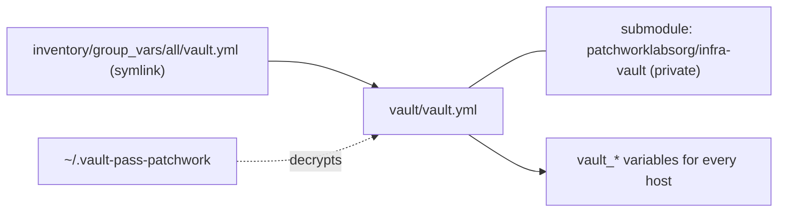
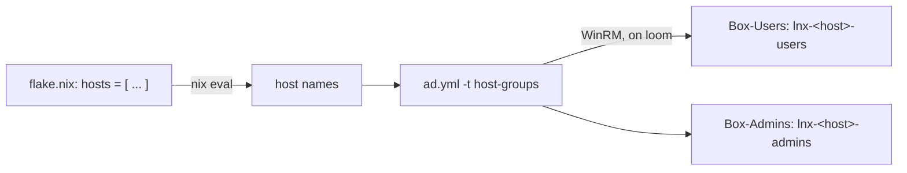

# ansible

Ansible for the Windows side of `patchwork.internal`: the domain controllers, the issuing CA and the NPS server. It also keeps the directory objects that the NixOS hosts need, for example the per-host login groups.

## What this manages

| Host | Address | Group | Role in the forest |
|---|---|---|---|
| `loom` | 10.100.90.10 | `domain_controllers` | PDC emulator, DNS, DHCP |
| `spindle` | 10.100.90.11 | `domain_controllers` | Second DC, DNS |
| `bobbin` | 10.100.90.12 | `member_servers` | Issuing CA |
| `shuttle` | 10.100.90.14 | `member_servers` | NPS / RADIUS for the thimble VPN |

| Playbook | Target | What it does |
|---|---|---|
| `windows.yml` | `windows` | windows_exporter (`roles/windows_base`) and Tailscale (`roles/tailscale_windows`) |
| `ad.yml` | `domain_controllers` | Directory maintenance. Each job has its own tag. See below. |

Ansible does not manage these hosts:

- `warp`, `skein`, `seam` and `hem`. They are NixOS hosts in `../flake.nix`. `modules/ad-join` joins them to AD.
- `pattern`, the offline root CA. It is stopped and is never a target.
- `thimble`, the VyOS VPN edge. It is not domain joined.

The Proxmox layer (VM creation, templates, the network gear) is not in this repo.

These jobs are done by hand and are not in Ansible: AD CS setup and the offline root signing, NPS policies, the forest build (sites, OUs, users), and GPOs.

## Layout

| Path | Contents |
|---|---|
| `ansible.cfg` | Inventory path, roles path, vault password file. |
| `inventory/hosts.yml` | The four Windows hosts. |
| `inventory/group_vars/patchwork.yml` | The forest: realm, DCs, OU DNs, service accounts, DHCP scopes. |
| `inventory/group_vars/windows.yml` | WinRM connection settings. |
| `inventory/group_vars/all/main.yml` | Variables for every host. |
| `inventory/group_vars/all/vault.yml` | Symlink to `../../../vault/vault.yml`. |
| `vault/` | Git submodule: `patchworklabsorg/infra-vault` (private). Holds `vault.yml`. |
| `roles/` | `windows_base`, `tailscale_windows`. |
| `bootstrap/Enable-AnsibleWinRM.ps1` | One-time WinRM setup on a new Windows host. |
| `bin/vault-set` | Sets one key in the vault from stdin. |

## Prerequisites

1. Install the collections:

   ```sh
   ansible-galaxy collection install -r requirements.yml
   ```

2. Install `pywinrm` on the control node: `pip install pywinrm`.
3. Get the vault. The submodule repo is private, so you need read access to `patchworklabsorg/infra-vault`:

   ```sh
   git submodule update --init ansible/vault
   ```

4. Put the vault password in `~/.vault-pass-patchwork`, mode `0600`. `ansible.cfg` reads it from there. It is not the same file as any other vault password on your machine.
5. Make sure that the control node can reach 10.100.90.0/24 on TCP 5985.
6. For `ad.yml -t host-groups`, install Nix with flakes.

## The vault

The secrets are in a separate private repo, `patchworklabsorg/infra-vault`. This repo is public, so the encrypted file does not go here.



- Ansible loads `inventory/group_vars/all/vault.yml` for every host. That file is a symlink into the submodule, so the vault keys are normal `group_vars/all` variables.
- If the submodule is not checked out, the symlink points at nothing and Ansible ignores it. The inventory still loads. A play that needs a secret then fails with an undefined `vault_*` variable.
- The vault repo README lists the keys.
- To set a key, pipe the value in. The script prints only the key name:

  ```sh
  pbpaste | bin/vault-set vault_ad_svc_ansible_password
  ```

  Then commit `vault.yml` in `vault/`, push it, and commit the new submodule pointer here.

- To read or edit the whole file: `ansible-vault edit vault/vault.yml`.

Refer to secrets by name only. Do not print them.

## Connection

Ansible connects to Windows over WinRM: NTLM over HTTP on port 5985, as `PATCHWORK\svc-ansible`. NTLM encrypts the payload, so the listener needs no certificate. Keep `svc-ansible` out of Protected Users, or NTLM stops.

Each new Windows host needs the listener and a firewall rule once. Run this on the host as an administrator. Use the subnet of your control node:

```powershell
.\bootstrap\Enable-AnsibleWinRM.ps1 -RemoteAddress <control-node-cidr>
```

Then check it from the control node:

```sh
ansible windows -m ansible.windows.win_ping -l <host>
```

## Usage

Run all commands from this directory.

```sh
ansible-playbook windows.yml                  # all Windows hosts
ansible-playbook windows.yml -l shuttle       # one host
ansible-playbook ad.yml -t audit              # report only, changes nothing
ansible-playbook ad.yml -t host-groups        # login groups for every NixOS host
ansible-playbook ad.yml -t dhcp,svc-posture
```

## ad.yml tags

Every tag is opt-in. A run without `-t` does nothing. Directory changes run once, on loom (the PDC emulator), and AD replicates them.

| Tag | What it does |
|---|---|
| `dhcp` | Adds the DHCP exclusion ranges from `dhcp_scopes`. |
| `audit` | Reports join delegation, Protected Users and service-account posture. Changes nothing. Add `-e ad_audit_strict=true` to fail on a finding. |
| `join-delegation` | Gives `svc-lnx-join` the rights to join computers in both computer OUs. |
| `host-groups` | Creates `lnx-<host>-users` and `lnx-<host>-admins` for every NixOS host in the flake. |
| `svc-posture` | Sets AES only and "not delegatable" on `svc-ansible` and `svc-lnx-join`. |
| `user-mail` | Sets the `mail` attribute from `ad_user_mail`. Does nothing while the map is empty. |
| `ca-chain` | Exports the forest CA chain to `files/pki/patchwork.internal-ca-chain.pem`. |
| `dns-log` | Enables the DNS Analytical log on every DC. |

### Host groups come from the flake

`-t host-groups` does not use a host list in Ansible. It reads the names from the flake:

```sh
nix eval --json ..#nixosConfigurations --apply builtins.attrNames
```



To add a NixOS host:

1. Add the name to `hosts` in `flake.nix`.
2. Run `ansible-playbook ad.yml -t host-groups`.
3. Add members to the two new groups in AD.
4. Do the other steps in "Login" in the top-level README.

The play creates missing groups only. It does not delete the groups of a removed host, and it does not change members.

Nix reads the flake from git. `flake.nix` must be tracked by git. An uncommitted change to `flake.nix` is included. Nix evaluates only the names, so the host directory does not have to exist yet. To use a different list, give it as an extra variable:

```sh
ansible-playbook ad.yml -t host-groups -e '{"ad_linux_hosts": ["newhost"]}'
```

## Checks

```sh
ansible-inventory --graph
ansible-playbook --syntax-check ad.yml
ansible-playbook --syntax-check windows.yml
yamllint .
ansible-lint
```
