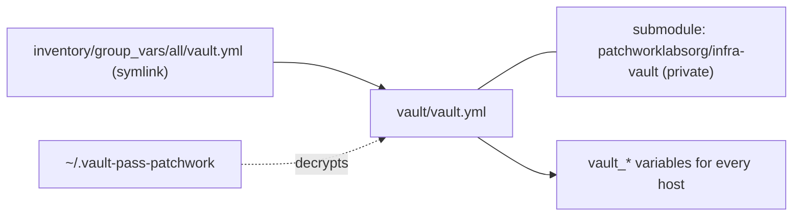
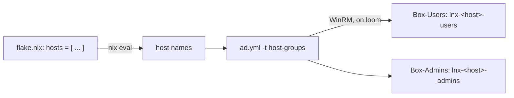
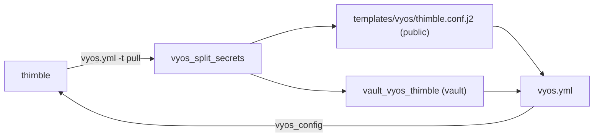
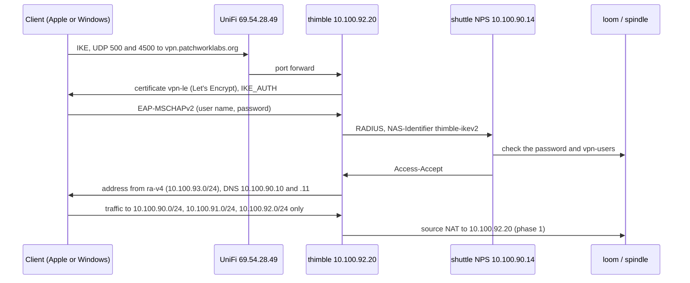

# ansible

Ansible for the Windows side of `patchwork.internal` (the domain controllers, the issuing CA and the NPS server) and for `thimble`, the VPN edge. It also keeps the directory objects that the NixOS hosts need, for example the per-host login groups.

## What this manages

| Host | Address | Group | Role in the forest |
|---|---|---|---|
| `loom` | 10.100.90.10 | `domain_controllers` | PDC emulator, DNS, DHCP |
| `spindle` | 10.100.90.11 | `domain_controllers` | Second DC, DNS |
| `bobbin` | 10.100.90.12 | `member_servers` | Issuing CA |
| `shuttle` | 10.100.90.14 | `member_servers` | NPS / RADIUS for the thimble VPN |
| `spool` | 10.100.90.59 | `jump_hosts` | Tier 0 jump host (`../ad/TIERING.md`). No Tailscale. |
| `thimble` | 10.100.92.20 (verify) | `vyos_edges` | VyOS VPN edge. Staff log in with AD through NPS. |

| Playbook | Target | What it does |
|---|---|---|
| `windows.yml` | `windows` | windows_exporter (`roles/windows_base`) and Tailscale (`roles/tailscale_windows`). Neither on spool (`group_vars/jump_hosts.yml`). |
| `ad.yml` | `domain_controllers` | Directory maintenance. Each job has its own tag. See below. |
| `sync-join-password.yml` | loom | Sets the AD password of `svc-lnx-join` to `../secrets/ad-join.age`, only if they differ. |
| `vyos.yml` | `vyos_edges` | thimble's config, from `templates/vyos/thimble.conf.j2`. |
| `jump-host.yml` | `jump_hosts`, and the DCs and member servers | The RSAT consoles and a `Tier 0` desktop folder on spool, with one RDP shortcut (`mstsc /remoteGuard`) per Tier 0 server. The servers get `DisableRestrictedAdmin = 0`, so they accept Remote Credential Guard. |

Ansible does not manage these hosts:

- `warp`, `skein`, `seam` and `hem`. They are NixOS hosts in `../flake.nix`. `modules/ad-join` joins them to AD.
- `pattern`, the offline root CA. It is stopped and is never a target.

The Proxmox layer (VM creation, templates, the network gear) is not in this repo.

These jobs are done by hand and are not in Ansible: AD CS setup and the offline root signing, NPS policies, and the GPOs other than the two armoring GPOs and the password values of the `Default Domain Policy` (see "Tier 0"). The OUs, users and groups are in `../ad/` (`converge.ps1`).

## Layout

| Path | Contents |
|---|---|
| `ansible.cfg` | Inventory path, roles path, vault password file. |
| `inventory/hosts.yml` | The Windows hosts and thimble. |
| `inventory/group_vars/patchwork.yml` | The forest: realm, DCs, OU DNs, service accounts, DHCP scopes. |
| `inventory/group_vars/windows.yml` | WinRM connection settings. |
| `inventory/group_vars/jump_hosts.yml` | spool: no Tailscale, the RDP targets, the consoles and the RSAT features. |
| `inventory/group_vars/all/main.yml` | Variables for every host. |
| `inventory/group_vars/all/vault.yml` | Symlink to `../../../vault/vault.yml`. |
| `vault/` | Git submodule: `patchworklabsorg/infra-vault` (private). Holds `vault.yml`. |
| `roles/` | `windows_base`, `tailscale_windows`. |
| `bootstrap/Enable-AnsibleWinRM.ps1` | One-time WinRM setup on a new Windows host. |
| `bin/vault-set` | Sets one key in the vault from stdin. |
| `bin/vault-import` | One-time copy of the Patchwork values from the personal vault. |
| `bin/t0-admin` | Asks the `PatchworkT0` endpoint for a just-in-time Domain Admins grant. See "Just-in-time admin". |
| `files/tiering/` | PowerShell that the Tier 0 tags install on the DCs: `PatchworkAlert` (alert events, optional mail), `PatchworkT0` (JEA module and role capability), `Invoke-BreakGlassAlert.ps1`. |
| `templates/vyos/` | VyOS configs as `set` commands, with the secrets replaced by vault references. |
| `filter_plugins/vyos_secrets.py` | Splits the secrets out of a VyOS config. Tested by `tests/`. |
| `files/vpn/` | IKEv2 client profiles for the thimble VPN: `patchwork-ikev2.mobileconfig` (Apple) and `Add-PatchworkVpn.ps1` (Windows). No secrets. |

### Tailscale tags

`roles/tailscale_windows` logs a host in to the tailnet with `--advertise-tags=<tailscale_advertise_tags>`. `group_vars/domain_controllers.yml` sets `tag:patchwork-dc` for loom and spindle. The tailnet policy (`jaspermayone/infra`, `tailscale/policy.hujson`) lets alastor reach that tag on `tcp:636` only, for Weave (`../ad/README.md`, "Weave"). `group_vars/member_servers.yml` sets `tag:patchwork-t0` for bobbin and shuttle. The policy has no grant for that tag, so they are on the tailnet but nothing reaches them.

- Merge the policy change first. The tag must exist in the live policy before a node can take it.
- Use an untagged auth key of a tailnet admin. Do not use a tagged key: all Windows hosts use the same key, so its tags would go to each host.
- `--advertise-tags` applies only at the first login. After the login, and on each later run, the play reads the tags of the host. When they are not exactly `tailscale_advertise_tags`, the play fails and shows the command that tags it. The play does not log the host in again by itself.
- A host with no tag matches `autogroup:member`, and the policy gives that group much more access. The role refuses a host with no `tailscale_advertise_tags`, unless `tailscale_allow_untagged` is `true`.
- When `tailscale up` fails, the play shows the error with the key removed.
- The play logs in with `--accept-routes=false`, and turns off DNS registration on the Tailscale adapter. After a DC joins, check that AD DNS has no tailnet address for it: `Get-DnsServerResourceRecord -ZoneName patchwork.internal -RRType A | Where-Object { $_.RecordData.IPv4Address -like '100.*' }` must return nothing. If the DNS Server listens on the Tailscale address, set its listen addresses to the 10.100.90.x address by hand.

## Prerequisites

1. Install the collections:

   ```sh
   ansible-galaxy collection install -r requirements.yml
   ```

2. Install `pywinrm` and `paramiko` on the control node: `pip install pywinrm paramiko`.
3. Get the vault. The submodule repo is private, so you need read access to `patchworklabsorg/infra-vault`:

   ```sh
   git submodule update --init ansible/vault
   ```

4. Put the vault password in `~/.vault-pass-patchwork`, mode `0600`. `ansible.cfg` reads it from there. It is not the same file as any other vault password on your machine.
5. Make sure that the control node can reach 10.100.90.0/24 on TCP 5985.
6. For `ad.yml -t host-groups`, install Nix with flakes.

## The vault

The secrets are in a separate private repo, `patchworklabsorg/infra-vault`. This repo is public, so the encrypted file does not go here.



- Ansible loads `inventory/group_vars/all/vault.yml` for every host. That file is a symlink into the submodule, so the vault keys are normal `group_vars/all` variables.
- If the submodule is not checked out, the symlink points at nothing and Ansible ignores it. The inventory still loads. A play that needs a secret then fails with an undefined `vault_*` variable.
- The vault repo README lists the keys.
- To set a key, pipe the value in. The script prints only the key name:

  ```sh
  pbpaste | bin/vault-set vault_ad_svc_ansible_password
  ```

  Then commit `vault.yml` in `vault/`, push it, and commit the new submodule pointer here.

- To read or edit the whole file: `ansible-vault edit vault/vault.yml`.

### Move the values from the personal vault (once)

`bin/vault-import` reads the personal `jaspermayone/infra` vault and copies the Patchwork values. It prints key names only.

```sh
bin/vault-import --dry-run   # what it would copy
bin/vault-import
```

- It creates `~/.vault-pass-patchwork` with a random password if the file does not exist. Keep a copy in your password manager.
- It copies `vault_ad_svc_ansible_password` into `vault/vault.yml`. The new names drop the `_patchwork` suffix.
- It writes the join password to `../secrets/ad-join.age` for the recipients in `secrets/secrets.nix`. It is not in the Ansible vault.
- It keeps keys and files that exist. Use `--force` to replace them.

Then commit `vault.yml` in `vault/` and `secrets/ad-join.age` here. After that, delete the `_patchwork` keys from the personal vault.

Refer to secrets by name only. Do not print them.

## Connection

Ansible connects to Windows over WinRM: NTLM over HTTP on port 5985, as `PATCHWORK\svc-ansible`. NTLM encrypts the payload, so the listener needs no certificate. Keep `svc-ansible` out of Protected Users, or NTLM stops.

Each new Windows host needs the listener and a firewall rule once. Run this on the host as an administrator. Use the subnet of your control node:

```powershell
.\bootstrap\Enable-AnsibleWinRM.ps1 -RemoteAddress <control-node-cidr>
```

Then check it from the control node:

```sh
ansible windows -m ansible.windows.win_ping -l <host>
```

## Usage

Run all commands from this directory.

```sh
ansible-playbook windows.yml                  # all Windows hosts (spool gets neither role)
ansible-playbook windows.yml -l shuttle       # one host
ansible-playbook ad.yml -t audit              # report only, changes nothing
ansible-playbook ad.yml -t host-groups        # login groups for every NixOS host
ansible-playbook ad.yml -t dhcp,svc-posture
```

## ad.yml tags

Every tag is opt-in. A run without `-t` does nothing. Directory changes run once, on loom (the PDC emulator), and AD replicates them.

| Tag | What it does |
|---|---|
| `dhcp` | Adds the DHCP exclusion ranges from `dhcp_scopes`. |
| `audit` | Reports join delegation, Protected Users and service-account posture. Changes nothing. Add `-e ad_audit_strict=true` to fail on a finding. |
| `join-delegation` | Gives `svc-lnx-join` the rights to join computers in both computer OUs. |
| `host-groups` | Creates `lnx-<host>-users` and `lnx-<host>-admins` for every NixOS host in the flake. |
| `svc-posture` | Sets AES only and "not delegatable" on `svc-ansible`, `svc-lnx-join` and `svc-weave-ldap`. |
| `user-mail` | Sets the `mail` attribute from `ad_user_mail`. Does nothing while the map is empty. |
| `ldap-binds` | Creates the read-only LDAP bind accounts in `ad_ldap_bind_accounts` (`group_vars/patchwork.yml`). The list is empty until an app needs one; the comment there shows how to add one. |
| `ca-check` | Lists the enterprise CAs in AD and the CA certificates on loom, and checks that `ad_ca_subject_match` selects them. Changes nothing. Run it before `ca-chain`. |
| `ca-chain` | Exports the forest CA chain to `files/pki/patchwork.internal-ca-chain.pem`. |
| `dns-log` | Enables the DNS Analytical log on every DC. |
| `authn-log` | Enables the four `Microsoft-Windows-Authentication/*` logs on every DC. Sets the audit policy for Credential Validation, Kerberos Authentication Service, Kerberos Service Ticket Operations, User Account Management and Security Group Management to success and failure. |
| `armoring` | Makes two GPOs. `T0-Kerberos-Armoring-KDC` on the Domain Controllers OU: "KDC support for claims, compound authentication and Kerberos armoring" = Supported. `T0-Kerberos-Armoring-Client` on the domain root: "Kerberos client support for claims, compound authentication and Kerberos armoring" = Enabled. |
| `default-domain-gpo` | Makes the password and lockout values in the `Default Domain Policy` GPO match `passwordPolicy.default` in `../ad/org.json`, and raises the GPO version. On 2026-10-14 the GPO already matched, so the first run changes nothing. |
| `breakglass-alert` | Installs an event-triggered scheduled task on every DC. It writes event 1000 (source `Patchwork-Alert`) to the Application log of the DC when the built-in Administrator logs on, gets a TGT, is checked with NTLM, is enabled or has its password reset, and when a member is added to Domain Admins, `tier0-admins`, Enterprise Admins, Schema Admins or Administrators. It sends a mail to `security@patchworklabs.org` only when `ad_alert_mail_enabled` is `true`. `-e ad_alert_test=true` writes one test event (event 1001) and mails only when mail is enabled. |
| `administrator-random` | Sets a random 96-character password on the built-in Administrator and sets "sensitive and cannot be delegated". The DC makes the password, and nobody sees it. Refuses while the account is enabled. Changes the password only when the old one is older than 24 hours, or with `-e ad_admin_random_force=true`. |
| `krbtgt-reset` | Resets the `krbtgt` password once. Refuses while the password is younger than 10 hours, or while a DC shows a replication failure. Then each DC pulls the change and the play checks that each DC has it. |
| `jit-endpoint` | Installs the `PatchworkT0` JEA endpoint on every DC. Fails while the AD Privileged Access Management feature is off. It never enables the feature. |
| `admin-disabled-gpo` | Makes the GPO `T0-Builtin-Administrator-Disabled`: "Accounts: Administrator account status" = Disabled. Links it to the domain root and applies it to the `Domain Controllers` group only. See "Built-in Administrator GPO" below. |

Every Tier 0 tag supports `--check`, except that `krbtgt-reset` still refuses in check mode when a guard fails.

## Tier 0

The design is in [`../ad/TIERING.md`](../ad/TIERING.md) (PR #18). `../ad/converge.ps1` owns the directory objects (the silo, the policies, `tier0-eligible`). These tags own what is on the DCs.

### Tier 0 run order

Run each step with `--check` first. Each step starts only after the one before it works. The steps that you cannot undo are in bold.

| # | Command | Check after it |
|---|---|---|
| 1 | `ansible-playbook ad.yml -t authn-log` | `wevtutil gl Microsoft-Windows-Authentication/AuthenticationPolicyFailures-DomainController` shows `enabled: true` on both DCs. |
| 2 | `ansible-playbook ad.yml -t armoring` | In GPMC, both GPOs show the policy by name, not under "Extra Registry Settings". `gpresult /r` on loom lists both. |
| 3 | `ansible-playbook ad.yml -t default-domain-gpo` | The report shows no change, or the changes you expect. |
| 4 | `converge.ps1` Build (silo in audit mode, `tiering.enforce` is `false`) | `Get-ADAuthenticationPolicySilo T0-Silo`. Then read events 305 and 306 every day for two weeks (TIERING.md phase 2). |
| 5 | `ansible-playbook ad.yml -t breakglass-alert -e ad_alert_test=true` | On a DC, `Get-WinEvent -FilterHashtable @{LogName='Application'; ProviderName='Patchwork-Alert'}` shows event 1001. |
| 6 | `ansible-playbook ad.yml -t administrator-random` | The report says "set a new discarded random password". The account is still disabled. |
| 7 | **`ansible-playbook ad.yml -t krbtgt-reset`**, then the same command again 10 hours or more later | Each run reports one reset. The second run refuses if you start it too early. |
| 8 | **Enable the PAM optional feature by hand, once, after approval.** It cannot be undone. | `Get-ADOptionalFeature 'Privileged Access Management Feature'` shows `EnabledScopes`. |
| 9 | `ansible-playbook ad.yml -t jit-endpoint` | The report shows `PATCHWORK\tier0-eligible AccessAllowed`. |
| 10 | `bin/t0-admin 1 "test the JIT endpoint"` | A grant, a `Patchwork-JIT` event on the DC, and `t0-admin status` shows the grant with the time left. |
| 11 | Set `tiering.jit.enabled` to `true` in `../ad/org.json`, run Build | Build logs the grant as INFO and reports `adm_mayonej` as a standing member. |
| 12 | Later: `tiering.jit.removeStanding` `true`, then `tiering.enforce` `true` | TIERING.md phases 3 and 4. |

Command for step 8, on loom, as `adm_mayonej`:

```powershell
Enable-ADOptionalFeature 'Privileged Access Management Feature' -Scope ForestOrConfigurationSet -Target patchwork.internal
```

### Alerts

Mail is off. The variable `ad_alert_mail_enabled` is `false` in `inventory/group_vars/patchwork.yml`. The DCs write each alert to the Application log of the DC. No Google setting is needed.

| Source | Event | Meaning |
|---|---|---|
| `Patchwork-Alert` | 1000 | The built-in Administrator was used, or a privileged group changed. The message has what, when and who. |
| `Patchwork-Alert` | 1001 | Test event from `-e ad_alert_test=true`. |
| `Patchwork-JIT` | 1000 | A JIT grant. The message has the account, the hours, the reason and the end time. |
| `Patchwork-Alert` | 1900 | A mail failed. This happens only when mail is enabled. |

To read the alerts, open Event Viewer on a DC. Go to Windows Logs > Application and filter by the source. Or run this on a DC:

```powershell
Get-WinEvent -FilterHashtable @{LogName='Application'; ProviderName='Patchwork-Alert','Patchwork-JIT'} | Format-List TimeCreated, ProviderName, Id, Message
```

Each DC keeps its own events. A JIT grant makes two events: one from the endpoint, with the reason, and one from the break-glass task, because the grant adds a member to `tier0-admins`. The second event also comes when somebody adds a member without the endpoint. That is on purpose.

### Mail alerts later

This section is optional. Do it only when you want mail.

The DCs send through the Google Workspace SMTP relay, `smtp-relay.gmail.com` port 587 with STARTTLS. They do not log in. The relay accepts mail from the lab WAN address `69.54.28.49`. The sender is `ad-alerts@patchworklabs.org`, the recipient is `security@patchworklabs.org`. These values are in `inventory/group_vars/patchwork.yml` (`ad_alert_*`). The DCs use them only when mail is enabled. No secret is involved.

Do this once in the Google Admin console:

1. Go to Apps > Google Workspace > Gmail > Routing.
2. At "SMTP relay service", click Configure (or Add another rule).
3. Name: `patchwork-ad-alerts`.
4. Allowed senders: "Only addresses in my domains".
5. Authentication: select "Only accept mail from the specified IP addresses". Add `69.54.28.49`. Do not select "Require SMTP Authentication".
6. Encryption: select "Require TLS encryption".
7. Save. The change can take up to an hour.

Then set `ad_alert_mail_enabled: true` and run `ansible-playbook ad.yml -t breakglass-alert,jit-endpoint`. The DCs must reach `smtp-relay.gmail.com` on TCP 587 through thimble. Run `-t breakglass-alert -e ad_alert_test=true`. The test mail arrives at `security@`. The events stay in the Application log.

### Just-in-time admin

`adm_mayonej` asks for Domain Admins for 1 to 4 hours. The `PatchworkT0` endpoint on the DC adds it to `tier0-admins` with a time to live. The DC removes it when the time ends. The endpoint writes event 1000 (source `Patchwork-JIT`). It mails `security@` only when mail is enabled. `Mailed` is `False` while mail is off.

From remus, while `T0-Silo` is in audit mode:

```console
$ bin/t0-admin 1 "Change the Client-Baseline firewall rule"
adm_mayonej@PATCHWORK.INTERNAL's password:
Account     adm_mayonej
Group       tier0-admins
Status      granted
Hours       1
ExpiresUtc  2026-10-20 23:15:00Z
Mailed      False
Next        Run "klist purge" or log on again. The new TGT carries Domain Admins until the grant ends.
```

```console
$ bin/t0-admin status
adm_mayonej@PATCHWORK.INTERNAL's password:
Account      adm_mayonej
Kind         grant
MinutesLeft  58
ExpiresUtc   2026-10-20 23:15:00Z
```

- `kinit` asks for the `adm_mayonej` password. The password goes to `kinit` only. The ticket cache is a temp file, and the script deletes it.
- The script needs `uv` and `kinit`. `uv` gets `pypsrp` and `pyspnego[kerberos]` the first time. The nixpkgs `pypsrp` does not build on macOS today.
- It connects to loom by address (`10.100.90.10`). To use spindle: `T0_DC_IP=10.100.90.11 T0_DC_NAME=spindle.patchwork.internal bin/t0-admin ...`.
- An open grant is not extended. `Status` is then `open`. While `adm_mayonej` is still a standing member, `Status` is `standing` and no grant is made.
- Errors: "PAM feature is off" (step 8 is not done), "is not in tier0-eligible" (wrong account), "The maximum grant is 4 hours".

After the silo is enforced, remus cannot get a TGT for `adm_mayonej`, because it is not joined and cannot armor the request. Then ask for the grant on `spool`, in PowerShell as `adm_mayonej`:

```powershell
Enter-PSSession -ComputerName loom.patchwork.internal -ConfigurationName PatchworkT0
Request-T0Admin -Hours 1 -Reason 'Change the Client-Baseline firewall rule'
Exit-PSSession
klist purge
```

The endpoint has only `Request-T0Admin` and `Get-T0AdminGrant`. Every session is recorded in `C:\ProgramData\Patchwork\jea\transcripts` on the DC.

### Built-in Administrator GPO

```sh
ansible-playbook ad.yml -t admin-disabled-gpo --check
ansible-playbook ad.yml -t admin-disabled-gpo
```

The play makes the GPO, turns off its user settings, gives `Domain Controllers` Apply and `Authenticated Users` Read only, writes `EnableAdminAccount = 0` to `GptTmpl.inf`, adds the security extension to `gPCMachineExtensionNames`, raises the version, and then links the GPO to the domain root. A second run changes nothing.

- The link is on the domain root, not on the Domain Controllers OU. A DC reads "Accounts: Administrator account status" only from a GPO linked to the domain root (Microsoft KB 259576).
- Member servers and workstations do not apply it. LAPS manages their local Administrator.
- Before you enable the built-in Administrator for break-glass, disable this link. Otherwise the DCs disable the account again. The steps are in `../ad/TIERING.md` section 4.
- The report warns when the link is disabled, when another GPO on the domain root sets `EnableAdminAccount = 1`, and when the account is enabled now.

### Host groups come from the flake

`-t host-groups` does not use a host list in Ansible. It reads the names from the flake:

```sh
nix eval --json ..#nixosConfigurations --apply builtins.attrNames
```



To add a NixOS host:

1. Add the name to `hosts` in `flake.nix`.
2. Run `ansible-playbook ad.yml -t host-groups`.
3. Add members to the two new groups in AD.
4. Do the other steps in "Login" in the top-level README.

The play creates missing groups only. It does not delete the groups of a removed host, and it does not change members.

Nix reads the flake from git. `flake.nix` must be tracked by git. An uncommitted change to `flake.nix` is included. Nix evaluates only the names, so the host directory does not have to exist yet. To use a different list, give it as an extra variable:

```sh
ansible-playbook ad.yml -t host-groups -e '{"ad_linux_hosts": ["newhost"]}'
```

## The join password

`../secrets/ad-join.age` is the source of truth for the `svc-lnx-join` password. AD follows it:

```sh
ansible-playbook sync-join-password.yml
```

The play decrypts the file on your machine with `~/.ssh/id_ed25519` (set `-e age_identity=...` for another key), tests the password against AD, and sets it only if the test fails. To rotate the password, run `cd ../secrets && agenix -e ad-join.age`, then run the play. Joined hosts are not affected: after the join they use their own computer account.

## thimble

thimble's config is in `templates/vyos/thimble.conf.j2` as VyOS `set` commands. The secret values (WireGuard keys, password hashes) are not in that file. They are in the vault as `vault_vyos_thimble`, and the template refers to them by name.



1. thimble's management address is 10.100.92.20 (`eth0`, its only interface).
2. `ansible-playbook vyos.yml -t pull`. Read the template diff. Look for a value that should be secret but is not, and add its option name to `SECRET_WORDS` in `filter_plugins/vyos_secrets.py`.
3. Commit the template here, and `vault.yml` in `vault/`.
4. To change the router, edit the template, then run `ansible-playbook vyos.yml --check --diff` and `ansible-playbook vyos.yml`.

What the first pull showed (2026-10-20):

- One interface, `eth0` on VLAN 92 (10.100.92.20/24). The default route goes to the UniFi gateway, 10.100.92.1.
- WireGuard `wg0` on UDP 51822: 10.100.79.0/24 and `fd00:100:79::/64`, one peer per device.
- Source NAT (`masquerade`) on `eth0` for 10.100.79.0/24 and `fd00:100:79::/64`. The servers see every VPN client as 10.100.92.20.
- No RADIUS. The VPN and the SSH login do not use AD. The SSH login is the local `vyos` user with a key.
- No VyOS firewall. Only the UniFi port forward limits what reaches thimble. The UniFi config is not in this repo. Check it in the UniFi console.

`vyos_config` only adds lines that the router does not have. To remove a setting, add a `delete ...` line, apply, then remove both lines from the template.

The list above is the router before the IKEv2 VPN. The template now also has the VPN, the firewall and the ACME certificate, behind `vyos_ikev2_stage` in `inventory/host_vars/thimble.yml`. At stage 0 (the default) the template gives the same commands as the first pull. See "VPN".

`vyos.yml -t pull` leaves out the `pki ca AUTOCHAIN_*` lines. After an ACME request, VyOS adds one with the issuer of the certificate when that issuer is not in the config. A renewal does not update it. The template pins the Let's Encrypt issuers instead (see "VPN").

## VPN

thimble gets a second VPN: IKEv2 with AD login. People log in with their daily account and password. NPS on shuttle checks the password and the `vpn-users` group. WireGuard stays until every person uses IKEv2.



| Item | Value |
|---|---|
| Public name | `vpn.patchworklabs.org`, 69.54.28.49. UniFi forwards UDP 500, UDP 4500 and TCP 80 to 10.100.92.20. |
| Connection | `pw-ikev2`: server `x509` with `vpn-le`, client `eap-radius`, local ID `vpn.patchworklabs.org`, `unique replace`. One session per person: a second device closes the first session. |
| Pool | `ra-v4`, 10.100.93.0/24, DNS 10.100.90.10 and 10.100.90.11. IPv4 only. |
| Split tunnel | Traffic selectors 10.100.90.0/24, 10.100.91.0/24, 10.100.92.0/24. Not 10.100.0.0/16: it includes other tenants. |
| IKE (`PW-IKE`) | IKEv2. aes256-sha256-modp2048, aes128gcm128-prfsha256-modp2048. Lifetime 28800 s. DPD `clear`, 30 s. |
| ESP (`PW-ESP`) | aes256-sha256, aes128gcm128. PFS group 14. Lifetime 3600 s. |
| RADIUS | 10.100.90.14 port 1812, NAS-Identifier `thimble-ikev2`. The key is `vpn_ipsec_remote_access_radius_server_10_100_90_14_key` in `vault_vyos_thimble`. |
| Certificate | `pki certificate vpn-le acme`, HTTP-01 on 10.100.92.20 TCP 80, RSA 2048, `security@patchworklabs.org` |
| Chain | Pinned as `pki ca` nodes and `x509 ca-certificate`: `ISRG-Root-X1`, `LE-Root-YR-X1` (Root YR signed by ISRG Root X1), `LE-YR1`, `LE-YR2`, `LE-YR3`. strongSwan sends the intermediates from these files. |
| AD group | `vpn-users` (domain local, `Groups/Resources`). Members: `mayonej`. |
| Clients | `files/vpn/patchwork-ikev2.mobileconfig`, `files/vpn/Add-PatchworkVpn.ps1` |

Why PFS group 14 on ESP: Windows and Apple can both do PFS on a CHILD_SA rekey, and strongSwan 6 needs the same key exchange on both sides of a rekey. The Windows script sets `-PfsGroup PFS2048` (group 14) and the Apple profile sets `EnablePFS` and group 14. The first CHILD_SA comes with IKE_AUTH and has no key exchange. iOS and macOS can still put a DH group in that proposal. strongSwan 6.0.2 and later accepts this. Check the version on thimble (`sudo swanctl --version`) before stage 4. If it is 6.0.0 or 6.0.1, Apple clients can fail with `NO_PROPOSAL_CHOSEN`.

### The stages

`vyos_ikev2_stage` in `inventory/host_vars/thimble.yml` turns on the parts of `templates/vyos/thimble.conf.j2` in order. Each stage keeps the stages before it.

| Stage | Adds |
|---|---|
| 0 | Nothing. The router as the first pull showed it. |
| 1 | Firewall groups `PW-NETS` and `SSH-SOURCES`. Input and forward rules. Both default actions stay `accept`. Input rule 999 accepts and logs what stage 5 will drop. |
| 2 | ACME certificate `vpn-le` from the Let's Encrypt staging CA |
| 3 | The same certificate from the Let's Encrypt production CA. The pinned chain CAs (see "The pinned chain"). `AUTOCHAIN_vpn-le` deleted. |
| 4 | IKE and ESP groups, pool `ra-v4`, RADIUS, connection `pw-ikev2`, source NAT rule 110 |
| 5 | Input default action `drop`, rule 999 deleted. Do this by hand with `commit-confirm` first. |

The firewall is new on thimble. A wrong rule can lock out SSH or stop WireGuard. Thus the rules come first with `default-action accept` (they change nothing), and `drop` comes last, after the log shows that nothing needed is dropped. The forward rules affect only 10.100.93.0/24: the pool reaches `PW-NETS` through IPsec, and everything else from the pool is dropped. WireGuard forwarding does not change.

The input rules accept: replies, loopback, ICMP, SSH (TCP 22) from 10.100.79.0/24, 10.100.93.0/24 and 10.100.90.0/24, WireGuard (UDP 51822), IKE and NAT-T (UDP 500, 4500), ESP, and TCP 80 to 10.100.92.20 for ACME. There is no IPv6 firewall yet.

Do not run `vyos.yml -t pull` during the rollout. Pull writes the router config over the template, and the stages that are not applied are lost. After stage 5, a pull gives a flat template with no stages. In the same commit, remove `vyos_ikev2_stage` and `vyos_ikev2_always_send_cert` from `inventory/host_vars/thimble.yml` and remove `tests/test_thimble_template.py` (or change it to test the flat file). Else the tests fail.

The apply task has `diff: true`. Each apply prints the commands that it sends, also without `--diff`. Stage 4 sends the RADIUS key line. Do not paste that output anywhere.

Stage 5 is a manual step. `vyos.yml` refuses stage 5 while the router does not drop on input yet, so the play cannot be the first to drop.

Risk: an IKEv2 login needs only a password, and WireGuard needs a device key. With NAT (phase 1), each VPN client arrives at the servers as 10.100.92.20, the same as WireGuard and the Ansible control node. Thus a person in `vpn-users` with a stolen password has the network position of the admin. Keep `vpn-users` small until phase 2 (routing, no NAT, rules per address). `../ad/TIERING.md` has the details.

### Steps

Do the steps in this order. Each step has its rollback.

0. **DNS.** `dig +short vpn.patchworklabs.org` must give 69.54.28.49. The ACME request (stage 2) and the clients need this name. The record is not in this repo.
1. **RADIUS key in the vault.** Make a key of letters and numbers only: `openssl rand -hex 32`. Keep it in your clipboard only. Run `ansible-vault edit vault/vault.yml` and add `"vpn_ipsec_remote_access_radius_server_10_100_90_14_key": "<key>"` to the `vault_vyos_thimble` mapping. Commit `vault.yml` in `vault/`, then the submodule pointer here. `bin/vault-set` cannot do this: it replaces the whole mapping.
   Rollback: remove the entry.
2. **AD group.** On a DC as `adm_mayonej`: `.\converge.ps1 -WhatIf`, then `.\converge.ps1`. The log shows "Create DomainLocal group" for `vpn-users` and "Add member mayonej". The NPS policy in step 3 needs the group, so this step comes first.
   Rollback: set `members` to `[]` and run Build. That removes every person from the VPN. Build does not delete groups. Delete `vpn-users` by hand if you need to.
3. **NPS on shuttle.** As `adm_mayonej` over the jump host.
   1. Export the NPS config: `netsh nps export filename="C:\ProgramData\Patchwork\nps\nps-before-ikev2.xml" exportPSK=YES`. The file holds the RADIUS secrets in clear text. Keep it on shuttle, readable by administrators only, and delete it when the VPN works.
   2. Add a RADIUS client: name `thimble`, address 10.100.92.20, shared secret = the key from step 1. PowerShell: `New-NpsRadiusClient -Name thimble -Address 10.100.92.20 -SharedSecret (Read-Host)`.
   3. Add a network policy "Patchwork IKEv2 VPN", above the default policies. Conditions: Windows Groups = `PATCHWORK\vpn-users`, Client IPv4 Address = 10.100.92.20, NAS Identifier = `thimble-ikev2`. Access: granted. Authentication methods: only EAP type "Microsoft: Secured password (EAP-MSCHAP v2)". Clear all "less secure" methods (MS-CHAP-v2, MS-CHAP, CHAP, PAP).
   4. Make sure that the NPS server is registered in AD (member of "RAS and IAS Servers"). Otherwise NPS cannot read the dial-in properties.
   5. Turn on the NPS account lockout, below the AD lockout (10 tries): in `HKLM\SYSTEM\CurrentControlSet\Services\RemoteAccess\Parameters\AccountLockout`, set `MaxDenials` to 5 and `ResetTime (mins)` to 15. Then restart NPS (`Restart-Service IAS`). UDP 500 and 4500 are open to the internet. Without this, anyone who knows a UPN in `vpn-users` can guess passwords and lock the AD account. With it, NPS refuses after 5 failures and AD does not lock. The person can still be kept out of the VPN for 15 minutes. To unlock early, delete the value `<domain>:<user>` under that key.
   6. Export again: `netsh nps export filename="C:\ProgramData\Patchwork\nps\nps-after-ikev2.xml" exportPSK=YES`. The same rules apply to this file.
   Rollback: `netsh nps import filename="C:\ProgramData\Patchwork\nps\nps-before-ikev2.xml"`, or delete the client and the policy. Set `MaxDenials` to 0 to turn off the NPS lockout.
4. **UniFi.** Forward UDP 500, UDP 4500 and TCP 80 from 69.54.28.49 to 10.100.92.20. Keep UDP 51822 for WireGuard. TCP 80 must stay open: certbot renews `vpn-le` on it every 60 days or so.
   Rollback: remove the three forwards.
5. **Stage 1, firewall in accept mode.** Open the Proxmox console of thimble, logged in, before each apply. Set `vyos_ikev2_stage: 1`. Run `ansible-playbook vyos.yml --check --diff`, read the commands, then `ansible-playbook vyos.yml`. Test SSH from WireGuard and from spool, and a WireGuard client. Watch `show firewall ipv4 input filter` for some days: rule 999 counts what stage 5 will drop. Read the log lines of rule 999.
   Rollback: on the console, `configure`, `delete firewall`, `commit`, `save`, and set the stage back to 0. thimble had no firewall before.
6. **Stages 2 and 3, the certificate.** Set stage 2 and apply (check first). certbot gets a staging certificate. `show pki certificate` shows it. pki also adds `pki ca AUTOCHAIN_vpn-le` with the staging issuer. If the request fails, the commit should fail: check DNS, the TCP 80 forward and firewall rule 80. If Ansible stops on a timeout, compare the running config with the saved config before you continue. Then set stage 3 and apply. The certificate now comes from the production CA (issuer YR1 or YR2, not "(STAGING)"). Stage 3 also adds the pinned chain CAs and deletes `AUTOCHAIN_vpn-le`. The staging step protects the production rate limits.
   Rollback: `delete pki certificate vpn-le`, `delete pki ca AUTOCHAIN_vpn-le`, `commit`, `save`, and set the stage back to 1.
7. **Stage 4, IKEv2.** Needs steps 1 to 4 and stage 3. Check `sudo swanctl --version` (see "Why PFS"). Run `set vpn ipsec remote-access connection pw-ikev2 authentication ?` in configure mode. If it lists `always-send-cert`, set `vyos_ikev2_always_send_cert: true` (Apple clients can need it), then `exit discard`. Set stage 4, run `--check --diff`, then apply. On thimble: `show vpn ike sa`, `show vpn ipsec sa` and the IPsec log. Hold a console open.
   Rollback: `delete vpn ipsec`, `delete nat source rule 110`, `commit`, `save`, and set the stage back to 3.
8. **Client tests.** Test from mobile data, not from the office network, so that the test uses the public name and the UniFi forwards.
   - Apple: open `files/vpn/patchwork-ikev2.mobileconfig` and install it (Settings > General > VPN & Device Management on iOS, System Settings > Privacy & Security > Profiles on macOS). Enter the daily account (`jasper@patchworklabs.org`) and the password.
   - Windows: `powershell -ExecutionPolicy Bypass -File .\Add-PatchworkVpn.ps1`, then connect in Settings.
   - Test: `ping 10.100.90.10`, `nslookup loom.patchwork.internal 10.100.90.10`, SSH to a lab host. A public site must not go through the VPN (the public address stays the mobile one). On Windows, `route print` must not show 10.0.0.0/8 on the VPN.
   - Test the refusals: a wrong password, a person not in `vpn-users`, and `adm_mayonej` (Protected Users). Each must fail. NPS logs event 6273 (refused) and 6272 (granted) in the Security log on shuttle.
9. **Stage 5, input default drop.** On the console, with an SSH session open from WireGuard:

   ```
   configure
   set firewall ipv4 input filter default-action drop
   delete firewall ipv4 input filter rule 999
   commit-confirm 10
   ```

   Open a new SSH session from WireGuard and from spool. Connect a WireGuard client and an IKEv2 client. If all works, type `confirm`, then `save`. If you do not confirm in 10 minutes, VyOS reboots with the saved config. The action is `reboot` unless `system config-management commit-confirm action` says other. Do not `save` before `confirm`. Then set `vyos_ikev2_stage: 5` and run `--check --diff`: it must show no changes.
   Rollback: `set firewall ipv4 input filter default-action accept`, `commit`, `save`, stage 4.
10. **Later (phase 2, not in this change).**
    1. Add UniFi static routes: 10.100.79.0/24 and 10.100.93.0/24 via 10.100.92.20.
    2. Remove the source NAT: `delete nat source rule 100`, `delete nat source rule 110` (and `nat66` rule 100). Servers then see each client address.
    3. Add firewall rules per person on spool and the servers (`../ad/TIERING.md`).
    4. Retire WireGuard when every person uses IKEv2: delete `wg0`, NAT 100, `nat66` 100, input rule 50, the UniFi forward for UDP 51822, and 10.100.79.0/24 in `SSH-SOURCES`.

### The pinned chain

IPsec with `server-mode x509` needs a `ca-certificate` from `pki ca` (`verify()` in vyos-1x `vpn_ipsec.py`). On this build, pki adds `pki ca AUTOCHAIN_<cert>` after the first ACME request, but only on a config commit: a renewal by the certbot timer does not update it. Let's Encrypt picks the intermediate for each certificate. After a renewal from another intermediate, an `AUTOCHAIN_` CA can no longer give strongSwan the chain, and clients that do not fetch intermediates fail. Thus the template pins the whole Let's Encrypt RSA chain (letsencrypt.org/certificates, read 2026-10-20). The default chain is: certificate, YR1 or YR2, Root YR (signed by ISRG Root X1), ISRG Root X1.

| `pki ca` | Subject | Issuer | Valid until | SHA-256 |
|---|---|---|---|---|
| `ISRG-Root-X1` | C=US, O=Internet Security Research Group, CN=ISRG Root X1 | C=US, O=Internet Security Research Group, CN=ISRG Root X1 | Jun  4 11:04:38 2035 GMT | `96:BC:EC:06:26:49:76:F3:74:60:77:9A:CF:28:C5:A7:CF:E8:A3:C0:AA:E1:1A:8F:FC:EE:05:C0:BD:DF:08:C6` |
| `LE-Root-YR-X1` | C=US, O=ISRG, CN=Root YR | C=US, O=Internet Security Research Group, CN=ISRG Root X1 | Sep  2 23:59:59 2032 GMT | `07:26:39:D0:B1:40:D5:BF:FA:E1:6A:D9:C3:F6:CC:60:86:04:06:21:F5:1E:E6:1A:6D:46:A8:91:5C:07:CF:76` |
| `LE-YR1` | C=US, O=Let's Encrypt, CN=YR1 | C=US, O=ISRG, CN=Root YR | Sep  2 23:59:59 2028 GMT | `13:94:96:34:D9:9C:D6:FD:6A:A8:0B:C0:34:FE:FA:CC:EB:19:69:FE:EF:98:65:86:71:3E:CD:BB:05:75:8D:3F` |
| `LE-YR2` | C=US, O=Let's Encrypt, CN=YR2 | C=US, O=ISRG, CN=Root YR | Sep  2 23:59:59 2028 GMT | `23:8B:85:A0:09:9C:65:B9:70:47:7D:57:24:F1:A1:D4:75:CE:50:58:CF:FE:4E:FA:87:33:89:9B:DB:86:3C:47` |
| `LE-YR3` | C=US, O=Let's Encrypt, CN=YR3 | C=US, O=ISRG, CN=Root YR | Sep  2 23:59:59 2028 GMT | `35:50:0C:B6:3B:8D:97:69:52:8D:65:D8:72:20:F5:1C:06:98:07:A5:95:AC:BF:2F:B6:EC:A3:8F:BE:0A:4B:D2` |

When Let's Encrypt adds an RSA intermediate (the page lists it as active or backup), add it as a `pki ca` and a `ca-certificate` line at stage 3 and 4, before it issues. Check each new file with `openssl x509 -noout -subject -issuer -fingerprint -sha256` against the page. YR1 to YR3 expire on 2028-09-02.

### Open points

- The ESP proposals and the remote-access template come from vyos-1x. Check them on thimble with `sudo swanctl --list-conns` after stage 4.
- `always-send-cert` is in vyos-1x since November 2025 (T8027). It is not certain on this build (step 7).
- vyos-1x changed the ACME chain in August 2026 (T9135): it reads the chain from disk and adds no `AUTOCHAIN_` node. The pinned CAs work with both. After a VyOS upgrade, read `show pki ca` before you commit.
- A renewal marks `vpn-le` as changed and runs the IPsec config again (vyos-1x `pki.py`, `certbot_renew`). After the first renewal (about 60 days), check that clients get the new certificate. If not, run `restart vpn` on thimble.

## Checks

```sh
ansible-inventory --graph
ansible-playbook --syntax-check ad.yml
ansible-playbook --syntax-check windows.yml
ansible-playbook --syntax-check sync-join-password.yml vyos.yml
python3 -m unittest discover -s tests
yamllint .
ansible-lint
```

## Restricted Admin

`jump-host.yml` sets `DisableRestrictedAdmin = 0` on `tier0_servers`. Remote Credential Guard (`mstsc /remoteGuard`) needs this value on the target, and Windows has no narrower switch. The same value allows Restricted Admin RDP: a client can log on with an NT hash or a Kerberos key and no password.

- `adm_mayonej` is in Protected Users, so its NTLM hash does not work.
- Other accounts can still use a hash: the local `Administrator` on bobbin and shuttle until LAPS sets it, `svc-ansible` (not in Protected Users, `../ad/TIERING.md` decision 8), and any later Domain Admin.
- Planned controls, not applied yet:
  - a GPO on `Servers/Tier0` that denies network logon and Remote Desktop logon to local accounts (`S-1-5-114`)
  - Remote Desktop logon on the Tier 0 servers only for `tier0-eligible`
  - `T0-Silo` in enforce mode (TIERING.md phase 3)

