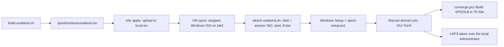

# terraform/proxmox

This root manages the Patchwork NixOS VMs on the Proxmox node `pve01`. It uses the `bpg/proxmox` provider.

## What it manages

| Host | VMID | Address | Memory |
|---|---|---|---|
| `warp` | 356 | 10.100.90.56 | 6 GB |
| `skein` | 355 | 10.100.90.55 | 4 GB |
| `seam` | 357 | 10.100.90.57 | 2 GB |
| `hem` | 358 | 10.100.90.58 | 2 GB |
| `batting` | 360 | 10.100.90.60 | 2 GB |
| `weft` | 361 | 10.100.90.61 | 2 GB |

Each VM matches `hosts/proxmox-vm.nix`:

- SeaBIOS, `virtio-scsi-single`, one disk `scsi0` (`/dev/sda` in the guest).
- CPU type `host`. The QEMU guest agent is on.
- The disk is on `trunk-vms`. The pool `local-zfs` is full.
- The NIC is on the SDN vnet `pwpriv`. This vnet carries VLAN 90, so the root sets no VLAN tag.

The root sets the VM hardware only. The address is not set in Proxmox. NixOS sets it. The `ip` field in the map is a record, and the output shows it.

Cores and disk sizes in `variables.tf` are starting values. Check them before the first apply.

## Tier 0 jump host `spool`

`windows.tf` adds `spool`, the Tier 0 jump host from `ad/TIERING.md` (decision 3). It is a separate resource, because it is Windows and not NixOS.

| Host | VMID | Address | Memory | Cores | Disk |
|---|---|---|---|---|---|
| `spool` | 359 (confirm free) | 10.100.90.59 (confirm free) | 4 GB | 2 | 60 GB |

- OVMF (UEFI) with pre-enrolled Secure Boot keys, a TPM 2.0 state disk, machine `q35`, OS type `win11` (Windows 11 and Server 2022/2025).
- The disk is `sata0` and the NIC is `e1000e`. The Windows installer has drivers for both, so you do not need the virtio-win ISO.
- The guest agent is off in Proxmox until you install it in Windows. Then set `agent.enabled = true` by hand in Proxmox. Terraform ignores the change.
- No VM is created while `create_spool` is false and `windows_iso_file_id` is null. The NixOS VMs do not need these variables.
- The install is hands-off with the answer ISO from `spool/build-unattend.sh`. See "Create spool".

### Windows ISO

With `create_spool = true`, Terraform makes Proxmox download the Windows Server 2025 evaluation ISO to `local:iso/windows-server-2025-eval.iso`. The resource is `proxmox_virtual_environment_download_file.windows_installer`.

- The URL is the variable `windows_iso_url`. The default is the Microsoft fwlink `https://go.microsoft.com/fwlink/?linkid=2293312&clcid=0x409&culture=en-us&country=us`. It comes from the Microsoft Evaluation Center (English, x64).
- The fwlink redirects to the file `26100.1742.240906-0331.ge_release_svc_refresh_SERVER_EVAL_x64FRE_en-us.iso`. It is 6014152704 bytes (about 5.6 GiB). Microsoft can publish a newer build behind the same link.
- The resource sets `overwrite = false`, so a later plan does not download the file again.
- The upload timeout is two hours.
- To use an ISO that is already on the node, set `windows_iso_file_id`. It overrides the download.

License: this is the evaluation edition. It runs for 180 days. Activate it over the internet in the first 10 days, or it shuts down. To keep it, convert it to a retail or volume edition with a valid key (`DISM /Online /Set-Edition`). Plan the conversion before day 180.

### Create spool

The install is hands-off. A small answer ISO holds `autounattend.xml`. Terraform uploads it and attaches it to `spool` as a second CD-ROM. Windows Setup reads it and installs without questions.



#### Files

| File | What it does |
|---|---|
| `spool/autounattend.xml.tmpl` | The answer file template. |
| `spool/spool-setup.ps1.tmpl` | The first logon script template. The answer file runs it once. |
| `spool/build-unattend.sh` | Renders both templates and writes `spool/out/autounattend.iso`. Git ignores `spool/out/`. |
| `spool/attach-unattend.sh` | Attaches or detaches the answer ISO through the Proxmox API. Terraform runs it. |
| `spool/show-password.sh` | Reads the local Administrator password back from the ISO, for the domain join. |

#### What the install does

- It installs "Windows Server 2025 Datacenter Evaluation (Desktop Experience)" (image name `Windows Server 2025 SERVERDATACENTER`) on the single SATA disk.
- It wipes the disk and makes three GPT partitions: EFI (260 MB, FAT32), MSR (16 MB) and Windows (the rest, NTFS, `C:`).
- It accepts the EULA and skips the OOBE screens.
- It sets the computer name `SPOOL` and the time zone "Eastern Standard Time".
- It sets the static address 10.100.90.59/24, the gateway and the DNS servers on the NIC `Ethernet`. If that NIC name is wrong, `spool-setup.ps1` sets the address on the first connected NIC.
- It turns on RDP with NLA off and TLS on (`ad/TIERING.md`, decision 3).
- It keeps the built-in "Remote Desktop" firewall rules off. It adds one rule, `Spool-RDP-VPN`: TCP 3389 only from 10.100.79.0/24, the Patchwork VPN clients.
- It stops the Print Spooler service and disables it.
- It installs the RSAT AD DS tools (with the AD PowerShell module) and GPMC: `Install-WindowsFeature RSAT-AD-Tools, GPMC -IncludeAllSubFeature`.
- It logs on once as the local Administrator to run `spool-setup.ps1`. The script turns off the automatic logon, deletes the cached answer files, and restarts the VM.
- It does not join the domain. A join in the answer file needs a domain credential in the ISO.

The log is `C:\Windows\Temp\spool-setup.log`. The file `C:\Windows\Temp\spool-setup.done` shows that the script finished.

`ad/TIERING.md` limits RDP to Jasper's VPN address. The default allows the VPN client subnet. To allow one address only, build the ISO with `RDP_ALLOWED=10.100.79.<n>/32`, or change the rule later.

#### The local Administrator password

`build-unattend.sh` makes a new random password (24 letters and digits) at each run. The password goes only into the ISO, in the encoded form of the answer file. The encoding is not encryption. The build script does not print the password, write it to a file, or keep it.

You need the password once, for the domain join. Read it back from the ISO only at that time:

```bash
./spool/show-password.sh --copy   # copies it to the macOS clipboard
./spool/show-password.sh          # prints it
```

After the domain join, Windows LAPS manages the account. The GPO `LAPS-Local-Admin` is linked to `OU=Servers` and applies to its child OUs, so it covers `OU=Tier0,OU=Servers`. LAPS sets a new password at the next policy refresh, and the password in the ISO is no longer valid. Read the LAPS password with `Get-LapsADPassword -Identity spool` from a Tier 0 account, only when you need it.

Keep the ISO on the node only during the install. Delete `spool/out/` after the domain join. Never commit it.

#### Steps

1. Check that VMID 359 and 10.100.90.59 are free: `pvesh get /cluster/resources --type vm` on pve01, and `Resolve-DnsName 10.100.90.59` or a ping in the lab.
2. Check the committed memory on pve01 (see "Memory warning").
3. Confirm the gateway. Read option 3 (Router) of the 10.100.90.0/24 DHCP scope on loom: `Get-DhcpServerv4OptionValue -ScopeId 10.100.90.0 -OptionId 3`. The default in the script is 10.100.90.1.
4. Build the answer ISO. Set `GATEWAY`, `DNS1` or `DNS2` if they are not the defaults:

   ```bash
   cd terraform/proxmox
   GATEWAY=10.100.90.1 DNS1=10.100.90.10 DNS2=10.100.90.11 ./spool/build-unattend.sh
   ```

5. Plan only the Windows resources:

   ```bash
   tofu plan \
     -var create_spool=true \
     -var spool_unattend_iso_path=spool/out/autounattend.iso \
     -target=proxmox_virtual_environment_download_file.windows_installer \
     -target=proxmox_virtual_environment_file.spool_unattend_iso \
     -target=proxmox_virtual_environment_vm.spool \
     -target=terraform_data.spool_unattend_cdrom
   ```

   The plan must add these four resources only. It must not change the NixOS VMs.
6. Read the plan. Then run the same command with `apply`. The apply:
   1. downloads the Windows ISO to `local:iso/windows-server-2025-eval.iso` (about 5.6 GiB),
   2. uploads the answer ISO to `local:iso/spool-autounattend.iso`,
   3. creates the VM stopped, with the Windows ISO on `ide2`,
   4. runs `spool/attach-unattend.sh attach`: it sets `ide0` to the answer ISO, starts the VM and sends Enter for 30 seconds for the "Press any key to boot from CD or DVD" prompt.
7. If the script says "sendkey failed", open the console of VMID 359 in Proxmox and press a key at once. If the prompt is gone, reset the VM in the console and press a key. To make this step hands-off, give the role `VM.Console` (see "Token").
8. Wait about 15 to 25 minutes. The VM restarts two or three times. At the end it shows the logon screen.

#### Check the install

- The VM runs: `qm status 359` on pve01, or the Proxmox UI.
- Port 3389 answers from the VPN: `nc -vz 10.100.90.59 3389` on remus, with the VPN on.
- From an address outside 10.100.79.0/24, port 3389 must not answer.
- The Proxmox console shows the logon screen of `SPOOL`.

#### Join the domain

The join is a manual step. The answer file does not join, because a join needs a domain credential in the ISO.

1. Copy the local password: `./spool/show-password.sh --copy`.
2. Log on to `spool` as `.\Administrator`. Use RDP from the VPN to 10.100.90.59: save the password in the connection, because NLA is off and the logon screen does not take a paste. Or type it in the Proxmox console of VMID 359.
3. In PowerShell as Administrator, run:

   ```powershell
   Add-Computer -DomainName patchwork.internal `
     -OUPath 'OU=Tier0,OU=Servers,OU=Patchwork,DC=patchwork,DC=internal' `
     -Credential PATCHWORK\adm_mayonej -Restart
   ```

4. Delete the saved local password from the RDP connection.
5. Run `converge.ps1` Build. `SPOOL` is in `tiering.computers` in `ad/org.json`, so Build adds `SPOOL$` to `T0-Silo`.
6. Run `gpupdate /force` on `spool`, or wait for the policy refresh. Then check that LAPS has a password for `spool`: `Get-LapsADPassword -Identity spool` shows the expiry (do not show the value).

#### First RDP

1. Connect the VPN.
2. Open an RDP connection to `spool.patchwork.internal` (or 10.100.90.59).
3. NLA is off, so the client does not ask for a password first. The `spool` logon screen opens.
4. Log on as `PATCHWORK\adm_mayonej`.

#### After the install

1. Run the plan without `spool_unattend_iso_path`:

   ```bash
   tofu plan -var create_spool=true \
     -target=proxmox_virtual_environment_file.spool_unattend_iso \
     -target=terraform_data.spool_unattend_cdrom
   ```

   The plan destroys `terraform_data.spool_unattend_cdrom` and the answer ISO. Apply it. The destroy step detaches `ide0`, then Terraform deletes `local:iso/spool-autounattend.iso` from the node.
2. Delete the local output: `rm -rf spool/out`. Do this after the domain join.
3. Detach the Windows ISO from `ide2` in the Proxmox UI. Terraform ignores the CD-ROM and the boot order.
4. Install the QEMU guest agent in Windows. Then set `agent.enabled = true` by hand in Proxmox.

Keep `create_spool = true` in later runs. If you set it to false, the plan destroys the ISO resource and the VM. The VM has `prevent_destroy`, so the plan fails.

The evaluation license runs 180 days. See "Windows ISO" for the activation and the conversion.

The token needs `VM.Config.Disk` on the pool for the EFI and TPM disks. It has it. The attach script needs `VM.Config.CDROM` and `VM.PowerMgmt`. The role has both.

## Not managed

The Windows VMs `loom` (310), `spindle` (311), `bobbin` (312) and `shuttle` (314) are not in this root. Ansible manages their contents. They can be imported later.

## State

The state is in the GCS bucket `pwl-tfstate`, prefix `proxmox`.

## Token

Use a dedicated API token. Do not reuse the `ansible@pve!provision` token.

1. Create a user, for example `terraform@pve`, and a token with privilege separation: `pveum user token add terraform@pve patchwork --privsep 1`.
2. Use the pool `patchwork`. It exists. Each VM sets `pool_id` to it.
3. Create a role with these privileges:
   `VM.Allocate VM.Audit VM.Config.CDROM VM.Config.CPU VM.Config.Disk VM.Config.HWType VM.Config.Memory VM.Config.Network VM.Config.Options VM.PowerMgmt VM.GuestAgent.Audit Sys.Audit Pool.Audit`

   Optional: `VM.Console`. With it, `spool/attach-unattend.sh` presses Enter at the boot prompt of the Windows ISO. Without it, press a key in the console.
4. Give the role to the user and to the token on `/pool/patchwork`.
5. Give the same role access to these paths:
   - `/storage/trunk-vms` with `Datastore.Audit Datastore.AllocateSpace`.
   - `/storage/local` with `Datastore.Audit Datastore.AllocateTemplate`, to download the ISO.
   - `/sdn/zones/<zone>/pwpriv` with `SDN.Use`. Use `SDN.Audit` on `/sdn`.
   - `/nodes/pve01` with `Sys.Audit`.

A privilege-separated token cannot hold more than its user. Give the privileges to the user and to the token. The token does not need `VM.Clone`, `Sys.Modify` or any SDN write privilege.

## Endpoint

The default endpoint is `https://proxmox.hogwarts.dev/`. It is behind Cloudflare. A request to `/api2/json/version` returns 301. Port 8006 does not answer from outside.

The API path may be behind Cloudflare Access. If it is, the provider cannot reach the API with only the API token. In that case, override the endpoint with the LAN address of pve01 over the VPN:

```bash
terraform plan -var proxmox_endpoint=https://<pve01-lan-address>:8006/
```

## Environment variables

| Variable | Value |
|---|---|
| `PROXMOX_VE_API_TOKEN` | `terraform@pve!patchwork=<secret>` |
| `PROXMOX_VE_INSECURE` | `true`, while pve01 uses a self-signed certificate |
| `GOOGLE_APPLICATION_CREDENTIALS` or `gcloud auth application-default login` | Access to the state bucket |

Do not write the token in a file or in a tfvars file.

## Plan

All variables have defaults. To override one, use a `terraform.tfvars` file that git ignores, or pass `-var`.

```bash
cat > terraform.tfvars <<'VARS'
proxmox_endpoint = "https://<pve01-lan-address>:8006/" # optional, see Endpoint
VARS
terraform init && terraform plan
```

Do not apply before you read the plan.

## Installer ISO

The root uploads the Patchwork installer ISO to `local` storage on `pve01`. The VMs boot from it. The ISO is the NixOS minimal ISO with the admin SSH keys on root, so nixos-anywhere connects at once. It also runs the QEMU guest agent, so `tofu output ipv4_addresses` shows the DHCP address.

Build the ISO before you apply:

```bash
nix build .#installer-iso -o result-installer
```

The build needs an x86_64-linux builder. The variable `installer_iso_path` points to the file. The default is `../../result-installer/iso/patchwork-nixos-installer.iso`.

The guest agent wait is 2 minutes (`agent.timeout`). A VM without an agent does not stall an apply for 15 minutes.

The old resource `proxmox_virtual_environment_download_file.nixos_installer` is gone. A `removed` block forgets it in the state and keeps the stock ISO on the node. The CD-ROM of existing VMs is in `ignore_changes`, so the plan does not touch them. Delete the old ISO file by hand when no VM uses it. This needs OpenTofu 1.7 or newer.

## Existing VMs

skein, seam and warp are in the state. warp was created with `qm` and then imported. Only hem still has a commented `import` block in `main.tf`. If a VM exists before its first apply, uncomment its `import` block before the first plan. Then run the plan. The plan must show no destroy. The provider can show small differences in disk or NIC settings. Adjust the map or the resource until the plan is clean.

The resource has `prevent_destroy`. It ignores the CD-ROM, the boot order, the power state, the description and the tags. You detach the ISO after the install, and Terraform leaves it alone.

## Add a host

1. Add the host to `hosts` in `flake.nix`.
2. Add the host to `linuxHosts` in `ad/org.json`.
3. Add an entry to the `vms` map in `variables.tf`.
4. Add a commented `import` block if the VM already exists.
5. Plan, apply, then install with nixos-anywhere from the installer ISO. See "Install a host" in the root `README.md`.

## Memory warning

pve01 has no swap. If the node runs out of memory, the OOM killer stops a guest. Check the committed memory before you add or grow a VM. On 2026-08-25, pve01 had 121 of 125.8 GiB committed. Keep at least 4 GiB of available memory after the VM boots. Count available memory, not free memory. Free memory excludes the reclaimable page cache.
